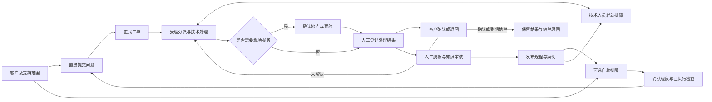
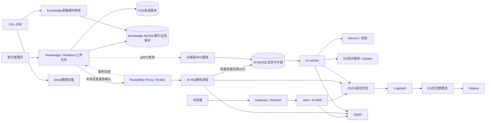

# 系统设计

Service Desk 面向一家 IT 服务商及其签约企业，提供办公终端、打印与扫描、办公网络连接及指定办公软件的 IT 支持。客户报告问题，服务团队远程处理、必要时上门并记录结果；AI 在明确支持范围内协助收集信息、依据知识逐步排障和交接，经过审核的规程与脱敏案例用于后续支持。

本文定义目标业务与运行机制。模块及功能归属见[项目结构](项目结构.md)，字段与约束见[数据库设计](数据库设计.md)，HTTP、RPC与消息见[接口约定](接口约定.md)，实施顺序见[开发改造计划](../开发计划/开发改造计划.md)。

## 1. 业务闭环与系统边界

人工受理、处理与确认可独立使用，AI、知识和预约依赖失效不阻断人工主链。AI自助不是提单前置步骤，AI执行成功不表示故障已修复。系统不远程执行设备命令、不自动开通外部账号、不修改客户系统、不自动维修或发布知识；不包含采购、支付、备件库存、任意工作流、全量CMDB、网络拓扑发现、生产服务器运维、自动代码修复或多租户平台。

### 1.1 支持范围与运营依据

| 类别 | 固定代码 | 支持内容与边界 |
| --- | --- | --- |
| 办公终端 | TERMINAL | 登记电脑及外设使用、操作系统和驱动的常见问题；不承诺板级维修 |
| 打印与扫描 | PRINTING | 打印/扫描、队列及连接问题；电脑、打印机是重点资产类型 |
| 办公网络连接 | NETWORK | 终端联网、指定VPN及共享资源访问的初步排查；不管理全网设备和生产网络 |
| 指定办公软件 | OFFICE_SOFTWARE | 服务项目列明的软件、客户端及访问问题；不承诺任意软件或外部账号自动操作 |

ticket维护小型服务项目目录及客户开通范围。每个项目属于上述一类，以支持产品、环境、版本说明和现场能力明确责任，不建设自定义表单或工作流引擎。设备资产仍只登记电脑和打印机，但设备不是所有问题的必填对象。软件名称、版本、系统、连接方式和影响范围使用固定问题环境字段，不新增通用配置对象图。

客户有至少一个当前有效服务项目时，可以先选择“不确定”提交待分类问题；这只承诺人工分流，不承诺支持所有问题。客服或当前处理人分类时核对目标项目的当前客户资格；不在范围的问题允许说明原因及建议去向后提交REFERRED处理结果，不能冒充已修复。新增自助排障必须选择当前有效服务项目，缺少适用资料则澄清或交接。

服务项目的启停、客户开通区间及现场能力由服务商人工维护。服务截止按Asia/Shanghai日期、首尾日均有效；已有工单保留受理时的范围快照，服务到期、目录停用或设备退役不自动终止履约与历史访问。首次受理1/4小时和确认72小时是自然时长内部规则，不声称营业小时或合同SLA。现场容量来自人工核对的出勤安排。

最终按每个应用单实例、一个AI worker、单机基础组件设计，不承诺高可用或未经测量的吞吐。微服务按身份、支持业务、知识发布及AI计算划分；不继续拆分空业务服务。Java管身份、服务资格、设备、工单、预约和知识发布；Python管解析、检索、诊断状态、模型及工具执行。各服务持有独立MySQL事实，具体字段及服务内FK见[数据库设计](数据库设计.md)。

### 1.2 最终运行方案

| 问题 | 确定方案 | 正确性边界 |
| --- | --- | --- |
| 服务资格与人工处理 | ticket本地目录、开通范围、工单版本、唯一回执及时间线 | 身份及客户人员范围归user；设备期限不再充当服务资格 |
| 预约与容量 | MySQL短事务、条件更新、唯一约束 | 工单地点快照与预约固定，不使用Redis库存 |
| 索引可靠受理 | RocketMQ事务消息、本地事务事实回查、AI落库后ACK | 本地提交、消息受理、执行及发布分开；不设outbox |
| 期限与准备收敛 | XXL-JOB有界触发ticket及knowledge | 不运行长模型任务，不与@Scheduled重复 |
| 上传外部互斥 | knowledge按上传者与请求键使用Redisson | 唯一回执仍归MySQL，未知OSS写入须对账 |
| 依赖保护 | Gateway/Java使用Sentinel，Python限制队列、并发及调用预算 | 不能代替权限、业务状态或持久执行权 |
| 排障执行 | AI MySQL持久受理、单一worker领取、有界领域工具循环 | 不叠加本地SQLite宿主或另一套Scheduler |
| 观测与用量 | ELK脱敏日志、Zipkin追踪，逐次模型/工具及证据记录归AI库 | Trace不是业务事实，不记录或展示模型隐藏思维链 |

所有既定组件纳入最终交付，开发阶段仅安排实现顺序。基础库职责、普通JSON成功0/系统异常1及各边界映射沿用[接口约定](接口约定.md)，不能把业务状态、任务诊断和响应码混为一谈。

### 1.3 通信分工

| 场景 | 固定方式 |
| --- | --- |
| 浏览器经Gateway访问 | HTTP/JSON、授权原件及SSE |
| Java↔Java即时协作 | OpenFeign/HTTP、Nacos发现及LoadBalancer |
| Java↔Python即时协作 | gRPC/Protobuf、独立私网端口及内部认证 |
| 跨服务异步指令 | RocketMQ；当前只有知识索引SUBMIT/CANCEL |

工单、服务项目、客户开通范围、预约和通知同属ticket，以本地事务组合；不为新增目录创建跨Java异步消息。AI队列是本库持久任务，不等于跨服务MQ。user撤权通过当前事实与authVersion复核。资源所有者提供合同，禁止跨库联表及引用兄弟服务Entity/Mapper/ServiceImpl。

## 2. 身份、组织与权限

组织分唯一服务商和多个客户，账号属于一个组织。客户可选本组织设备和已开通服务项目，工单按本人及原客户组织开放。客户自助会话、技术人员辅助会话、草稿及反馈均归各自拥有者；有工单权限不自动获得他人的AI对话。服务人员通过明确客户范围操作，组织和角色标签不自动授予全平台权限。

| 角色 | 业务职责 |
| --- | --- |
| CUSTOMER_USER | 本组织设备、本人排障/报修、补充、预约、结果查询与确认 |
| SERVICE_AGENT | 当前客户范围内服务资格维护、设备、受理/分类、分派转派、优先级和现场资格 |
| TECHNICIAN | 范围内接单，当前处理人处理、分类与环境补全、使用本人技术助手、开放上门及登记结果 |
| KNOWLEDGE_ADMIN | 资料上传核对、发布、检索诊断和允许共享的反馈 |
| SYSTEM_ADMIN | 组织、账号、角色、人员客户范围、全局服务目录、审计及区域时段发布 |

客户账号角色固定CUSTOMER_USER；组织类型和资料受众的CUSTOMER不是角色码。服务商角色可组合，系统管理员处理工单仍需相应角色和范围，知识管理员不自动阅读客户工单和聊天。

管理员开通账号，受控初始化建立唯一服务商及首名管理员，无默认口令，首次及重置后强制改密。最后一名有效系统管理员使用共同串行化事务保护。组织调动不修改旧工单/会话的customerId，客户不再属于原组织后失去读取资格；服务团队按当前范围接续处理。

user以Spring Security、JDBC Session和CSRF维护身份，Session只持必要身份/版本。改密、停用、角色、组织或范围变化提高authVersion，每次请求与后台排障重新核验当前事实。Gateway清理外来身份头，业务服务经内部认证核验身份，再做资源授权；依赖失败拒绝需授权的操作。

客户确认交接的现象与已执行检查写入正式工单快照和公开事件，不把整个客户会话授予技术人员。技术人员会话还须拥有当前工单读取资格及TECHNICIAN角色；接单、转派、备注和解决仍按实际处理关系授权。转派接续正式时间线，不共享前任私有助手对话。技术人员反馈含工单上下文时不开放给知识管理员，仅用于当前拥有者查看和脱敏聚合。

浏览器Cookie只送身份核验，不作为后台消息凭据。排障使用不可登录的sessionRef及认证版本复核会话；预约提交时核验当前申请人和组织资格，已确认预约不因浏览器退出取消。

## 3. 页面与交互

| 工作台 | 核心入口 |
| --- | --- |
| 客户 | 我的支持范围、可选设备、直接提交问题、本人工单、自助排障、已确认检查、预约与结果确认 |
| 客服 | 客户范围、服务目录查阅及服务资格维护、待分类/待受理/超期队列、分派转派、公开及内部时间线 |
| 技术人员 | 范围内接单、本人待办、工单内本人助手、诊断事实及待答项、处理草稿、上门与履约 |
| 知识管理 | PDF或Markdown修订、适用规则、索引任务、片段核对、审核发布、诊断及有权共享反馈 |
| 系统管理 | 组织、账号、角色范围、全局服务目录/目录审计、区域时段及受控索引处置 |

使用一个前端和分角色布局。提交问题先表达现象，类别/项目可以待分类，设备按需关联；固定环境字段允许“未知”，不要求填写资产号才能求助。服务人员补分类和环境时保留原描述及变更事件。软件和网络问题不伪造设备型号。

自助可随时转人工，技术助手嵌入工单详情，展示已反馈检查、来源、待答项及实际工具状态。正常等待用户回复结束本轮worker，界面展示待补充，不显示持续运行。客户看不到内部备注或技术人员私有会话，知识管理员不因审核知识而读取原工单。AI输出标记为建议，提交处理记录、解决或建单必须由人编辑确认。

首次加载、正常空结果、拒绝、故障、取消、中断及结果未知分开展示。冲突保留输入，资源/账号切换清理旧订阅及迟到响应；分页按[统一合同](../开发/Java后端规范.md#62-分页合同)。菜单不代替后端授权。正文及引用校验落库并复核交付权限后发送，不展示未校验Token或隐藏思维链。

## 4. 服务范围、设备与问题提交

ticket维护it_service_item及it_service_entitlement：服务项目固定类别和稳定代码，记录明确支持条件、现场能力及启停；服务资格以独立id维护客户/项目的当前连续有效日期区间，日期字段为starts_on/ends_on，客户和项目创建后固定；业务唯一键是(customer_id,service_item_id)。目录与资格的维护历史归it_service_event。系统管理员维护全局目录，范围内客服维护客户开通范围。创建及维护带clientActionId，已有行变更另带rowVersion与非空原因，变更和不可变审计事件同事务，重复回执先于新状态检查。恢复暂停资格沿用原id，不静默upsert新权益；不支持多份叠加或分段合同。提交问题在短事务锁定实际资格行并核验日期；未知分类在锁定客户的一条有效开通记录后受理为待分类，不复制user的账号范围。

型号和设备继续用于电脑/打印机资产。资产客户及型号固定，客户内资产号唯一；退役拒绝新增关联，纠错通过重新登记。设备地点只是提单时可选预填，不是后续预约地址权威。服务资格归客户开通范围，设备不再保存服务截止日。

直接提交与确认AI建单草稿复用一个建单用例。输入含可空serviceItemId、可空deviceId、标题、现象、已尝试操作、固定结构supportContext及可选现场地点。环境只保存必要的系统/软件名称版本、连接方式、错误码及影响范围，不保存密码、VPN密钥或网络全量配置。客户自述、人工核对、工具观测均标来源，不把输入文本当可信资产事实。

新建核对本人、客户、当前支持资格及可选设备归属，保存后端确定的entitlement_id、服务项目/资格快照、可选设备快照和环境，分类项目/资格/客户用本地复合FK保护；TRIAGE的入场资格仅作审计定位，不作为已覆盖项目。serviceItemId为空表示待分类，仅承诺分流；明确项目须当前已开通。客服或当前处理人以带版本动作补分类/环境，关联新项目时重核当前资格；到期后仍可按原已受理范围继续处理，不以改分类扩大服务承诺。无法覆盖时说明转介，不能因无可选设备而拒绝一切问题。

客户及提交人创建后固定。现场区域和地点在工单中维护，修改前须结束活动预约，预约按该工单版本固定地址。设备后续地点变化不回写工单与预约。分类/环境变化产生CONTEXT_UPDATED，旧技术助手结果标记过时；已发现上下文变化的运行不得提交新建议，任何旧版本结果不得直接应用到新版工单。

建单按requesterId+clientRequestId幂等，sourceDraftId非空唯一。先在当前读取权限内查原回执，再判断新资格、期限或草稿；同键异义冲突，未知响应查原键。AI不维护第二份工单或已消费状态，AI故障时允许不带草稿手动提交。

## 5. 工单处理与期限

| 状态 | 允许动作与迁移 |
| --- | --- |
| SUBMITTED | 客服分派或技术人员接单→PROCESSING，客服可调优先级 |
| PROCESSING | 当前处理人要求补充→WAITING_CUSTOMER，给解决说明→RESOLVED |
| WAITING_CUSTOMER | 提交人补充→PROCESSING |
| RESOLVED | 客户确认或期限到→CLOSED，反馈未解决→PROCESSING |
| CLOSED / CANCELLED | 保留历史，再发生问题新建工单 |

SUBMITTED/PROCESSING/WAITING_CUSTOMER可按权取消。客服可在处理阶段转派，处理结论必须由当前有权处理人提交。处理人停用或失去范围后不自动关闭工单，由范围内客服转派。

人工动作携带版本及clientActionId，取得工单锁后先查原回执，新动作才比较状态/版本。工单、时间线和相关站内通知同事务。公开记录与内部备注隔离，通知事件+收件人唯一，读取/已读重新授权，客服待受理队列从当前范围查询，不物化所有潜在客服收件人。

普通/高优先级首次受理期限为创建后4小时/1小时，只有未受理时客服可改优先级，期限按原创建时刻重算。首次受理指第一次接单或分派，不代表首次向客户答复，first_accepted_at不因转派覆盖；期限字段为acceptance_due_at，超期登记为acceptance_overdue_recorded_at。处理结果resolution_type明确RESTORED（人工报告恢复）、GUIDANCE（指导已交付）或REFERRED（范围外/需其他方处理并说明去向）。解决后72小时未确认自动关闭，新业务closure_reason区分CUSTOMER_CONFIRMED与CONFIRMATION_TIMEOUT；迁移旧数据无法判定时保留LEGACY_UNKNOWN，不伪造客户确认；超时结单不等于客户确认或设备修复。客户退回清空本轮解决类型/时间/确认期限，再次处理重建；历史事件保留。上述均为自然时长内部规则，不解释为营业小时或合同SLA。

XXL-JOB触发ticket的有界期限扫描。接单/分派时若已超期但扫描未登记，同事务补记同一超期事件；期限扫描重核当前状态、期限和处理轮次。客户退回与自动关闭只有一方成功，停机后补扫积压。

工作台概况为独立聚合业务服务，在当前范围和统计窗口内返回待办、超期、首次受理及总关闭耗时等安全VO，无概况实体。空结果、未知指标和查询失败分别表达，不从概况权限推导正文权限。

## 6. 上门时段与预约

现场服务是人工处理的条件分支。客服或当前处理人核对受理项目支持现场服务、区域可服务及工单地点后开放资格；未分类工单必须先分类。客户本人仅在PROCESSING/WAITING_CUSTOMER且具备资格时申请，原范围到期不取消已受理履约。软件/网络问题确需现场支持也可申请，不要求绑定实体设备。

管理员按区域人工核对出勤并发布容量，使用Asia/Shanghai的09:00、11:00、14:00、16:00固定两小时窗口。窗口及容量发布后冻结，关停只停止新申请；不承诺工程师智能排班、路线优化或精确到达时刻。

申请先核验身份，在短事务按工单→已有预约→时段锁定，再独立查询MySQL UTC决策时刻，核对状态、资格、工单区域/地点、开放截止及容量。CONFIRMED预约、reserved_count条件增加、时间线及站内通知同事务；SOLD_OUT/SLOT_CLOSED保存REJECTED回执，不扣容量；其他资格失败直接拒绝。预约固定工单当时地址，设备不参与预约锁序。

ticketId+clientRequestId幂等，先查回执再判断新资格；一工单最多一笔CONFIRMED，换时段先取消。到访前取消仅回补一次，到访开始后由当前处理人登记VISITED/NOT_PERFORMED并保留占用。解决、取消、改现场地点或撤回资格须先按同一锁序处理活动预约。履约重试比较原finishResult，相同返回原回执、不同冲突；重复取消显示真实状态。窗口结束不自动登记履约，无PENDING、Redis库存或MQ预约消息。容量验证是正确性实验，不包装成秒杀。

## 7. 原件、修订与发布

知识管理员登记官方手册、排障规程或已审核脱敏案例，系列按来源、语言和受众区分。修订至少一条适用规则：service_item_id必填，可选限定型号、系统名称/版本、软件名称/版本；一条规则内AND、规则间OR，仅支持规范化精确匹配和显式通配，不猜测版本兼容。缺少被限定条件时先澄清；无型号规则不是所有客户无条件可读。

PDF保存真实页码；Markdown保存真实标题、段落锚点及行区间，不伪造物理页。两类均保存不可变OSS原件版本，经同一索引事务链处理、核对和发布；Markdown使用本地确定性解析，不调用MinerU。排障规程明确前置条件、检查步骤、反馈分支、风险及停止条件，它是审核知识，不是可执行脚本。技术人员可整理脱敏候选文本交知识管理员审核，不自动共享原助手聊天或开放原工单读取权，不另建自动经验上线流程。

knowledge接收PDF或UTF-8 Markdown的multipart原件，使用有界临时文件校验格式、字节预算和SHA-256；文本编辑器提交导出的Markdown文件，禁原始HTML及自动外联，不执行嵌入脚本或文档指令。服务生成不复用Object Key，上传OSS私有版本Bucket并取得Version ID，再短事务登记修订。数据库保存Bucket/Key/Version/大小/摘要，不保存签名URL；ETag不充当SHA-256。

上传者+clientUploadId唯一，语义摘要覆盖文件与元数据。同键同义返回原修订，异义冲突。knowledge先授权并查询原回执，校验临时文件后，以Redisson RLock互斥同一上传者和请求键；取得锁后再查回执并核验当前权限，才在数据库事务外上传OSS、短事务登记修订。锁等待有界，忙时返回可重试冲突并保留原键；未知先查回执及原对象定位。不同上传键并行，不以整个系列为锁粒度。Redis故障时暂停新的原件上传，已提交回执查询和原件阅读不依赖锁。锁丢失、进程暂停或OSS结果未知仍可能产生重复对象，唯一约束保证一份修订回执，不保证外部对象恰好写一次；未被采用对象在暂停上传、等待在途写入收敛且核对无引用后回收，未查到回执不能当删除依据。

原件由knowledge逐次授权并代理精确版本读取，Python走内部原件接口且复核摘要，不持OSS密钥，不接受任意Bucket/URL。已发布和被引用的对象版本保留，生命周期不能提前删非当前版本，OSS故障不静默回退本地副本。

仅DRAFT可新建索引尝试、切换currentJobId或请求取消。已发布成功任务/片段固定；解析、切片、模型空间变更通过新草稿修订。一个系列最多一个当前修订，PUBLISHED/DISABLED占用当前位置。发布前核对来源依据、适用规则、成功任务和两路索引，再锁系列/修订/当前Java任务，比较版本和提交/取消事实后提交。

替换在同事务退役旧修订、发布较新修订并记录双向事件，不预占前驱链。停用立即停止授权召回，恢复只作用当前DISABLED并重新核对可用性。已发布不物理删，未发布草稿删除前，各尝试须本地SUBMIT明确ABORTED，或CANCEL已提交且AI已受理、终态/解析收敛；没有AI回执不能推断没有在途消息，本地事务事实与墓碑保留。旧引用与原件按生命周期保留。

## 8. 可靠索引与解析

knowledge使用RocketMQ原生事务消息协调本地索引提交与下游可见性，不设outbox发送表或定时投递器。kb_index_job是本地索引业务记录，保存尝试身份、幂等回执、SUBMIT/CANCEL准备及提交事实，供管理查询、并发控制及TransactionChecker使用；不能因为不用outbox就删掉业务任务和事务证据。

发起时先授权并登记PREPARING及30秒准备截止，再在数据库事务外发送半消息。明确取得半消息回执后，短事务重核文档版本/当前任务、准备状态及截止，保存COMMITTED与资料事件；提交数据库后向Broker COMMIT，AI才可消费。半消息失败/未知且尚未提交本地业务时，不报告“已受理”；沿原clientRequestId查询准备/失败，过期准备有界收敛为ABORTED。Broker不可用时新索引不能确认提交，人工支持及已持久AI任务可继续。

COMMIT二次确认丢失由Broker回查恢复。TransactionChecker按固定jobId、摘要、指令及operationId读取本地事实：COMMITTED→COMMIT，ABORTED→ROLLBACK，未收敛PREPARING/数据库不可达/锁超时→UNKNOWN。过期准备先通过同一文档→任务锁序提交ABORTED再ROLLBACK，防止旧请求恢复后迟到提交；不能把查不到记录、当前已取消或AI未受理当作回滚原提交的理由。历史提交证明及取消墓碑长期保留，详见数据库设计。

取消另行登记准备操作，发送CANCEL半消息，短事务提交取消事实及事件后COMMIT。取消准备中阻止发布；失败准备可显式重试并更换cancelOperationId，已提交取消不回退。已提交SUBMIT即使后来取消，回查仍COMMIT；提交与取消是两个业务事实。

AI独立receiver只校验已提交消息，在短事务保存任务/墓碑后ACK；重复消费不重置执行状态，落库后ACK丢失依靠唯一约束幂等。事务消息不提供消费恰好一次或消息顺序。lastCommand只SUBMIT→CANCEL，取消先到保留完整CANCELLED墓碑，晚到提交不复活；已终态取消保留原执行结果并记录CANCEL。本地取消已提交的尝试不能发布，新尝试须前次AI终态且解析收敛；仅本地SUBMIT已ABORTED且未被业务提交的尝试可不等待不存在的AI任务。

Java经gRPC GetStatus查询AI摘要、lastCommand、受理/执行及解析收敛，页面区分本地事务状态、远端受理和成功。事务回查、Broker消息保留和消费重试都有预算：生产者失联、DB长期故障、回查耗尽、消息过期或DLQ必须可观察并处置。恢复按持久业务事实核对后由管理员沿原身份重放已提交指令，不能换jobId掩盖未知；不保留HTTP/RPC提交旁路或扫描业务表自动重发的第二套链路。

AI worker从MySQL领取任务并按令牌续约，MQ接收与执行是不同进程职责。任务content_format固定为PDF或MARKDOWN；Markdown确定性解析，不创建MinerU任务，parser_state=NOT_REQUIRED且page_count为空；PDF沿用远端解析对账，成功须SETTLED及正页数。两类同样核验完整切片及双索引。MinerU创建前持久化SUBMITTING，远端回执固定taskId/fileId，未知且无ID转UNKNOWN先对账；已知任务沿原ID查询/取消，不能通过新ID绕过未明结果。

PDF解析校验正文、页数、表格和物理页，保留章节、表头及跨页关系，不从模型答复猜页；Markdown使用原UTF-8文本标题、锚点及真实行区间，page_count为空，不伪造物理页。两类不承诺坐标高亮。完整切片清单在有界事务中一次固定，稳定ID、正文及来源保存MySQL。

事务外调用百炼Embedding并写Qdrant，关键词写ES。分别核对两路完整ID/数量、载荷、空间和查询可见性，全部满足才SUCCEEDED。失败恢复按原清单回查并补缺失副本，不重新解析；未持久的向量结果可能再次付费，不承诺外部恰好一次。

同空间副本重建沿用成功任务/片段身份，ES从MySQL重建，Qdrant优先snapshot，无快照按原空间重新Embedding并核对费用和可用性。换空间走新修订，暂停相关写入和发布、等待在途收敛后统一切换，不混新旧空间。

## 9. 授权知识与有界辅助排障

### 9.1 适用范围与证据

knowledge依据当前ActorRef、服务项目、受众和实际问题环境返回有权且适用的PUBLISHED修订及成功任务。客户自助只用CUSTOMER受众；技术人员可用CUSTOMER及SERVICE_STAFF受众，但工单/设备仍经ticket逐次授权。服务项目、客户开通与工单历史资格归ticket，模型不得提供身份、角色或任意客户ID扩大范围。

适用规则的每个非空限定必须与可信资产字段或明确反馈相符；字段未知不当作通配。客户端软件/系统反馈只代表自述，不等于工具实测；保留来源。错误型号、版本不匹配、缺少前置条件时澄清或转人工，不能仅因检索相似就断言适用。历史工单按原受理快照继续获取适用知识，避免开通到期使在办支持失效；当前身份和资源权限仍实时核验。

有权任务集合在ES和Qdrant两路查询前过滤，空集合不发无过滤查询。ES用于关键词/错误码，Qdrant同模型空间语义召回，RRF融合后有界回查MySQL核对任务、片段与正文；knowledge提供真实标题及修订。两路故障为依赖失败，不伪装证据不足或完整单路答案。RRF只是排序，不代表结论正确。

候选经预算裁剪后才成为实际上下文。每次模型调用记录用过的来源，纯规则结果也保留实际依赖但first_model_call_number为空，跨工具步骤、摘要和历史所依赖的来源取并集写ai_source_usage，不能只保留最终引用。交付和历史读取重核全部实际来源；任一不可读则隐藏相关回答、摘录、状态摘要及工具结果，保留拥有者问题和安全终态。引用由真实片段或有权工单事件构造，PDF用页码，Markdown用锚点/行区间，不让模型编造标题或定位。

### 9.2 按任务选择流程

信息充分的知识问题用单次RAG；路径已知的检查用确定性规程；只有需依据反馈选择后续取证时才进入动态工具循环。执行器在一个generation内按上下文→模型→工具→核验结果推进，受总时间、模型调用、Token及工具步数限制。工具限于查询授权知识、适用规程、必要设备、当前工单时间线及有权审核案例；客户侧不提供内部记录工具。工具参数及结果类型化，执行前复核权限和剩余预算，错误、空结果与未知分别返回。

领域工具仅保留真实消费者：

| 工具 | 模型可写参数 | 可信宿主固定的范围及结果 |
| --- | --- | --- |
| search_knowledge | query、可选sourceType、limit（1–8） | 服务项目/环境/受众取当前上下文；按授权混合检索返回实际片段及适用条件，案例仅取审核发布的SANITIZED_CASE |
| read_knowledge | 本轮候选中chunkIds（至多8） | 重核发布/适用范围后取真实章节及定位；候选原先未送模型的正文到此步才登记实际使用 |
| read_ticket_events | afterSequence、limit（1–20）或eventIds（至多20），二选一 | 仅技术会话绑定工单，按当前可见性返回实际事件；不允许模型指定其他工单/客户或提高可见性 |

必要设备和服务范围在初始可信上下文取得，不为已有静态信息另造工具。目录、规程和案例共用同一知识检索，不建设任意历史工单全库搜索。返回超过预算须显式分页/拒绝，不能静默丢失关键条件。候选ID/标题等进入模型也属于上下文依赖，实际使用时须登记来源及其授权；read_knowledge再读取正文时更新本轮实际来源集合。

模型可以选择允许的只读工具、提出待答项或输出有依据建议；不能执行SQL/Shell、修改客户环境、自动接单/解决、发布资料或绕过业务服务写状态。只读并发有界，同一会话最多一个活跃generation。普通提问即使不需工具也走同一持久受理和终态规则，不建立第二套聊天引擎。

### 9.3 跨轮事实与停止

ai_diagnostic_fact以追加记录保留用户反馈、人工记录、工具观测及助手提议的来源，区分现象、已执行操作、待答项和假设。ASSISTANT_PROPOSAL只承载假设或待答项，producer区分MODEL/RULE，规则澄清不伪造模型调用；只读工具仅形成OBSERVATION。模型建议不自动成为已执行操作，用户明确反馈后才记录为USER_REPORT；工具观测也只证明该工具返回的内容。纠错和撤回追加同会话更正，旧事实保留；矛盾信息需要澄清，不用摘要覆盖原始来源。环境已知条件变化后，旧环境的检查作为历史待复核，不自动算作当前已完成；未知字段补全只重新匹配适用知识，不凭空否定原观测。每轮保存实际输入环境快照，手动事实记录也保存发生时环境，确保后续可区分。

需要用户操作或补充时，输出CLARIFICATION并成功结束本轮，保存待答项并释放worker；下一条消息开启新generation，读取当前state_version及仍可读事实，不从头重复检查。达到范围边界、风险边界或证据不足时给出原因与交接建议；预算耗尽或技术失败保存明确诊断，不以虚构结论收束。没有设备遥测时不声称客观验证维修成功。

## 10. 会话、执行、草稿与反馈

### 10.1 客户与技术人员会话

ai_conversation.mode区分CUSTOMER_SELF_SERVICE和TECHNICIAN_ASSIST。前者绑定本人、原客户、有效服务项目及可选设备；后者绑定本人及固定工单，客户/分类/设备/环境由ticket提供，不接受浏览器覆盖。技术会话每轮读取当前有权工单及版本，只有当前TECHNICIAN可使用；有读取权不等于有处理动作权。私有会话不随转派自动共享，接任者从正式时间线新建本人会话。

客户会话项目和设备固定，换对象新建；问题环境及事实通过版本化动作补充；环境可由POST /facts中的SET_CONTEXT受控操作更新，和诊断state_version同事务，不改固定项目/设备。技术会话以ticket当前上下文为准。每会话至多一轮QUEUED/RUNNING，事实修改也带stateVersion且无活跃轮才允许。受理事务登记输入事实及state_version、generation、幂等回执；输出事实/待答项及成功正文在终态事务一起提交。取消保留已提交的用户输入事实，不提交迟到模型假设。

### 10.2 持久执行与用量

owner+clientRequestId幂等先于新额度。worker领取带令牌/租约，阶段、调用、事实和结果回写核对当前执行权；网络调用在事务外。技术运行固定ticket_version，提交结果及草稿前重核当前工单和授权，发现版本变化则记CONTEXT_CHANGED并要求用户检查新上下文，不自动花费重跑。跨服务检查与AI本地提交不具有原子冻结能力，结果始终带输入工单版本；交付/采用再次复核，检查后发生变化的旧结果只作为过时历史，不自动应用到新工单。

每次真实模型请求（含重试、摘要及最后合成）先登记ai_model_call，结束记录返回模型、用量、缓存及估算费用依据；缺失用量保存未知，不填0。ai_tool_call记录步骤、受控输入、来源引用和明确结果，ai_source_usage登记实际上下文并集。它们与generation关联，存放受访问控制的AI库，不把提示词、聊天、工具正文或隐藏思维链写普通日志。运行汇总是派生值，任何调用未知则相应总量未知，费用不是实际账单。

正文、实际来源/引用、输出事实及成功终态同事务提交，交付前复核权限。取消先提交终态并撤销执行权，再尽力停止上游；完成与取消竞争同一行。过期RUNNING改INTERRUPTED且不自动付费重跑，未结束调用记录UNKNOWN；迟到结果只可用于受控运维对账，不写正文或复活终态。索引继续按原阶段/远端ID恢复，与问答恢复规则分开。

改名/删除带版本，删除先结束活跃运行并逻辑保留事实。身份、原客户、工单和全部来源在读取时重新核验；会话快照不能当权限。

### 10.3 人工确认的动作草稿

ai_action_draft用途限定CREATE_TICKET、ADD_RECORD或RESOLVE_TICKET，固定成功源运行、事实版本和技术工单版本，24小时有效。CREATE_TICKET只供客户自助会话，按模板预填本人确认现象及已执行操作，不额外调用模型；技术记录/解决草稿只采用该轮已有、经来源校验的结构化建议，不为点击生成草稿再发起付费请求。缺失字段留空，建议与已执行事实分开。

创建草稿不是业务动作。人编辑确认后，ticket重新授权、校验用途/目标/期限/版本并执行原建单、记录或解决用例。建单以sd_ticket.source_draft_id唯一；处理动作以sd_ticket_event.source_draft_id非空唯一，且clientActionId继续防重。原幂等回执优先于过期草稿和新版本判断。AI不存consumed或第二份ticketId结果；跨服务未知按ticket原键查证。记录可见性、解决类型及预约处理由ticket决定，AI不能提高权限。

### 10.4 反馈与案例

每个成功运行最多一份本人反馈。HELPFUL无需处理，客户自助UNHELPFUL带类别进入待处理；已处理不重置，共享默认关闭且撤销不抹除历史处理。只有CUSTOMER_SELF_SERVICE会话可显式共享给知识管理员，管理员展开须会话未删、当前共享、全部来源仍有权。TECHNICIAN_ASSIST含工单上下文，不提供共享开关或管理员展开；无帮助反馈以RECORDED记录并做脱敏聚合，不进入知识管理员无权处理的PENDING待办。其拥有者可编辑未处理记录。

知识复用走人工脱敏、来源复核、新修订及发布，不自动将用户聊天或技术假设变成知识。客户报告恢复、技术人员处理结论、客户确认和超时结单分别保留，不合并为“维修成功率”。

## 11. 调度、限流与故障边界

### 11.1 调度与执行权

| 所有者 | XXL-JOB预定义BEAN | 工作与初始触发间隔 |
| --- | --- | --- |
| ticket | ticketDeadlineScan | 每60秒处理首次受理超期、客户确认到期；每批至多100条 |
| knowledge | knowledgeIndexPrepareExpire | 每30秒收敛超过准备截止的SUBMIT/CANCEL；每批至多100条，只改业务准备状态，不发送消息 |

XXL-JOB Admin使用独立技术库，ticket/knowledge各嵌入一个执行器。执行器仅接受预定义BEAN及受限批次参数，使用accessToken、可达注册地址和独立私网端口；不允许任意SQL、GLUE脚本或浏览器身份。路由先采用第一个实例、单机串行且丢弃后续重叠触发，调度失败不无限自动重试，数据库扫描承担补偿。重复触发、人工补触发或未来增加实例仍须满足本库条件更新/领取令牌，不以调度串行保证业务唯一。同批业务不再注册@Scheduled；user的Session框架清理例外。

触发器只调用所属Service并在本轮批次完成后报告执行结果，不等待MinerU/模型。不为每张工单创建调度条目。Broker事务回查由SDK和本地业务事实承担，不通过XXL发送消息。停机/漏触发后按状态和期限补扫，首次受理动作自行补记已经发生的超期；自动关闭由当前解决轮次竞争。AI接收循环、持久worker及远端解析回收归Python，不通过XXL远程执行Python脚本。

### 11.2 Redisson与Redis

Redisson只承担knowledge同一上传请求的外部写入互斥：锁名desk:{env}:lock:kb-upload:{createdBy}:{clientUploadId}，不放原文件名或正文。锁取得后重查MySQL回执，不在持有数据库事务时等锁；RLock使用有界tryLock等待及watchdog续约，finally仅由当前持有线程解锁。外部操作有总预算，锁不是无限等待许可。锁续约丢失应停止新的外部步骤，已发出的OSS操作仍可能完成；MySQL唯一约束、孤立对象对账及原键查询承担最终收敛。锁不代替索引领取、预约事务或权限核验。

Redis另以Lua原子维护有TTL的登录防刷和用户日新生成次数。幂等回执先于新次数计算；跨MySQL/Redis不宣称恰好计数一次，失败可能保守多计。次数是调用保护，不是购买权益或账单，未知付费调用不自动返还。Redis不可用时暂停新登录、新付费生成和新原件上传；已有Session、人工工单、预约、已提交索引的事务回查及worker恢复继续按MySQL事实工作。

### 11.3 Sentinel与预算

Gateway按稳定资源组对登录、知识上传、新排障受理、普通API和SSE分别流控；禁用含资源ID的无限资源名和不受限热点键。Java对user身份核验、knowledge→AI状态查询和OSS等实际依赖设置独立并发隔离；适合的远端调用启用异常比例熔断。HTTP业务4xx和RPC权限/输入/状态拒绝不计依赖故障；网络失败、超时、HTTP 5xx及RPC UNAVAILABLE/DEADLINE_EXCEEDED/INTERNAL等技术故障才计入；身份熔断时拒绝操作，不能用缓存权限放行。Sentinel保护Java入口与Java出站边界，Python使用自身并发、队列及超时预算，不装Java SDK，也不把网关限流误当worker模型并发上限。

规则由Nacos按环境、应用及规则类型持久保存，应用有已登记的启动基线；配置不可用时保留最后有效规则，冷启动使用基线并报告配置降级，不回退无限流。控制台临时编辑不作为唯一配置。普通流控返回429及Retry-After，熔断/必要依赖不可用返回503；均使用统一错误，SSE在响应提交前拒绝，提交后按安全协议结束，不返回空答案或伪成功。每实例阈值不声称全局配额，部署实例数改变时重新分配预算。

AI另限制排队长度、worker执行并发、单次Token/时间及索引批次；Redis每日次数与Sentinel瞬时流控同时生效。具体初值见部署说明，必须按真实PDF、身份调用和混合负载验证。MQ积压、worker停止、调度漏扫、死信、长期未受理和事务准备/回查异常分别可查；ELK和Zipkin故障只影响观测，不改变业务提交结果。

## 12. 验收与恢复原则

按角色完成“有效支持范围/待分类提交→人工分派处理→客户确认”和“可选自助→确认交接→技术人员辅助→必要上门→履约”。四类问题均能在无设备绑定时按支持范围受理，不承诺AI覆盖所有问题；为明确支持的型号/系统/软件版本建立人工核对题集和真实可复现案例。

业务验证覆盖范围未开通/到期、待分类与范围外转介、目录/服务资格幂等和审计、设备跨客户、处理人撤权、最后管理员、双人接单、重复键、环境更新竞争、超时结单与退回、预约容量及取消回补。AI验证来源分级、反馈改变后续选择、不重复已确认检查、事实更正、跨轮隔离、技术私有会话、内部备注泄漏、上下文版本变化、调用未知、预算、取消/完成、失效执行权和迟到结果。

知识链覆盖PDF及Markdown、适用条件未知/不匹配、真实定位、双索引、半消息未知、本地提交后二次确认丢失、回查耗尽、ACK丢失、取消乱序、死信、删除在途消息、上传锁丢失和原件保护。身份、MySQL、模型、MinerU、RPC、MQ、ES/Qdrant及恢复分别真实联调，替身或健康不代替业务证据。

同模型、同资料与可访问工具条件比较单次RAG、固定流程和动态诊断，分开报告额外取证收益；评价适用性、事实保持、必要澄清、引用支持、交接完整、成本及延迟，失败/未知/跳过单列。开发题与评价题按故障变体隔离，不把隐藏答案输入模型。只报告绑定当前任务和版本的结果，不继承历史项目指标或虚构企业落地。

恢复暂停相关写入并等待在途收敛，联合保存四库、执行事实、知识原件/空间及Qdrant快照，独立环境核验范围、工单、诊断事实/调用记录、来源、未完预约与容量，再重建ES。已中断问答不自动付费重跑；新设计增量迁移及旧数据保留见[数据库初始化与迁移](../sql/README.md)，运行恢复见[部署说明](../开发/部署说明.md)。

## 13. 组件职责与使用依据

本文确定同一个最终系统，组件均有实际消费者与验收条件，实施阶段不改变最终范围。

| 组件 | 消费者及职责 | 正确性边界 |
| --- | --- | --- |
| MySQL | 四个业务服务的事实、Session；独立XXL技术库 | 工单/预约本地事务、唯一约束及执行权；不跨库联表 |
| Redis / Redisson | user防刷、AI日次数；knowledge上传请求互斥 | 不持权限、容量、消息或任务权威事实 |
| RocketMQ NameServer、Broker/Proxy | knowledge生产索引指令、AI接收进程持久受理 | 事务消息依本地业务事实回查；幂等、墓碑、预算及死信恢复 |
| XXL-JOB | Admin及ticket/knowledge执行器 | 集中触发和执行记录，不保存业务进度或执行解析 |
| Sentinel / Nacos | Gateway和Java实际调用边界；发现、配置与规则 | 瞬时流控/并发隔离/熔断不替代身份、日次数及worker预算 |
| MinerU、百炼 | AI解析、Embedding和有依据生成 | 远端结果未知对账；原件、权限与RAG由项目负责 |
| ES / Qdrant | AI关键词和语义召回 | 由MySQL片段重建的副本，两路核验后发布 |
| ELK | JSON日志→Logstash→独立ES日志数据流→Kibana | 集中检索、错误及任务看板，不承担业务审计 |
| Zipkin | Java内部HTTP、跨语言gRPC、MQ接收与worker追踪 | 有界采样与投递；耗时拓扑不证明业务成功 |
| OSS | knowledge私有版本原件 | 精确版本及摘要、逐次授权读取、被引用版本保留 |

### 13.1 日志与运行定位

统一逐行JSON字段timestamp、level、service、environment、instance、event、traceId、spanId，以及适用的jobId/generationId/ticketId、stage、durationMs、errorCode。使用有界异步队列、独立实例目录及时间/字节双重滚动，默认3天且每进程最多512MiB。应用源头脱敏，Logstash按字段白名单二次过滤；密码、Cookie、SQL参数、提示词、聊天和资料正文不入普通日志，不自动展开任意业务JSON。

交付时Logstash只读挂载各进程日志，独立持久sincedb保存偏移，磁盘persistent queue有界；输出按环境/服务命名logs-desk.<service>-<env>数据流，模板和保留初值7天。service数据流段使用固定白名单gateway/user/ticket/knowledge/ai_api/ai_receiver/ai_worker，不含连字符或资源ID，与日志原service字段显式映射。Kibana提供traceId跨服务错误、jobId解析阶段、MQ积压/受理延迟、XXL失败和Sentinel拒绝等看板。队列、采样及各中间件状态通过受控检查结果进入运维事件，不用扫描聊天或工单正文。日志统计不作为精确SLA报表。采集停止、轮转超出保留、磁盘满或队列满可能丢运行日志，必须显示采集滞后/丢弃计数，不能阻塞业务无限等待。

ES知识desk-kb-*与日志数据流分模板、角色、凭据、保留和写入预算。AI不读写日志，Logstash不读知识，Kibana运维角色不因此获得知识或客户正文。共享ES的CPU/IO/磁盘水位仍有耦合；给日志设置速率上限、滚动及删除策略、磁盘预警，观测过载先限采集，保护检索。运行日志、追踪与MySQL审计/事件各自保留，互不替代。

### 13.2 Zipkin跨语言与异步追踪

Java使用Micrometer/Brave与Zipkin reporter，Python使用OpenTelemetry SDK和Zipkin JSON exporter直连Zipkin。统一W3C traceparent/tracestate；公开入口在追踪提取前删除外来traceparent/tracestate/baggage及B3头，再新建128位traceId，经过内部认证的服务间调用才接续上下文。traceId/spanId不作为身份凭据；未采样请求仍保留关联标识，不能承诺Zipkin有每一次调用。

knowledge本地任务保存初始受控trace_context，提交/取消请求建立短MQ发送span，经消息属性传递上下文；事务回查有独立span并关联jobId/operationId，不把回查当成第二次业务提交。AI接收在受理事务后结束接收span，将首次接收上下文存入ai_index_job；重复或迟到取消不能覆盖原任务上下文。worker从持久上下文创建执行span，按解析、Embedding、双索引阶段拆span，恢复产生新的执行span并保留jobId。问答同样在ai_generation保存受理上下文供worker接续。HTTP和gRPC客户端/服务端均在对应适配器传播W3C；跨数分钟任务不保持HTTP/RPC/MQ确认span；每次领取结束自己的执行span，业务终态仍查数据库。

上下文只含受限traceparent/tracestate与schema_version，不存baggage、会话、正文或任意header，不参与requestHash，格式错误仅丢弃追踪并新建上下文。默认生产采样10%、受控验收100%，span队列及批量超时有界；Zipkin不可用只丢追踪并记录投递失败，不能回滚业务。Zipkin最终交付使用有界内存存储，重启历史丢失属于明确的观测保留合同；长期任务与审计仍能经MySQL及ELK查证，不另为追踪增加业务库。

### 13.3 拆分尺度

common/api为非运行库；设备、预约和站内通知归ticket以保持本地一致性。知识发布和AI计算分别拥有事实和生命周期，通过可靠异步指令隔离受理可用性和执行耗时。AI Web、MQ接收和worker共用同一代码镜像及业务所有权，分三个运行进程以隔离故障和资源；不新增消息、锁、日志或调度空业务服务。
