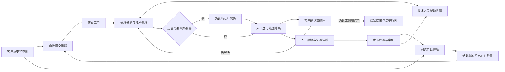
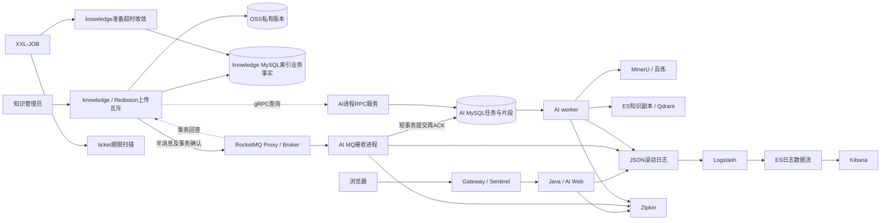

# 系统设计

Service Desk 面向一家 IT 服务商及其签约企业，提供办公终端、打印与扫描、办公网络连接及指定办公软件的 IT 支持。客户报告问题，服务团队远程处理、必要时上门并记录结果；技术人员使用有状态 Agent 选择检查、阅读证据、根据反馈修正假设并完成交接；客户可咨询或在明确支持范围内自助排障，经过审核的规程与脱敏案例用于后续支持。

本文定义协同排障 Agent 的目标业务与运行机制，设计基线为2026-11-16。本文描述最终目标，不声明现有代码、迁移或生产验收已完成。模块及功能归属见[项目结构](项目结构.md)，字段与约束见[数据库设计](数据库设计.md)，HTTP、RPC与消息见[接口约定](接口约定.md)。

## 1. 业务闭环与系统边界

人工受理、处理与确认可独立使用，AI、知识和预约依赖失效不阻断人工主链。AI自助不是提单前置步骤，AI执行成功不表示故障已修复。系统不远程执行设备命令、不自动开通外部账号、不修改客户系统、不自动维修或发布知识；不包含采购、支付、备件库存、任意工作流、全量CMDB、网络拓扑发现、生产服务器运维、自动代码修复或多租户平台。

### 1.1 支持范围与运营依据

| 类别 | 固定代码 | 支持内容与边界 |
| --- | --- | --- |
| 办公终端 | TERMINAL | 登记电脑及外设使用、操作系统和驱动的常见问题；不承诺板级维修 |
| 打印与扫描 | PRINTING | 打印/扫描、队列及连接问题；电脑、打印机是重点资产类型 |
| 办公网络连接 | NETWORK | 终端联网、指定VPN及共享资源访问的初步排查；不管理全网设备和生产网络 |
| 指定办公软件 | OFFICE_SOFTWARE | 服务项目列明的软件、客户端及访问问题；不承诺任意软件或外部账号自动操作 |

ticket维护小型服务项目目录及客户开通范围。每个项目属于上述一类，以支持产品、环境、版本说明和现场能力明确责任，不建设自定义表单或工作流引擎。设备资产仍只登记电脑和打印机，但设备不是所有问题的必填对象。软件名称、版本、系统、连接方式和影响范围使用固定问题环境字段，不新增通用配置对象图。

客户有至少一个当前有效服务项目时，可以先选择“不确定”提交待分类问题；这只承诺人工分流，不承诺支持所有问题。客服或当前处理人分类时核对目标项目的当前客户资格；不在范围的问题允许说明原因及建议去向后提交REFERRED处理结果，不能冒充已修复。新增自助排障必须选择当前有效服务项目，缺少适用资料则澄清或交接。

服务项目的启停、客户开通区间及现场能力由服务商人工维护。服务截止按Asia/Shanghai日期、首尾日均有效；已有工单保留受理时的范围快照，服务到期、目录停用或设备退役不自动终止履约与历史访问。首次受理1/4小时和确认72小时是自然时长内部规则，不声称营业小时或合同SLA。现场容量来自人工核对的出勤安排。

最终按每个应用单实例、一个AI worker、单机基础组件设计，不承诺高可用或未经测量的吞吐。微服务按身份、支持业务、知识发布及AI计算划分；不继续拆分空业务服务。Java管身份、服务资格、设备、工单、预约和知识发布；Python管解析、检索、诊断状态、模型及工具执行。各服务持有独立MySQL事实，具体字段及服务内FK见[数据库设计](数据库设计.md)。

### 1.2 最终运行方案

| 问题 | 确定方案 | 正确性边界 |
| --- | --- | --- |
| 服务资格与人工处理 | ticket本地目录、开通范围、工单版本、唯一回执及时间线 | 身份及客户人员范围归user；设备期限不再充当服务资格 |
| 预约与容量 | MySQL短事务、条件更新、唯一约束 | 工单地点快照与预约固定，不使用Redis库存 |
| 索引可靠受理 | RocketMQ事务消息、本地事务事实回查、AI落库后ACK | 本地提交、消息受理、执行及发布分开；不设outbox |
| 期限与准备收敛 | XXL-JOB有界触发ticket及knowledge | 不运行长模型任务，不与@Scheduled重复 |
| 上传外部互斥 | knowledge按上传者与请求键使用Redisson | 唯一回执仍归MySQL，未知OSS写入须对账 |
| 依赖保护 | Gateway/Java使用Sentinel，Python限制队列、并发及调用预算 | 不能代替权限、业务状态或持久执行权 |
| 排障执行 | AI MySQL持久受理、任务状态机、Run阶段、调用账目、持久检查反馈、有界模型/工具循环 | 不叠加本地SQLite宿主或另一套Scheduler |
| 观测与用量 | ELK脱敏日志、Zipkin追踪，逐次模型/工具及证据记录归AI库 | Trace不是业务事实，不记录或展示模型隐藏思维链 |

所有既定组件纳入最终交付，开发阶段仅安排实现顺序。基础库职责、普通JSON成功0/系统异常1及各边界映射沿用[接口约定](接口约定.md)，不能把业务状态、任务诊断和响应码混为一谈。

### 1.3 交付范围与工程重点

最终自有表37张：user 5、ticket 12、knowledge 5、AI 15；框架会话/迁移/调度技术表另计。保留事务预约、统一动作回执、知识事务消息、完整证据阅读与跨轮排障，不为减少数字把独立生命周期数据塞进JSON。JSON仅承载修订内规程、任务内当前假设、Run上下文摘要及结果引用等有界整体；消息、事实、检查反馈、事件、来源和逐次外调仍独立持久化。

Java交付重点是资源与服务资格授权、工单状态/期限竞争、预约容量及取消幂等、本地业务与审计/通知原子提交、知识索引事务回查。Agent交付重点是反馈驱动取证、来源化事实与假设修正、权限与适用性过滤RAG、完整证据、上下文压缩、持久等待/取消/未知调用，以及同条件领域评测。每项亮点均须有实际故障用例和可重现证据，组件数量不作为完成指标。

最终不交付工单关系图、自动案例挖掘/发布、独立候选审批、独立规程引擎、远程Shell/电脑控制、智能排班、采购备件/完整CMDB、多Agent、插件市场或MCP平台，也不保留这些功能的空表、备用入口和“后续完整版”。功能范围固定，实施发现合同矛盾或安全/正确性缺陷仍须修正并同步文档，不承诺设计永不纠错。

### 1.4 通信分工

| 场景 | 固定方式 |
| --- | --- |
| 浏览器经Gateway访问 | HTTP/JSON、授权原件及SSE |
| Java↔Java即时协作 | OpenFeign/HTTP、Nacos发现及LoadBalancer |
| Java↔Python即时协作 | gRPC/Protobuf、独立私网端口及内部认证 |
| 跨服务异步指令 | RocketMQ；当前只有知识索引SUBMIT/CANCEL |

工单、服务项目、客户开通范围、预约和通知同属ticket，以本地事务组合；不为新增目录创建跨Java异步消息。AI队列是本库持久任务，不等于跨服务MQ。user撤权通过当前事实与authVersion复核。资源所有者提供合同，禁止跨库联表及引用兄弟服务Entity/Mapper/ServiceImpl。

## 2. 身份、组织与权限

组织分唯一服务商和多个客户，账号属于一个组织。客户可选本组织设备和已开通服务项目，工单按本人及原客户组织开放。咨询会话、客户自助会话、技术人员辅助会话、任务、草稿及反馈均归各自拥有者；有工单权限不自动获得他人的AI对话。服务人员通过明确客户范围操作，组织和角色标签不自动授予全平台权限。

| 角色 | 业务职责 |
| --- | --- |
| CUSTOMER_USER | 本组织设备、本人排障/报修、补充、预约、结果查询与确认 |
| SERVICE_AGENT | 当前客户范围内服务资格维护、设备、受理/分类、分派转派、优先级和现场资格 |
| TECHNICIAN | 范围内接单，当前处理人处理、分类与环境补全、使用本人技术助手、开放上门及登记结果 |
| KNOWLEDGE_ADMIN | 资料上传核对、发布、检索诊断和人工脱敏知识审核 |
| SYSTEM_ADMIN | 组织、账号、角色、人员客户范围、全局服务目录、审计及区域时段发布 |

客户账号角色固定CUSTOMER_USER；组织类型和资料受众的CUSTOMER不是角色码。服务商角色可组合，系统管理员处理工单仍需相应角色和范围，知识管理员不自动阅读客户工单和聊天。

管理员开通账号，受控初始化建立唯一服务商及首名管理员，无默认口令，首次及重置后强制改密。最后一名有效系统管理员使用共同串行化事务保护。组织调动不修改旧工单/会话的customerId，客户不再属于原组织后失去读取资格；服务团队按当前范围接续处理。

user以Spring Security、JDBC Session和CSRF维护身份，Session只持必要身份/版本。改密、停用、角色、组织或范围变化提高authVersion，每次请求与后台排障重新核验当前事实。Gateway清理外来身份头，业务服务经内部认证核验身份，再做资源授权；依赖失败拒绝需授权的操作。

客户确认交接的现象与已执行检查写入正式工单快照和公开事件，不把整个客户会话授予技术人员。技术人员会话还须拥有当前工单读取资格及TECHNICIAN角色；接单、转派、备注和解决仍按实际处理关系授权。转派接续正式时间线，不共享前任私有助手对话。技术人员反馈含工单上下文时不开放给知识管理员，仅用于当前拥有者查看和脱敏聚合。

浏览器Cookie只送身份核验，不作为后台消息凭据。排障使用不可登录的sessionRef及认证版本复核会话；预约提交时核验当前申请人和组织资格，已确认预约不因浏览器退出取消。

## 3. 页面与交互

| 工作台 | 核心入口 |
| --- | --- |
| 客户 | 我的支持范围、可选设备、直接提交问题、本人工单、自助排障、已确认检查、预约与结果确认 |
| 客服 | 客户范围、服务目录查阅及服务资格维护、待分类/待受理/超期队列、分派转派、公开及内部时间线 |
| 技术人员 | 范围内接单、本人待办、工单内本人助手、诊断事实及待答项、处理草稿、上门与履约 |
| 知识管理 | PDF或Markdown修订、适用规则、索引任务、片段核对、审核发布、检索诊断及人工编写案例审核 |
| 系统管理 | 组织、账号、角色范围、全局服务目录/目录审计、区域时段及受控索引处置 |

使用一个前端和分角色布局。提交问题先表达现象，类别/项目可以待分类，设备按需关联；固定环境字段允许“未知”，不要求填写资产号才能求助。服务人员补分类和环境时保留原描述及变更事件。软件和网络问题不伪造设备型号。

自助可随时转人工，技术助手嵌入工单详情，展示已反馈检查、来源、待答项及实际工具状态。正常等待用户回复结束本轮worker，界面展示待补充，不显示持续运行。客户看不到内部备注或技术人员私有会话，知识管理员不因审核知识而读取原工单。AI输出标记为建议，提交处理记录、解决或建单必须由人编辑确认。

首次加载、正常空结果、拒绝、故障、取消、中断及结果未知分开展示。冲突保留输入，资源/账号切换清理旧订阅及迟到响应；分页按[统一合同](../开发/Java后端规范.md#62-分页合同)。菜单不代替后端授权。正文及引用校验落库并复核交付权限后发送，不展示未校验Token或隐藏思维链。

## 4. 服务范围、设备与问题提交

ticket维护it_service_item及it_service_entitlement：服务项目固定类别和稳定代码，记录明确支持条件、现场能力及启停；服务资格以独立id维护客户/项目的当前连续有效日期区间，日期字段为starts_on/ends_on，客户和项目创建后固定；业务唯一键是(customer_id,service_item_id)。目录与资格的维护历史归it_service_event。系统管理员维护全局目录，范围内客服维护客户开通范围。创建及维护带clientActionId，已有行变更另带rowVersion与非空原因，变更和不可变审计事件同事务，重复回执先于新状态检查。恢复暂停资格沿用原id，不静默upsert新权益；不支持多份叠加或分段合同。提交问题在短事务锁定实际资格行并核验日期；未知分类在锁定客户的一条有效开通记录后受理为待分类，不复制user的账号范围。

型号和设备继续用于电脑/打印机资产。资产客户及型号固定，客户内资产号唯一；退役拒绝新增关联，纠错通过重新登记。设备地点只是提单时可选预填，不是后续预约地址权威。服务资格归客户开通范围，设备不再保存服务截止日。

直接提交与确认AI建单草稿复用一个建单用例。输入含可空serviceItemId、可空deviceId、标题、现象、已尝试操作、固定结构supportContext及可选现场地点。环境只保存必要的系统/软件名称版本、连接方式、错误码及影响范围，不保存密码、VPN密钥或网络全量配置。客户自述、人工核对、工具观测均标来源，不把输入文本当可信资产事实。

新建核对本人、客户、当前支持资格及可选设备归属，保存后端确定的entitlement_id、服务项目/资格快照、可选设备快照和环境，分类项目/资格/客户用本地复合FK保护；TRIAGE的入场资格仅作审计定位，不作为已覆盖项目。serviceItemId为空表示待分类，仅承诺分流；明确项目须当前已开通。客服或当前处理人以带版本动作补分类/环境，关联新项目时重核当前资格；到期后仍可按原已受理范围继续处理，不以改分类扩大服务承诺。无法覆盖时说明转介，不能因无可选设备而拒绝一切问题。

客户及提交人创建后固定。现场区域和地点在工单中维护，修改前须结束活动预约，预约按该工单版本固定地址。设备后续地点变化不回写工单与预约。分类、设备或关键环境变化产生CONTEXT_UPDATED并增加diagnosis_context_version；所有正式变更增加row_version，时间线追加独立增加event_sequence。普通备注不改变环境版本。新建议提交发现环境版本变化则中止该轮；旧结果仍可按当前权限审阅并标过时，正式采用始终检查当前写版本。

建单按requesterId+clientRequestId幂等，sourceDraftId非空唯一。先在当前读取权限内查原回执，再判断新资格、期限或草稿；同键异义冲突，未知响应查原键。AI不维护第二份工单或已消费状态，AI故障时允许不带草稿手动提交。

## 5. 工单处理与期限

| 状态 | 允许动作与迁移 |
| --- | --- |
| SUBMITTED | 客服分派或技术人员接单→PROCESSING，客服可调优先级 |
| PROCESSING | 当前处理人要求补充→WAITING_CUSTOMER，给解决说明→RESOLVED |
| WAITING_CUSTOMER | 提交人补充→PROCESSING；当前处理人说明撤回等待也可恢复处理 |
| WAITING_EXTERNAL | 当前处理人登记外部反馈或结束等待→PROCESSING；保留跟进负责人、原因和期限 |
| RESOLVED | 客户确认或期限到→CLOSED，反馈未解决→PROCESSING |
| CLOSED / CANCELLED | 保留历史，再发生问题新建工单 |

SUBMITTED/PROCESSING/WAITING_CUSTOMER/WAITING_EXTERNAL可按权取消。PROCESSING可进入WAITING_EXTERNAL；两类等待不互相隐式跳转。进入WAITING_EXTERNAL须先明确结束活动预约并关闭现场资格，不静默取消已确认出勤；等待外部反馈期间不新增预约。等待必须有原因和下次跟进时间，工单处理人继续负责，提醒不自动判定故障解决。客服可在处理阶段转派，处理结论必须由当前有权处理人提交。处理人停用或失去范围后不自动关闭工单，由范围内客服转派。

人工动作携带版本及clientActionId，取得工单锁后先查原回执，新动作才比较状态/版本。工单、时间线和相关站内通知同事务。公开记录与内部备注隔离，通知事件+收件人唯一，读取/已读重新授权，客服待受理队列从当前范围查询，不物化所有潜在客服收件人。

普通/高优先级首次受理期限为创建后4小时/1小时，只有未受理时客服可改优先级，期限按原创建时刻重算。首次受理指第一次接单或分派，不代表首次向客户答复，first_accepted_at不因转派覆盖；期限字段为acceptance_due_at，超期登记为acceptance_overdue_recorded_at。处理结果resolution_type明确RESTORED（人工报告恢复）、GUIDANCE（指导已交付）或REFERRED（范围外/需其他方处理并说明去向）。解决后72小时未确认自动关闭，新业务closure_reason区分CUSTOMER_CONFIRMED与CONFIRMATION_TIMEOUT；迁移旧数据无法判定时保留LEGACY_UNKNOWN，不伪造客户确认；超时结单不等于客户确认或设备修复。客户退回清空本轮解决类型/时间/确认期限，再次处理重建；历史事件保留。上述均为自然时长内部规则，不解释为营业小时或合同SLA。

XXL-JOB触发ticket的有界期限扫描。接单/分派时若已超期但扫描未登记，同事务补记同一超期事件；期限扫描重核当前状态、期限和处理轮次。客户退回与自动关闭只有一方成功，停机后补扫积压。

外部等待或客户等待每轮增加wait_cycle，期限任务按轮次仅提醒一次，续期增加轮次并记事件。

工作台概况为独立聚合业务服务，在当前范围和统计窗口内返回待办、超期、首次受理及总关闭耗时等安全VO，无概况实体。空结果、未知指标和查询失败分别表达，不从概况权限推导正文权限。

## 6. 上门时段与预约

现场服务是人工处理的条件分支。客服或当前处理人核对受理项目支持现场服务、区域可服务及工单地点后开放资格；未分类工单必须先分类。客户本人仅在PROCESSING/WAITING_CUSTOMER且具备资格时申请，原范围到期不取消已受理履约。软件/网络问题确需现场支持也可申请，不要求绑定实体设备。

管理员按区域人工核对出勤并发布容量，使用Asia/Shanghai的09:00、11:00、14:00、16:00固定两小时窗口。窗口及容量发布后冻结，关停只停止新申请；不承诺工程师智能排班、路线优化或精确到达时刻。

申请先核验身份，在短事务按工单→已有预约→时段锁定，再独立查询MySQL UTC决策时刻，核对状态、资格、工单区域/地点、开放截止及容量。CONFIRMED预约、reserved_count条件增加、时间线及站内通知同事务；SOLD_OUT/SLOT_CLOSED保存REJECTED回执，不扣容量；其他资格失败直接拒绝。预约固定工单当时地址，设备不参与预约锁序。

ticketId+clientRequestId幂等，先查回执再判断新资格；一工单最多一笔CONFIRMED，换时段先取消。到访前取消仅回补一次，到访开始后由当前处理人登记VISITED/NOT_PERFORMED并保留占用。解决、取消、改现场地点或撤回资格须先按同一锁序处理活动预约。预约登记明确负责技术人员；到访前可由客服或当前处理人转交给有范围的技术人员并留事件，不能通过工单转派静默更改出勤人。取消及未履约必须说明原因，履约保存实际执行人和时间。改约先确认取消，再申请新时段，失败清楚展示没有新预约。履约重试比较原finishResult及说明，相同返回原回执、不同冲突；重复取消显示真实状态。窗口结束不自动登记履约，无PENDING、Redis库存或MQ预约消息。容量验证是正确性实验，不包装成秒杀。

## 7. 原件、修订与发布

知识管理员登记官方手册、排障规程或已审核脱敏案例，系列按来源、语言和受众区分。修订至少一条适用规则：service_item_id必填，可选限定型号、系统名称/版本、软件名称/版本；一条规则内AND、规则间OR，仅支持规范化精确匹配和显式通配，不猜测版本兼容。缺少被限定条件时先澄清；无型号规则不是所有客户无条件可读。

PDF保存真实页码；Markdown保存真实标题、段落锚点及行区间，不伪造物理页。两类均保存不可变OSS原件版本，经同一索引事务链处理、核对和发布；Markdown使用本地确定性解析，不调用MinerU。规程定义保存在资料修订内，包含有限检查清单、前置条件和风险停止条件，不设独立步骤表、分支图或规程发布流程。技术人员人工挑选正式记录并脱敏确认，知识管理员据已确认材料编写Markdown草稿，按原件登记、索引、核对和发布流程处理；knowledge不获得原工单或私聊读取权。

knowledge接收PDF或UTF-8 Markdown的multipart原件，使用有界临时文件校验格式、字节预算和SHA-256；文本编辑器提交导出的Markdown文件，禁原始HTML及自动外联，不执行嵌入脚本或文档指令。服务生成不复用Object Key，上传OSS私有版本Bucket并取得Version ID，再短事务登记修订。数据库保存Bucket/Key/Version/大小/摘要，不保存签名URL；ETag不充当SHA-256。

上传者+clientUploadId唯一，语义摘要覆盖文件与元数据。同键同义返回原修订，异义冲突。knowledge先授权并查询原回执，校验临时文件后，以Redisson RLock互斥同一上传者和请求键；取得锁后再查回执并核验当前权限，才在数据库事务外上传OSS、短事务登记修订。锁等待有界，忙时返回可重试冲突并保留原键；未知先查回执及原对象定位。不同上传键并行，不以整个系列为锁粒度。Redis故障时暂停新的原件上传，已提交回执查询和原件阅读不依赖锁。锁丢失、进程暂停或OSS结果未知仍可能产生重复对象，唯一约束保证一份修订回执，不保证外部对象恰好写一次；未被采用对象在暂停上传、等待在途写入收敛且核对无引用后回收，未查到回执不能当删除依据。

原件由knowledge逐次授权并代理精确版本读取，Python走内部原件接口且复核摘要，不持OSS密钥，不接受任意Bucket/URL。已发布和被引用的对象版本保留，生命周期不能提前删非当前版本，OSS故障不静默回退本地副本。

仅DRAFT可新建索引尝试、切换currentJobId或请求取消。已发布成功任务/片段固定；解析、切片、模型空间变更通过新草稿修订。一个系列最多一个当前修订，PUBLISHED/DISABLED占用当前位置。发布前核对来源依据、适用规则、成功任务和两路索引，再锁系列/修订/当前Java任务，比较版本和提交/取消事实后提交。

替换在同事务退役旧修订、发布较新修订并记录双向事件，不预占前驱链。DISABLED只停止新召回，普通RETIRED换版同样保留有权历史审阅；两者不可新启动规程。WITHDRAWN表示内容存在风险，停止新召回和在途规程并隐藏受影响指导正文，保留安全撤回提示；纠正必须新修订，不能直接恢复风险撤回。access_status=REVOKED独立表达访问撤销，连历史摘录和派生摘要也不得展示。恢复仅作用当前DISABLED且访问未撤销，并重新核对可用性。已发布不物理删，未发布草稿删除前，各尝试须本地SUBMIT明确ABORTED，或CANCEL已提交且AI已受理、终态/解析收敛；没有AI回执不能推断没有在途消息，本地事务事实与墓碑保留。旧引用与原件按生命周期保留。

## 8. 可靠索引与解析

knowledge使用RocketMQ原生事务消息协调本地索引提交与下游可见性，不设outbox发送表或定时投递器。kb_index_job是本地索引业务记录，保存尝试身份、幂等回执、SUBMIT/CANCEL准备及提交事实，供管理查询、并发控制及TransactionChecker使用；不能因为不用outbox就删掉业务任务和事务证据。

发起时先授权并登记PREPARING及30秒准备截止，再在数据库事务外发送半消息。明确取得半消息回执后，短事务重核文档版本/当前任务、准备状态及截止，保存COMMITTED与资料事件；提交数据库后向Broker COMMIT，AI才可消费。半消息失败/未知且尚未提交本地业务时，不报告“已受理”；沿原clientRequestId查询准备/失败，过期准备有界收敛为ABORTED。Broker不可用时新索引不能确认提交，人工支持及已持久AI任务可继续。

COMMIT二次确认丢失由Broker回查恢复。TransactionChecker按固定jobId、摘要、指令及operationId读取本地事实：COMMITTED→COMMIT，ABORTED→ROLLBACK，未收敛PREPARING/数据库不可达/锁超时→UNKNOWN。过期准备先通过同一文档→任务锁序提交ABORTED再ROLLBACK，防止旧请求恢复后迟到提交；不能把查不到记录、当前已取消或AI未受理当作回滚原提交的理由。历史提交证明及取消墓碑长期保留，详见数据库设计。

取消另行登记准备操作，发送CANCEL半消息，短事务提交取消事实及事件后COMMIT。取消准备中阻止发布；失败准备可显式重试并更换cancelOperationId，已提交取消不回退。已提交SUBMIT即使后来取消，回查仍COMMIT；提交与取消是两个业务事实。

AI独立receiver只校验已提交消息，在短事务保存任务/墓碑后ACK；重复消费不重置执行状态，落库后ACK丢失依靠唯一约束幂等。事务消息不提供消费恰好一次或消息顺序。lastCommand只SUBMIT→CANCEL，取消先到保留完整CANCELLED墓碑，晚到提交不复活；已终态取消保留原执行结果并记录CANCEL。本地取消已提交的尝试不能发布，新尝试须前次AI终态且解析收敛；仅本地SUBMIT已ABORTED且未被业务提交的尝试可不等待不存在的AI任务。

Java经gRPC GetStatus查询AI摘要、lastCommand、受理/执行及解析收敛，页面区分本地事务状态、远端受理和成功。事务回查、Broker消息保留和消费重试都有预算：生产者失联、DB长期故障、回查耗尽、消息过期或DLQ必须可观察并处置。恢复按持久业务事实核对后由管理员沿原身份重放已提交指令，不能换jobId掩盖未知；不保留HTTP/RPC提交旁路或扫描业务表自动重发的第二套链路。

AI worker从MySQL领取任务并按令牌续约，MQ接收与执行是不同进程职责。任务content_format固定为PDF或MARKDOWN；Markdown确定性解析，不创建MinerU任务，parser_state=NOT_REQUIRED且page_count为空；PDF沿用远端解析对账，成功须SETTLED及正页数。两类同样核验完整切片及双索引。MinerU创建前持久化SUBMITTING，远端回执固定taskId/fileId，未知且无ID转UNKNOWN先对账；已知任务沿原ID查询/取消，不能通过新ID绕过未明结果。

PDF解析校验正文、页数、表格和物理页，保留章节、表头及跨页关系，不从模型答复猜页；Markdown使用原UTF-8文本标题、锚点及真实行区间，page_count为空，不伪造物理页。两类不承诺坐标高亮。完整切片清单在有界事务中一次固定，稳定ID、正文及来源保存MySQL。

事务外调用百炼Embedding并写Qdrant，关键词写ES。分别核对两路完整LEAF片段ID/数量、载荷、空间和查询可见性，全部满足才SUCCEEDED。失败恢复按原清单回查并补缺失副本，不重新解析；未持久的向量结果可能再次付费，不承诺外部恰好一次。

同空间副本重建沿用成功任务/片段身份，ES从MySQL重建，Qdrant优先snapshot，无快照按原空间重新Embedding并核对费用和可用性。换空间走新修订，暂停相关写入和发布、等待在途收敛后统一切换，不混新旧空间。

## 9. 证据、规程与上下文

### 9.1 授权检索和完整阅读

knowledge按当前身份、受众、服务资格或原工单受理范围及环境返回可召回修订。CUSTOMER受众可供客户使用；SERVICE_STAFF仅供有权服务人员。环境限定采用明确反馈或可信业务字段，未知不当作通配。技术工单尚未分类时只能摘要/澄清，不进行无范围检索。

ES关键词/错误码与Qdrant语义检索均在查询前过滤授权任务及空间；空集合不执行无过滤查询。RRF融合后回查MySQL的稳定片段和定位，任一路故障明确报告依赖失败。检索返回短候选、完整性和定位，read_evidence按需读取完整步骤、表格或章节；父子/相邻展开逐项重核同修订、适用范围、授权和预算。不以固定400字符作为正文阅读上限，不静默丢弃安全前置条件。

每次实际进入模型的候选元信息、正文、工单事件、反馈、附件及摘要依赖登记来源；候选仅在检索器内部使用不计实际输入。引用是实际来源中的可定位子集。历史可读、新召回和继续指导分别授权；普通换版可审阅旧依据并标过时，撤回/撤权传播至相关回答、工具结果、摘要和草稿。依赖无法细分的完整回答整体隐藏，能证明独立的其他消息不受牵连。服务失败不伪装永久撤权。

### 9.2 有限类型化规程

TROUBLESHOOTING_GUIDE修订可携带一个不可变procedure_definition，与PDF/Markdown原件、适用规则共用审核和发布生命周期。定义随上传创建，纠错创建新修订。只包含所需信息、最多20项允许检查、角色、风险、强制前置检查、停止/交接条件及原件位置，不描述完整程序控制流。

前置条件使用固定字段、前置选择题允许值和宿主内置条件代码，检查依赖只能引用同定义中较早的检查，禁止循环、任意表达式、脚本、节点跳转或视觉流程编辑。prerequisiteAnswers只对前置CHOICE检查做有限允许值匹配，与已实际执行、同环境有效分别核对；例如观察结果“无权访问”不能因观察已完成而继续恢复操作。多个条件全部满足才允许提交检查，缺值或不符拒绝提议；可在原预算内纠正一次输出，不能默认为安全。发布前验证引用/类型/预算、原文位置及安全条件并记录定义摘要；固定条件码、风险等级和答案合同见数据库设计，不接受运行时自由扩展。load_procedure返回所选检查、适用环境、全部全局与该检查停止条件和前置答案要求，完整审核快照可独立作为对应检查依据；普通资料仍须read_evidence完整阅读，快照缺少必要解释时再补读原章节，不能把召回预览当正文。模型结合反馈提出下一检查或结束建议，宿主核对角色、适用性、必填信息、有效完成及答案满足的前置检查和停止条件；反馈不足先澄清，条件不满足不执行。连续无进展三次停止取证，依据既有有效证据进入最终阶段。

运行固定documentId和definitionSha256；普通新版本不静默替换已有任务，风险撤回阻止继续使用。选择新规程必须重新核对适用性及已有检查，不把旧完成状态无条件继承。规程提供安全约束和检查候选，任务状态机负责持久进度，不另有规程引擎。

### 9.3 来源化事实与上下文

原始消息和事实独立保存，检查及其唯一反馈请求合为DiagnosticCheck；当前假设存任务内有界类型化投影，与事实语义分开。事实来源限定USER_REPORT、HUMAN_RECORD、TOOL_OBSERVATION；抽取候选先校验，歧义或关键矛盾需确认，模型假设不能写成事实。事实更正/撤回追加同任务前驱链，不改旧记录。人工答复标ANSWERED且结果必须区分未执行、已执行未恢复和报告恢复；仅受控工具实际观测可标OBSERVED_DONE，不以收到回答推断已完成。

澄清和检查都通过checkId定位一条明确反馈请求，绑定任务、环境版本及执行者。再次提问/复查新建实例，previousCheckId保留关联；环境变化按依赖字段使相关未答或已完成项变为NEEDS_RECHECK，旧观测仍可审阅。任务最多维护8个当前假设，每项记录稳定键、状态及支持/反证事实ID，历史变更记任务事件；事实更正、撤回及环境变更在同一任务事务中失效相关假设。技术任务环境由ticket提供，用户文本不能直接改正式工单。

上下文依次包含系统边界、目标/关键环境、最新输入、未决矛盾与检查、相关既有事实、规程/证据和必要历史摘要。按需分页读取，不对长期任务设置30条事实总上限。工具调用与回执成组保留；摘要作为Run.context_manifest的有界快照，记录策略/环境/覆盖版本和本Run实际来源编号，全部传递根来源进入ai_source_usage。复用前逐项重核，来源失效重新构建安全上下文，不覆盖旧Run。摘要不提升来源可信度；最终引用映射放structured_result，展示引用仅是实际输入来源的子集，不用引用列表代替授权。

先为固定系统边界与较大的输出/工具协议预留空间，剩余输入预算平分给初始任务状态和后续工具证据；初始历史不能把固定Schema计入自身一半额度后挤掉用户反馈。输入估算逐项包含模型消费的正文、工具参数、定义和输出Schema，不把HTTP JSON转义再次计为正文；仍按保守文本估算加25%余量，真实用量以供应商回执结算。当前输入和待答/待复查检查不可被历史挤出。历史用户消息保留原文并标为历史材料，助手历史仅保留有界原文摘录、消息标识及省略标记，作为来源化输入数据传递，不以assistant角色示范包装JSON，不伪装成完整操作证据，也不额外调用模型生成摘要。

跨轮继承的根来源记METADATA，承担撤权和风险传播；只有本轮实际读取或完整复用回执的CONTENT来源可用于最终操作引用。历史METADATA可提供至多八项文档/片段定位、标题和审核检查键；规程用documentId及checkKey重新调用load_procedure，普通正文用chunkId调用read_evidence。目录不提供正文或操作引用资格，checkId/factId不得代替知识定位。授权依赖上限按根身份和版本去重，不将跨轮复制的新usage ID重复计数；不同版本分别计数，私有范围及Run祖先循环仍独立校验。规程引用向人展示完整指令、角色、环境、前置及全局/局部停止条件，持久层保留原审核快照。

## 10. 会话、任务与执行

### 10.1 三种会话及独立任务

初始任务事实保留全文、身份、来源类型及环境版本，不重复传送整份已由任务范围提供的环境快照；历史环境显式标记。已答、待答和待复查检查均保留完整原指令；已答检查同时保留规范反馈、原反馈消息身份和规程定位。原指令只解释反馈对应的检查，不授予本轮重新执行权限。已选检查完整包含同一条反馈时，核对消息ID及规范答案相等后只输入一次正文；原消息仍登记来源，当前提问、自由文本及不匹配内容不得合并。省略清单分别标明聊天、事实、检查或假设，不能把省略聊天解释为尚未读取全部已答检查。模型输入可对同文档、同修订且完全相同的规程全局安全条件使用前项来源号引用，局部检查及局部停止条件不裁剪；数据库完整工具回执和来源保持不变。

Conversation承载私人交流，DiagnosisTask承载一个故障目标，Run承载一次有界执行，Message承载用户输入和已提交结果。会话模式固定为CONSULT、CUSTOMER_SELF_SERVICE或TECHNICIAN_ASSIST；CONSULT允许轻量IT咨询，不自动取得客户业务范围。普通闲聊限轻量无工具回复，咨询与排障独立计日次数，咨询每Run最多2次模型调用，相关解释不改变原任务进度。Redis原日期/拥有者/请求键保持不变，预留值标记资源组；升级前未分组的旧预留保守占用两组，随原日期自然退出，不清计数或重新赠送额度。

CONSULT转排障由用户确认目标和有效服务项目后新建自助会话/任务，只复制经确认摘要，保留原咨询。技术会话固定owner与ticket，其他环境从ticket读取；工单权限不授予他人私聊。同一会话至多一个未终结任务、一个QUEUED/RUNNING运行；每任务最多一个活动运行。问题对象变化新建任务，已终结任务不复活。

客户自助任务绑定原客户、项目和可选设备；有效服务资格是新建前提，后续续行重核资格，到期保留历史并可人工提单/分流；已关联正式工单按受理快照履约。技术任务需当前TECHNICIAN和工单读取资格，正式动作仍要求对应处理权。后台每轮重核当前Session引用及authVersion，重新登录后通过新请求采用当前身份继续，旧Run不换身份复活。

### 10.2 状态和版本

| 对象 | 状态及含义 |
| --- | --- |
| DiagnosisTask | ACTIVE、WAITING_USER、WAITING_APPROVAL、BLOCKED_EXTERNAL；终态RESOLVED_REPORTED、HANDED_OFF、CLOSED、CANCELLED |
| Run | QUEUED→RUNNING→SUCCEEDED/FAILED/CANCELLED/INTERRUPTED；未执行取消也可QUEUED→CANCELLED |
| DiagnosticCheck | OPEN→ANSWERED/OBSERVED_DONE/FAILED/SKIPPED/WITHDRAWN/EXPIRED；环境变化→NEEDS_RECHECK，复查新实例；沉默不形成答案 |
| 任务内Hypothesis投影 | PROPOSED、SUPPORTED、REFUTED、INAPPLICABLE；支持不等于已确认根因 |

提出问题并保存成功结果后Run为SUCCEEDED、任务为WAITING_USER，worker释放；回复先持久记录，再显式申请下一Run，队列满不丢已提交答案。WAITING_APPROVAL通过blocking_draft_root_id定位阻断任务的草稿根，只表示任务后续依赖某个确认，不是每个草稿都阻断排障。任务创建提交taskStateVersion=1及TASK_CREATED事件；BLOCKED_EXTERNAL必须保存阻断原因，用户明确续行并核验条件后才回ACTIVE。任务终态必须有来源和原因，RESOLVED_REPORTED不等于工单解决。

taskStateVersion只管理诊断变更；diagnosisContextVersion管理环境依赖；ticketRowVersion管理正式写入；ticketEventSequence定位时间线增量；conversation.rowVersion用于改名/归档。普通工单备注不使旧结果无权。任务变更、事件回执和版本同事务；活跃运行时拒绝手工更正，允许取消先终止执行再更正。技术运行发现环境变化以CONTEXT_CHANGED结束，历史仍按当前权限可读。

### 10.3 执行器与领域工具

采用领域任务状态机、有界模型/工具循环、Pydantic合同和薄供应商SDK适配。MySQL是唯一执行权威，不另引LangGraph/Temporal检查点库、SQLite宿主或通用工作流DSL。简单咨询可直接回答，知识问题单次RAG，已知路径按规程，存在动态取证需求时模型选择下一行动。框架不是验收指标，恢复正确性必须由测试证明。

| 工具 | 作用及约束 |
| --- | --- |
| read_support_context | 读取绑定范围、标题、现象、交接和环境；身份/客户/目标由宿主固定 |
| read_task_context | 初始上下文有省略时按需补读当前任务事实/检查；固定任务、版本、字面检索及稳定游标，每次至多3项，重核原来源 |
| search_knowledge | 已授权适用集合内混合召回，候选至多8 |
| read_evidence | 已授权候选ID和有界范围/游标，完整正文与定位，不接任意路径 |
| load_procedure | 已发布且允许执行的固定规程修订 |
| read_ticket_events | 绑定工单、当前可见性、序号分页，禁止全库工单搜索 |
| inspect_diagnostic_text | ticket已登记且允许AI使用的脱敏文本；有限解析器，不执行附件内容 |
| request_check | 校验规程/风险和前置条件，登记检查提议；最终事务生成待答项并结束本轮 |
| propose_action | 登记绑定用途/目标/前置条件的草稿提议，最终事务生成草稿，不执行正式动作 |

工具参数拒绝未知字段，作用域不可由模型扩大。返回OK、EMPTY、INVALID_ARGUMENT、FORBIDDEN、STALE_CONTEXT、DEPENDENCY_FAILED或UNKNOWN，包含data、evidenceRefs、完整性及游标。同一提议中的独立只读调用按冻结并发上限执行，每个调用独立取得数据库连接；回执仍按提议顺序组装。包含付费Embedding的搜索串行，不能在未知计量时并发预留下一笔调用。执行权错误取消同批在途工作，迟到结果仍须令牌校验；诊断写入统一在最终事务提交。重复检测比较工具、规范参数、环境版本及结果指纹；成功但无新证据也算无进展，连续3次关闭取证并按既有证据收束。权限拒绝不通过换参数或身份绕过。

取证阶段只注册有权只读工具，不同时要求最终结果Schema；模型不再提出工具调用时，宿主进入最终结构化回答阶段。取证阶段文本保留在原模型账目中，不作为公开回答、业务事实或下一轮指令，不解析其中的伪造工具命令。最终结构化结果不符合Schema、引用或审核规程时，宿主不提交回答、检查或草稿；每Run仅允许一次携带安全拒绝原因的模型纠正，原调用及纠正均记账且消耗原Run/任务预算；纠正上下文只携带有界的错误字段定位及固定拒绝原因；原无效提议完整保留于调用账目，按原证据重新生成，仍受原上下文上限约束，不写成助手公开消息。纠正前重新核验身份、来源、环境和执行权；排障再次无效交付宿主固定的INSUFFICIENT_EVIDENCE，不发布候选或动作，咨询仍按上游协议失败处理。权限变化、状态冲突、取消、依赖故障及未知结果不作为输出错误重试。审核规程的下一步使用检查、澄清、结论三种互斥结构；必需环境依赖由宿主补齐，模型不能删去，检查指令、选项和前置条件仍严格核对。规程澄清必须声明非空的未知必需环境字段，字段只来自本轮已读检查及其全局要求，检查键不得复用审核检查键；不能将观察操作改写为自由文本问题以绕过规程身份与选项。

排障自由正文、模型假设、草稿和自由澄清在最终提交前还需一次无工具的模型依据核验；审核检查原指令及宿主状态说明由合同和事务校验保障，不重复交由模型裁定。核验仅输入当前请求、原始任务目标与省略提示、固定环境、实际引用正文、带原检查指令的完整人工反馈及宿主的已读检查前提核验，核对适用条件未知、指定资料不符、断言无依据和虚构执行。核验自身无写权限，仍受同一身份、租约及费用账目约束，最多一次纠正后再次核验；核验失败不把原候选交付。单轮诊断预算内预留最多四次调用用于候选、核验、一次纠正和再核验，咨询仍预留两次，不提高总预算。核验逐段返回身份、类别及依据来源号，再返回整体判定、固定问题码和至多四个问题片段编号，不生成解释或重抄候选。宿主按字段和句界拆分候选可见文字，每片段最多100字符并附稳定编号；候选原文完整保留，片段只用于定位，不是独立事实。宿主从编号取得原句，纠正时仅投影四个40字符定位并标记缩短，不裁剪原始证据。不存在的辅助编号丢弃但拒绝保持；原句仍是不可信user数据，不能新增系统指令。核验协议失败独立报告上游协议错误，不要求生成器重写候选。MESSAGE的messageRole与FACT的factSourceType显式区分人工反馈、助手自述和工具观测；旧快照缺失角色时标为UNKNOWN，不按标题推断。助手历史消息只证明过去说过什么，不成为设备状态或技术结论的独立证据。同一模型的核验只能降低错误风险，不能证明语义正确或替代独立专家与真实设备验收。

取证阶段模型提出白名单外工具时，整批提议不执行，调用仍记FAILED/INVALID_MODEL_RESULT。仅在供应商响应已确认完整用量且诊断Run尚处取证阶段时，宿主关闭取证能力，按此前有效证据进入无工具最终阶段；没有充分证据则直接给出证据不足结果。不得再次尝试原工具、继承非法回应正文或假装取得新来源。后续候选及核验继续消耗原Run/任务预算；最终阶段协议失败、未知计量、授权、环境、租约及依赖失败仍终止，不走此收束路径。

审核规程的宿主状态与可选模型分析分别验收。模型假设、记录/解决草稿及转交对象作为一组核验；仅这组内容被语义拒绝或其核验预算不足时，整组不交付，保留原审核检查或宿主结论进入最终事务校验，不据此更改既有假设。原候选和已发生的核验保留调用账目。自由澄清及普通回答仍整份纠正或拒绝；协议、身份、来源、环境和依赖失败不能走此路径。检查前置条件及当前最新恢复反馈仍在提交锁内复核，舍弃可选内容不等于检查已通过或已执行。

逐段核验最多覆盖64个非空片段，必须各出现一次。冒号引导的标题与后续问题或断言合并后再按100字符上限分段，不把标题单独作为无对象的事实，也不省略其后的断言。SUPPORTED在输出Schema中通过完整对象联合分支要求至少一个来源号或上下文字段；每个分支独立声明片段身份、类别和全部依据字段，避免依赖供应商合并外层字段与局部条件，读取时再次校验；所列来源号须是本次核验实际读取的CONTENT来源号，或绑定确实提供的request/taskGoal/environment/ticket上下文；环境和工单不能支持资料技术断言。QUESTION仅容纳中性问题，夹带原理或原因须按事实断言核验；阅读范围和未读内容说明仍按断言核验，不设免审类别；HYPOTHESIS仅允许结构化假设字段。任何UNSUPPORTED不得整体批准。候选可见文字仅在片段清单出现一次，元数据保留状态、引用、假设及检查身份，不重复整份正文。宿主拒绝缺段、重复编号、虚构来源或上下文及正文伪装假设；覆盖协议失败不交付候选，超预算安全收束。该检查证明审核覆盖及来源身份，不能证明模型的语义判断必然正确。

发现阶段按当前账目收窄工具，并显式提供当轮工具清单；历史回执不授予再次调用已收回工具的权限。一次发现Chat及一次查询Embedding之后仍须保留最多四次最终回答/核验/纠正调用；余量不足时不再提供search_knowledge。提供付费搜索的阶段仅允许一个工具提议，供应商多提议响应拒绝；其他只读工具仍可有界并行。当已知知识候选全部为审核规程、但尚无本轮完整审核检查时，阶段只允许并要求load_procedure，模型选择文档和检查；普通或混合资料不套用此约束。身份、原规程授权及预算继续独立核对，阶段约束不能绕过安全条件。

指定资料的搜索以完整documentTitle精确缩小当前有权知识集合；无匹配不调用Embedding，不以相似标题冒充结果。读取只按正文返回的chunkId与nextOffset续页，endOffset不是可猜测的游标；某章完整不表示整篇读完，未读内容不参与技术结论。

最终阶段无工具执行能力，已完成调用投影为不可信只读结果数据，不再重复发送调用参数和发现阶段的定位协议。完整正文、全局安全条件引用、局部停止条件、用户反馈与事实关联、消息角色与事实来源类型、章节/分页边界以及失败和空结果保持；原工具及模型账目不改写。此投影减少协议开销，不能以删除证据或放宽预算代替安全收束。

已读审核检查逐项提供来源号、检查键、可用状态及拒绝原因，可用不代表已执行或必须选择。模型据当前反馈决定下一步，不把后续检查的拒绝套到当前检查；宿主仍复用最终提交规则生成可用集合。最终请求的阶段说明与Schema在预算判断前完整组装，实际发送复用同一请求；取证工具协议过大时允许按已有完整证据收束，不以漏算阶段说明继续取证。工具上下文压缩仅改变模型投影：审核检查内嵌JSON展开为对象，同修订完全相同的全局安全条件按来源号引用去重，局部指令、停止条件与持久原始回执不裁剪或改写。

排障自由正文生成还有最低依据门槛：仅有用户提问、事实自述、召回预览或历史权限依赖时，最终阶段直接提交宿主的证据不足说明，不让模型凭常识附加操作。实际完整知识/审核检查、完整脱敏附件、已授权工单事件或本轮实际输入且环境/行版本一致的已答检查反馈可提供诊断依据；澄清回答不是操作观测。该门槛不放宽正式检查的完整章节、角色、前置答案及来源授权规则，也不保证自由正文的每个结论都被证据支持，仍须语义审阅。CONSULT保留普通概念解释和聊天能力，不访问业务工具。

### 10.4 持久调用、预算和恢复

模型选择与公开检查分开：已定位审核规程时使用互斥选择合同，历史METADATA只能确定输出合同，只有本轮完整CONTENT来源能产生可选操作。最终模型通过nextAction的CHECKS分支只返回selections中的sourceNumber；宿主从该来源的不可变审核快照取出原指令、答案结构、文档/检查键和强制环境依赖，再由宿主查询同任务同检查键的最新实例绑定复查身份。只有NEEDS_RECHECK、EXPIRED、FAILED、SKIPPED或WITHDRAWN可复查，已答或待答检查仍拒绝；模型调用前复用最终提交的角色、环境和前置答案校验，排除已答、待答及当前条件不允许的检查；完整证据和宿主固定拒绝原因保留，不能以改名澄清绕过。此筛选不授予执行权，最终提交仍在锁内再次核对原前驱及任务版本。事实输入保留类型、状态版本及UTC记录时间，检查反馈保留UTC回答时间，初始故障不能被解释为恢复后的新报障。缺少必要信息时选择CLARIFY分支，不同时提交操作；无需新检查时选择CONCLUDE分支明确本轮结论。规程模型不生成text，宿主依据互斥决策生成检查、澄清、证据不足或交接状态说明；前端使用完整检查卡片。模型可提出带来源的假设及待人工确认草稿，自由文字仍经过依据核验。只有CONTENT审核来源允许转换，历史METADATA、用户文字或任意编号均拒绝；来源号选择不绕过角色、环境、前置答案、停止条件和重复检查校验。普通正文证据仍使用原检查提议合同；浏览器及持久structured_result保持同一RunResult结构。规程CONCLUDE的ANSWERED必须绑定当前环境最新有效CHECK的人工恢复反馈来源，要求来源版本一致、PERFORMED及RESTORED_REPORTED且无未解除风险；准备与最终锁内提交均核验。宿主明确这仅是用户报告，普通完成操作和旧恢复反馈不能确认当前恢复。

同轮相同工具输入不再次外调：保留独立提议账目，状态为INVALID_ARGUMENT，回执说明原工具序号和DUPLICATE_CALL原因，不能冒充新证据或环境变化。当前工具批完成后转入最终回答阶段，继续核对已有来源及提交条件，不重新增加调用预算；原调用在途或未知时同样不得自动重试。普通重复检查的领域拒绝与工具请求重复分开。

每批工具结束后从同Run有界账目按tool_number核对进展：新增source_usage身份、附件脱敏版本定位或补读检查行版本才重置连续次数。初始上下文及较早回执已有身份、空结果和拒绝不算新进展，游标和资料正文中的指令不能改变计数。批末连续三次无新增依据时关闭工具，按既有有效证据进入无工具最终阶段；没有诊断依据则直接提交证据不足说明，不追加生成调用。无新增来源不能否定已读完整检查，后续仍受原Run/任务预算、来源授权、前提、依据核验及提交事务约束，不重置计数或重试工具；父执行权失效或仍有未知调用不能伪装成无进展。并行批内稍后取得的新依据仍算真实进展，不能只因其前面三个回执为空就忽略它。

已允许工具的参数结构校验失败也须持久记账：版本化arguments保留invalid_arguments原提议，结果为INVALID_ARGUMENT且不读取数据、不登记来源。模型可以依已给出的Schema纠正，仍占原工具、模型和Token预算；重复坏参数沿相同重复保护收束。不向模型回显校验异常输入、内部上下文或堆栈，不自动放宽范围或改写参数。工具白名单、当前执行权和数据库错误不转为可纠正的参数回执。

搜索候选已标明审核规程时即使用规程互斥输出合同；只有本轮完整读取且通过当前前置校验的检查才进入可选来源，预览和历史元信息不能产生操作选项。输出Schema只保留根合同可达的类型定义，保留全部实际类型约束和安全描述。

按需补读遇到本轮初始输入中已选中的同身份、同版本事实或检查时，返回明确复用标记，不复制整份反馈。初始投影已保留完整原指令；历史指令不能作为当前操作依据。省略项继续完整读取，结束前仍校验任务版本及全部传递来源。审核规程候选按修订文档合并定位目录，普通知识保留逐片段定位，不删掉不同修订或普通正文的阅读入口。

受理先查ownerId+clientRequestId回执，再核权限/版本/额度，消息、Run与必要任务事件短事务保存。Run记录CONTEXT/MODEL/TOOL/COMMIT阶段及循环序号，每次外调前在model_call或tool_call登记固定身份、输入和领取令牌，事务外发起请求。结果、完整可见模型输出/工具结果定位、来源、计量与下一阶段按有效Run令牌原子提交；没有独立步骤表。request_check/propose_action仅登记提议，最终提交时才创建检查/草稿与领域事实，避免中途推进任务版本。最后消息、任务投影、事件、引用映射和Run终态同事务提交；失败/取消仅保留调用及来源，不留下可操作待答项或草稿。调用成功不意味着业务成功。

累计Token、单次上下文、输出预留、费用、工具步数和墙钟分别预算。使用供应商适配估算及安全余量，不将UTF-8字节数冒充Token；Chat、Embedding、摘要、可选重排等全部计量，未知保持未知。任务累积预算跨Run保留，未知调用保守保留预留；用户续行不能重置任务额度，增加额度限系统管理员受控维护，保存操作者/依据及BUDGET_CHANGED事件；不开放用户自助无限续费。

取消先清空执行权并保存终态，再尽力停止上游。过期Run收敛为INTERRUPTED，已发出但未持久结果的外调记UNKNOWN，尚未发出的PREPARED调用可取消；未知付费请求不自动重发。用户明确续行创建新Run，重新核验身份/环境/预算，以有效领域状态和已提交call结果建立上下文；只复用完整、同输入且仍有权的结果，易变业务重新读取，并记录复用call身份。没有可靠完整结果则从当前安全边界重新推理，不承诺任意节点精确恢复。UNKNOWN费用预留在对账前继续计入预算，新Run不能通过换键隐藏未知调用。索引按原解析ID/片段清单恢复，独立于对话续行。

worker持久队列遇数据库连接故障按1、2、4秒递增退避，至多30秒，恢复后重新执行持久领取；成功重置退避。该机制不把原RUNNING或UNKNOWN请求重排，不吞编程错误，进程取消继续传播。日志使用独立进程目录及有界异步队列，磁盘写入不占用业务事件循环；traceId/spanId在产生日志的线程固定，队列丢弃计数随后续日志输出。

### 10.5 正式动作和回执

草稿用途CREATE_TICKET、ADD_RECORD、RESOLVE_TICKET、REQUEST_INFORMATION、BOOK_ONSITE，24小时有效。客户交接模板可直接来自已确认事实，不要求源Run成功；技术建议草稿必须有可核验来源。创建草稿不额外调用模型。用户编辑得到新不可变草稿修订，确认绑定修订ID和内容摘要，已确认内容不可被校验器暗改。

ticket先验证当前身份/回执可见性，再查询sd_action_receipt；合法重放优先返回原结果，新动作才校验草稿、期限、当前写版本和权限。草稿修订归同一draftRootId，所有用途以该根全局唯一采用；正式业务结果、事件/通知及回执同一ticket事务提交。AI不保存与Java竞争的consumed状态；界面从Java回执投影已采用，依赖失败显示待核实，不重新创建动作。

BOOK_ONSITE仅供客户自助拥有者在已有建单回执关联后使用，目标为其本人有权工单；已HANDED_OFF任务可生成预约草稿但不重开诊断。技术人员提出预约建议，客户通过本人入口确认。其他处理草稿限技术会话及当前处理关系。AI通过原草稿根查询Java回执后显式同步HANDED_OFF或确认等待结果，不因模型声称成功而改任务终态。

### 10.6 附件、反馈和案例

工单文本/日志附件归ticket，独立OSS前缀与最小权限凭据。限UTF-8 txt/log/json，至多1MiB；服务端登记上传意图、大小/摘要/所有者，上传不成功不变READY。原件私有，脱敏文本经上传者预览确认后才允许AI读取，前端不提供任意URL，AI不持存储密钥。内部附件不向客户显示，删除/撤销AI使用会阻止后续使用及相关派生展示。唯一原件不放本机临时目录。

反馈按Run记录有用性及采用/修改/拒绝原因，仅本人及脱敏聚合可用，不提供共享会话开关。知识沉淀采用人工流程：技术人员选取已授权正式记录、明确结果来源、脱敏并确认可共享文本，通过既有人工协作交给知识管理员；系统不新增提交队列或候选审批实体。知识管理员编写Markdown原件，记录材料核对人/确认时间/使用依据，再走已有草稿、索引、审核发布和文档事件。无人工核对材料不得发布案例，模型假设不成为已验证经验。

## 11. 调度、限流与故障边界

### 11.1 调度与执行权

| 所有者 | XXL-JOB预定义BEAN | 工作与初始触发间隔 |
| --- | --- | --- |
| ticket | ticketDeadlineScan | 每60秒处理首次受理超期、客户确认到期及两类等待的跟进提醒；每批至多100条 |
| knowledge | knowledgeIndexPrepareExpire | 每30秒收敛超过准备截止的SUBMIT/CANCEL；每批至多100条，只改业务准备状态，不发送消息 |

XXL-JOB Admin使用独立技术库，ticket/knowledge各嵌入一个执行器。执行器仅接受预定义BEAN及受限批次参数，使用accessToken、可达注册地址和独立私网端口；不允许任意SQL、GLUE脚本或浏览器身份。路由先采用第一个实例、单机串行且丢弃后续重叠触发，调度失败不无限自动重试，数据库扫描承担补偿。重复触发、人工补触发或未来增加实例仍须满足本库条件更新/领取令牌，不以调度串行保证业务唯一。同批业务不再注册@Scheduled；user的Session框架清理例外。

触发器只调用所属Service并在本轮批次完成后报告执行结果，不等待MinerU/模型。不为每张工单创建调度条目。Broker事务回查由SDK和本地业务事实承担，不通过XXL发送消息。停机/漏触发后按状态和期限补扫，首次受理动作自行补记已经发生的超期；自动关闭由当前解决轮次竞争。AI接收循环、持久worker及远端解析回收归Python，不通过XXL远程执行Python脚本。worker维护循环每30秒有界处理最多100个过期问题/草稿，按conversation→task锁序与用户回复/确认竞争；持久问题不因维护重启丢失。最后一个OPEN人工检查项过期时任务回ACTIVE；阻断草稿过期/撤回后先等待30秒证明窗口，再通过服务认证的ReconcileDraftReceipt按原拥有者及根查询最小正式结果，无已提交回执时解除草稿等待，有OPEN检查保持WAITING_USER，否则回ACTIVE。记录原因并等待用户明确续行，不自动调用模型。Java不可查时保持WAITING_APPROVAL并记录待核实日志，不能以超时猜未采用。解除等待也不证明不存在在途提交，维护器继续核对该根的迟到正式回执；同一回执只推进一次，既有终态不重新打开。

### 11.2 Redisson与Redis

Redisson只承担knowledge同一上传请求的外部写入互斥：锁名desk:{env}:lock:kb-upload:{createdBy}:{clientUploadId}，不放原文件名或正文。锁取得后重查MySQL回执，不在持有数据库事务时等锁；RLock使用有界tryLock等待及watchdog续约，finally仅由当前持有线程解锁。外部操作有总预算，锁不是无限等待许可。锁续约丢失应停止新的外部步骤，已发出的OSS操作仍可能完成；MySQL唯一约束、孤立对象对账及原键查询承担最终收敛。锁不代替索引领取、预约事务或权限核验。

Redis另以Lua原子维护有TTL的登录防刷和用户日新生成次数。幂等回执先于新次数计算；跨MySQL/Redis不宣称恰好计数一次，失败可能保守多计。次数是调用保护，不是购买权益或账单，未知付费调用不自动返还。Redis不可用时暂停新登录、新付费生成和新原件上传；已有Session、人工工单、预约、已提交索引的事务回查及worker恢复继续按MySQL事实工作。

### 11.3 Sentinel与预算

Gateway按稳定资源组对登录、知识上传、新排障受理、普通API和SSE分别流控；禁用含资源ID的无限资源名和不受限热点键。Java对user身份核验、knowledge→AI状态查询和OSS等实际依赖设置独立并发隔离；适合的远端调用启用异常比例熔断。HTTP业务4xx和RPC权限/输入/状态拒绝不计依赖故障；网络失败、超时、HTTP 5xx及RPC UNAVAILABLE/DEADLINE_EXCEEDED/INTERNAL等技术故障才计入；身份熔断时拒绝操作，不能用缓存权限放行。Sentinel保护Java入口与Java出站边界，Python使用自身并发、队列及超时预算，不装Java SDK，也不把网关限流误当worker模型并发上限。

规则由Nacos按环境、应用及规则类型持久保存，应用有已登记的启动基线；配置不可用时保留最后有效规则，冷启动使用基线并报告配置降级，不回退无限流。控制台临时编辑不作为唯一配置。普通流控返回429及Retry-After，熔断/必要依赖不可用返回503；均使用统一错误，SSE在响应提交前拒绝，提交后按安全协议结束，不返回空答案或伪成功。每实例阈值不声称全局配额，部署实例数改变时重新分配预算。

AI另限制排队长度、worker执行并发、单次Token/时间及索引批次；Redis每日次数与Sentinel瞬时流控同时生效。具体初值见部署说明，必须按真实PDF、身份调用和混合负载验证。MQ积压、worker停止、调度漏扫、死信、长期未受理和事务准备/回查异常分别可查；ELK和Zipkin故障只影响观测，不改变业务提交结果。

## 12. 验收与恢复原则

先打通网络打印故障的完整链，用VPN资源访问和指定办公软件异常验证抽象；四类支持均保留人工受理，AI只开放已验证规程范围。真实设备不具备时标记模拟，不宣传已实测。

工程验收覆盖权限、跨客户/私聊隔离、最后管理员、服务权益、双人接单、等待提醒、确认/退回、预约容量/出勤责任、附件、草稿根唯一采用、问题重复回复、环境变化、取消与迟到结果。知识验收覆盖两种格式、完整阅读、适用性、父子展开、普通换版、风险撤回、撤权和摘要失效；可靠索引覆盖事务消息回查、ACK丢失、乱序取消和解析对账。

领域评测使用隐藏故障环境与受约束的用户检查模拟器；隐藏原因不进入Agent。至少60个独立故障实例按原因/环境族划分开发30、验证15、保留测试15，变体不跨集合，每例至少重复3次。单次RAG、固定规程、动态Agent使用一致模型/知识/允许操作，报告预算及实际消耗。消融结构化状态、完整证据、按需上下文及重复检测；按实例报告方差，小样本不推断普遍能力。

按预先标签分别计算应解决实例解决率及必须交接实例正确交接率，首批目标各≥90%；条件交接另核依据，不能全部转人工刷分。关键建议证据支持率目标≥95%，报告分母和专家分歧。严重越权、伪造已执行/已修复、违反强制停止条件任一发生均阻止对应场景发布。攻击集含知识/附件提示注入、伪造工具结果、审批参数替换、跨客户引用及撤权摘要泄漏。

部署验收冻结环境规格、费用上限和版本，10个人工业务并发用户与2条模型运行混合负载30分钟，普通本地业务p95目标≤1秒，模型时延独立报告。试用目标RPO≤24小时、RTO≤4小时，必须独立恢复演练。上述是产品验收目标，不是已有成绩。设备、模型、数据库/中间件、专家审阅及真实参与者试用各有证据，缺项阻止相应发布范围。

恢复暂停相关写入，保存四库、执行账目、知识/附件原件版本和索引空间；恢复到独立环境验证范围、引用、未完预约与容量后重建ES。不重发未知付费请求或已确认正式动作。迁移及恢复操作见[数据库初始化与迁移](../sql/README.md)与[部署说明](../部署/部署说明.md)，实现完成度必须由对应制品和验证证明。

## 13. 组件职责与使用依据

本文确定同一个最终系统，组件均有实际消费者与验收条件，实施阶段不改变最终范围。

| 组件 | 消费者及职责 | 正确性边界 |
| --- | --- | --- |
| MySQL | 四个业务服务的事实、Session；独立XXL技术库 | 工单/预约本地事务、唯一约束及执行权；不跨库联表 |
| Redis / Redisson | user防刷、AI日次数；knowledge上传请求互斥 | 不持权限、容量、消息或任务权威事实 |
| RocketMQ NameServer、Broker/Proxy | knowledge生产索引指令、AI接收进程持久受理 | 事务消息依本地业务事实回查；幂等、墓碑、预算及死信恢复 |
| XXL-JOB | Admin及ticket/knowledge执行器 | 集中触发和执行记录，不保存业务进度或执行解析 |
| Sentinel / Nacos | Gateway和Java实际调用边界；发现、配置与规则 | 瞬时流控/并发隔离/熔断不替代身份、日次数及worker预算 |
| MinerU、百炼 | AI解析、Embedding和有依据生成 | 远端结果未知对账；原件、权限与RAG由项目负责 |
| ES / Qdrant | AI关键词和语义召回 | 由MySQL片段重建的副本，两路核验后发布 |
| ELK | JSON日志→Logstash→独立ES日志数据流→Kibana | 集中检索、错误及任务看板，不承担业务审计 |
| Zipkin | Java内部HTTP、跨语言gRPC、MQ接收与worker追踪 | 有界采样与投递；耗时拓扑不证明业务成功 |
| OSS | knowledge知识原件；ticket诊断附件，各自凭据/前缀 | 精确版本及摘要、逐次授权读取、被引用版本保留 |

### 13.1 日志与运行定位

统一逐行JSON字段timestamp、level、service、environment、instance、event、traceId、spanId，以及适用的jobId/runId/taskId/ticketId、stage、durationMs、errorCode。使用有界异步队列、独立实例目录及时间/字节双重滚动，默认3天且每进程最多512MiB。应用源头脱敏，Logstash按字段白名单二次过滤；密码、Cookie、SQL参数、提示词、聊天和资料正文不入普通日志，不自动展开任意业务JSON。

交付时Logstash只读挂载各进程日志，独立持久sincedb保存偏移，磁盘persistent queue有界；输出按环境/服务命名logs-desk.<service>-<env>数据流，模板和保留初值7天。service数据流段使用固定白名单gateway/user/ticket/knowledge/ai_api/ai_receiver/ai_worker，不含连字符或资源ID，与日志原service字段显式映射。Kibana提供traceId跨服务错误、jobId解析阶段、MQ积压/受理延迟、XXL失败和Sentinel拒绝等看板。队列、采样及各中间件状态通过受控检查结果进入运维事件，不用扫描聊天或工单正文。日志统计不作为精确SLA报表。采集停止、轮转超出保留、磁盘满或队列满可能丢运行日志，必须显示采集滞后/丢弃计数，不能阻塞业务无限等待。

ES知识desk-kb-*与日志数据流分模板、角色、凭据、保留和写入预算。AI不读写日志，Logstash不读知识，Kibana运维角色不因此获得知识或客户正文。共享ES的CPU/IO/磁盘水位仍有耦合；给日志设置速率上限、滚动及删除策略、磁盘预警，观测过载先限采集，保护检索。运行日志、追踪与MySQL审计/事件各自保留，互不替代。

### 13.2 Zipkin跨语言与异步追踪

Java使用Micrometer/Brave与Zipkin reporter，Python使用OpenTelemetry SDK和Zipkin JSON exporter直连Zipkin。统一W3C traceparent/tracestate；公开入口在追踪提取前删除外来traceparent/tracestate/baggage及B3头，再新建128位traceId，经过内部认证的服务间调用才接续上下文。traceId/spanId不作为身份凭据；未采样请求仍保留关联标识，不能承诺Zipkin有每一次调用。

knowledge本地任务保存初始受控trace_context，提交/取消请求建立短MQ发送span，经消息属性传递上下文；事务回查有独立span并关联jobId/operationId，不把回查当成第二次业务提交。AI接收在受理事务后结束接收span，将首次接收上下文存入ai_index_job；重复或迟到取消不能覆盖原任务上下文。worker从持久上下文创建执行span，按解析、Embedding、双索引阶段拆span，恢复产生新的执行span并保留jobId。问答同样在ai_run保存受理上下文供worker接续。HTTP和gRPC客户端/服务端均在对应适配器传播W3C；跨数分钟任务不保持HTTP/RPC/MQ确认span；每次领取结束自己的执行span，业务终态仍查数据库。

上下文只含受限traceparent/tracestate与schema_version，不存baggage、会话、正文或任意header，不参与requestHash，格式错误仅丢弃追踪并新建上下文。默认生产采样10%、受控验收100%，span队列及批量超时有界；Zipkin不可用只丢追踪并记录投递失败，不能回滚业务。Zipkin最终交付使用有界内存存储，重启历史丢失属于明确的观测保留合同；长期任务与审计仍能经MySQL及ELK查证，不另为追踪增加业务库。

### 13.3 拆分尺度

common/api为非运行库；设备、预约和站内通知归ticket以保持本地一致性。知识发布和AI计算分别拥有事实和生命周期，通过可靠异步指令隔离受理可用性和执行耗时。AI Web、MQ接收和worker共用同一代码镜像及业务所有权，分三个运行进程以隔离故障和资源；不新增消息、锁、日志或调度空业务服务。
