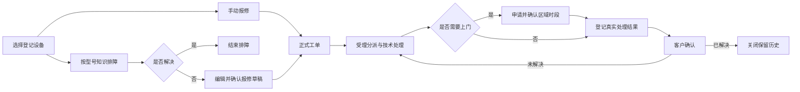
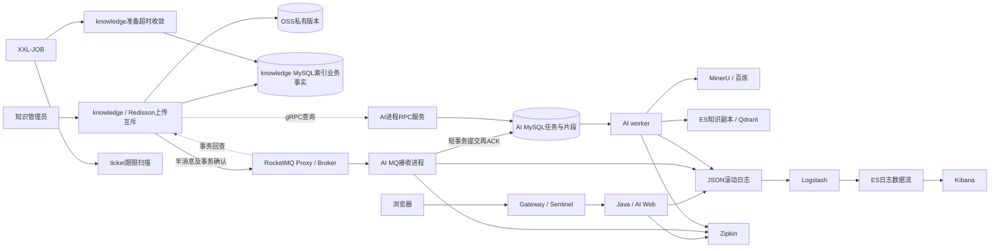

# 系统设计

Service Desk 面向一家 IT 服务商及其签约中小企业，为电脑和打印机提供设备售后、人工工单、上门预约和知识排障。系统让客户能够报修并确认结果，让服务团队有序处理，让知识管理员将可信手册和脱敏案例转为可追溯的排障依据。

本文定义目标业务与运行机制。模块及功能归属见[项目结构](项目结构.md)，字段与约束见[数据库设计](数据库设计.md)，HTTP、RPC与消息见[接口约定](接口约定.md)，实施顺序见[开发改造计划](../开发计划/开发改造计划.md)。

## 1. 业务闭环与系统边界

人工报修、处理与确认构成可独立使用的主链，AI/知识/预约依赖失效不阻断它。系统不执行客户设备命令，不实现自动工程师排班、跨区行程优化、多租户平台、自助注册、支付或任意工作流平台。以上业务边界为最终交付范围。

Java负责身份、设备、工单、预约及知识发布，Python负责解析、检索和排障，Vue负责展示交互。各业务服务独立MySQL库，OSS保存不可变原件版本，ES/Qdrant保存检索副本。公共Java基础合同和内部合同分别归common/api，不成为新的业务所有者。公共表单、枚举接口及错误按[Java后端规范](../开发/Java后端规范.md)复用，Entity、业务枚举和运行装配留在各服务；Python独立实现同一线合同。响应编号及边界转换以[接口约定](接口约定.md#12-错误码与边界转换)为准，Result成功不代表预约取得名额或异步任务已完成，业务状态、结果及诊断事实保持独立。

### 1.1 设计依据

系统以签约企业日常设备售后为背景，不包含集中抢号、商品交易或大规模事件广播，也不宣称未经测量的吞吐能力。最终交付按每个应用单实例、一个AI worker、单机基础服务设计，使用有界并发和持久恢复，不承诺高可用。请求重试、定时重复触发及进程重启仍可能并发，幂等与执行权保护不可省略。需求由业务闭环确定，不从已安装组件或压测脚本反推。

人工售后是核心，知识排障是辅助；上门容量来自人工确认的出勤安排。微服务按身份、售后、知识发布和AI计算划分，设备/预约/通知留在ticket保持本地事务，文件留在knowledge。服务独立部署是既定工程方向，不继续拆分无独立业务所有权的微服务。

### 1.2 最终运行方案

| 问题 | 确定方案 | 运行边界 |
| --- | --- | --- |
| 预约名额与重复提交 | MySQL短事务、条件更新、唯一约束和原请求回执 | ticket提交时返回确定结果，容量不复制到Redis |
| 索引跨服务可靠受理 | RocketMQ事务消息、knowledge本地任务事实回查、AI持久受理后ACK | 半消息、业务提交、AI受理、解析成功分开；长任务归worker |
| 工单期限和索引准备收敛 | XXL-JOB触发所属服务的有界扫描 | 调度平台管理触发、执行记录及失败；业务库保存进度和执行权 |
| 并发重试上传原件 | Redisson按上传者及请求键互斥外部OSS写入 | 缩小重复外部写入窗口，最终回执仍靠MySQL唯一约束 |
| 突发访问与依赖故障扩散 | Sentinel网关流控、Java调用边界并发隔离与熔断 | 与每日模型次数、Python执行预算分工，不替代授权 |
| 跨进程问题定位 | ELK集中JSON日志、Zipkin跨语言及异步追踪 | 日志解释事件，追踪展示调用关系，MySQL保存业务事实 |
| 付费调用与草稿 | Redis用户日次数、worker并发及Token/时间预算；草稿模板预填 | 用户确认事实后建单，不为整理表单再调用模型 |

组件共同服务人工售后与知识排障闭环，不增加秒杀、交易或通用事件平台。所有组件都是最终交付要求；单机交付也须验证重试、调度重触发、部署重叠和重启时的一致性。

### 1.3 通信分工

| 场景 | 固定方式 |
| --- | --- |
| 浏览器经Gateway访问 | HTTP/JSON、原件下载及SSE |
| Java↔Java即时业务协作 | OpenFeign + HTTP/JSON，Nacos发现及LoadBalancer |
| Java↔Python即时业务协作 | gRPC + Protobuf，共同.proto、独立私网端口 |
| 跨服务异步业务指令或事件 | RocketMQ，可靠性机制按实际用例定义，不按语言区分 |

当前没有Java↔Java跨服务异步业务：工单事件、预约和站内通知同属ticket并本地事务提交；身份撤权经user当前事实与authVersion核验，不依赖广播失效。若新增真实Java跨服务异步职责，也使用RocketMQ，并先定义所有者、幂等及恢复，不以线程池或Feign假装可靠异步。浏览器异步问答由HTTP持久受理及本库worker执行，不等于跨服务消息。

## 2. 身份、组织与权限

组织分唯一服务商和多个客户，账号属于一个组织。客户可选本组织设备，但工单、会话、草稿及反馈仍按本人及记录中的客户组织开放，不能阅读同事报修或聊天。服务人员通过明确客户范围操作，组织和角色标签不自动授予全平台权限。

| 角色 | 业务职责 |
| --- | --- |
| CUSTOMER_USER | 本组织设备、本人排障/报修、补充、预约、结果查询与确认 |
| SERVICE_AGENT | 范围内设备、受理、分派/转派、优先级和上门资格 |
| TECHNICIAN | 范围内接单，当前处理人处理、开放上门、登记履约和解决 |
| KNOWLEDGE_ADMIN | 资料上传核对、发布、检索诊断和允许共享的反馈 |
| SYSTEM_ADMIN | 组织、账号、角色、客户范围、审计及区域时段发布 |

客户账号角色固定CUSTOMER_USER；组织类型和资料受众的CUSTOMER不是角色码。服务商角色可组合，系统管理员处理工单仍需相应角色和范围，知识管理员不自动阅读客户工单和聊天。

管理员开通账号，受控初始化建立唯一服务商及首名管理员，无默认口令，首次及重置后强制改密。最后一名有效系统管理员使用共同串行化事务保护。组织调动不修改旧工单/会话的customerId，客户不再属于原组织后失去读取资格；服务团队按当前范围接续处理。

user以Spring Security、JDBC Session和CSRF维护身份，Session只持必要身份/版本。改密、停用、角色、组织或范围变化提高authVersion，每次请求与后台排障重新核验当前事实。Gateway清理外来身份头，业务服务经内部认证核验身份，再做资源授权；依赖失败拒绝需授权的操作。

浏览器Cookie只送身份核验，不作为后台消息凭据。排障使用不可登录的sessionRef及认证版本复核会话；预约提交时核验当前申请人和组织资格，已确认预约不因浏览器退出取消。

## 3. 页面与交互

| 工作台 | 核心入口 |
| --- | --- |
| 客户 | 我的设备、手动报修、本人工单、预约、知识排障、引用原件、草稿及反馈 |
| 客服 | 客户设备、待受理/超期队列、分派转派、工单详情与公开/内部记录 |
| 技术人员 | 范围内接单、本人待办、补充请求、处理说明、上门资格和履约 |
| 知识管理 | 系列、修订、上传回执、任务阶段、片段核对、发布替换、诊断和共享反馈 |
| 系统管理 | 组织、账号、角色范围、审计、区域时段与受控投递处置 |

使用一个前端和分角色布局，不复制业务应用。页面随对应业务纵向交付，登录阶段同时有账号管理，报修阶段同时有设备维护，任务阶段同时有核对与发布页面。菜单和按钮仅改善体验，后端始终授权。

首次加载、正常空结果、拒绝、故障、取消和结果未知分别呈现。输入及版本冲突保留草稿，资源切换/账号变化清理旧请求和订阅，迟到结果不能覆盖当前记录。分页引用[统一合同](../开发/Java后端规范.md#62-分页合同)，状态与终态以服务端事实展示。

## 4. 型号、设备与报修

型号定义类别、品牌、名称和已知适用系统，电脑/打印机类别明确，规范化后唯一。停用拒绝新增关联，不使已有设备或资料自动消失。设备固定客户及型号，客户内资产号唯一，保存期限、使用地点和上门区域；纠错通过退役重新登记，不暗改历史归属。

启用且服务期限未过的设备才能新排障/报修，服务截止日按Asia/Shanghai当天判断。退役/到期不一并禁止历史读取或已受理工单履约。设备区域/地点变更须先结束活动预约，申请时固定地址快照，历史不回写。

客户手动输入或编辑确认AI草稿复用同一建单动作。ticket核对当前提交人、客户、设备、服务资格及可选草稿，保存设备快照、标题、现象、已尝试操作、期限和公开创建事件。sourceDraftId最多创建一张工单，正式工单只由ticket维护。

按请求者+clientRequestId幂等。同键同义且当前可见返回原工单，同键异义冲突；旧请求先查回执，不因设备后来到期或草稿已使用而重复建单。响应未知先查原键，AI故障可不带草稿手动提交，保留用户已输入内容。

## 5. 工单处理与期限

| 状态 | 允许动作与迁移 |
| --- | --- |
| SUBMITTED | 客服分派或技术人员接单→PROCESSING，客服可调优先级 |
| PROCESSING | 当前处理人要求补充→WAITING_CUSTOMER，给解决说明→RESOLVED |
| WAITING_CUSTOMER | 提交人补充→PROCESSING |
| RESOLVED | 客户确认或期限到→CLOSED，反馈未解决→PROCESSING |
| CLOSED / CANCELLED | 保留历史，再发生问题新建工单 |

SUBMITTED/PROCESSING/WAITING_CUSTOMER可按权取消。客服可在处理阶段转派，处理结论必须由当前有权处理人提交。处理人停用或失去范围后不自动关闭工单，由范围内客服转派。

人工动作携带版本及clientActionId，取得工单锁后先查原回执，新动作才比较状态/版本。工单、时间线和相关站内通知同事务。公开记录与内部备注隔离，通知事件+收件人唯一，读取/已读重新授权，客服待受理队列从当前范围查询，不物化所有潜在客服收件人。

普通/高优先级首次响应期限为创建后4小时/1小时，只有未受理时客服可改优先级，期限按原创建时刻重算。首次响应时刻不因转派覆盖。解决后72小时未确认自动关闭，客户未解决退回后清空本轮解决/确认期限，再次解决重建本轮期限。这些是自然时长内部规则，不解释为营业小时或合同SLA。

XXL-JOB触发ticket的有界期限扫描。接单/分派时若已超期但扫描未登记，同事务补记同一超期事件；期限扫描重核当前状态、期限和处理轮次。客户退回与自动关闭只有一方成功，停机后补扫积压。

工作台概况为独立聚合业务服务，在当前范围和统计窗口内返回待办、超期、首次响应及总关闭耗时等安全VO，无概况实体。空结果、未知指标和查询失败分别表达，不从概况权限推导正文权限。

## 6. 上门时段与预约

上门适用于远程处理后确需现场服务的工单，客服或当前处理人开放资格。客户本人只在PROCESSING/WAITING_CUSTOMER、有资格且区域地点完整时申请。设备到期不取消已受理工单的正常履约。

管理员按区域人工核对出勤后发布容量，不用工程师账号数量直接当名额。采用Asia/Shanghai的09:00、11:00、14:00、16:00固定两小时窗口以简化排班，区域内不重叠；这是系统固定运营规则，不代表实时路线规划或精确承诺到达时刻。发布后冻结窗口和容量，关停只停止新申请，已确认预约继续有效。

预约是同一服务内的短事务，不需要排队异步确认。核验当前身份后，按设备→工单→已有预约→时段的顺序取得必要锁，所有锁取得后另查MySQL UTC时刻，核对工单、区域、发布、开放截止与容量。在同一事务保存CONFIRMED预约、条件增加reserved_count、写工单事件及站内通知，返回最终结果。约满或时段关停保存REJECTED回执；格式、权限或工单不合资格直接拒绝。预约不依赖Redis或RocketMQ。

一张工单最多一笔CONFIRMED，换时段先取消原预约。ticketId+clientRequestId幂等，同键先查回执再判定新资格，响应未知按原键查询，不能因超时重新扣名额。事务失败整体回滚，不留下待确认申请或容量预占。

到访前提交人或范围内客服可取消，确认占用只回补一次。到访开始后由当前处理人登记VISITED/NOT_PERFORMED，保留历史占用。解决/取消工单或撤回资格前处理活动预约；到访已开始未登记时先完成真实履约记录。窗口结束不自动视为已到访，不引入申请过期扫描。并发容量验证是正确性实验，不将本系统描述为抢购或秒杀业务。

## 7. 原件、修订与发布

知识管理员登记官方手册、故障指南或已审核脱敏案例系列，按语言和受众区分，修订关联明确适用型号。客户受众与服务人员受众分开，通用知识不保存客户身份和内部工单敏感内容。

PDF经knowledge接收multipart，使用有界临时文件校验大小、文件头/结构和SHA-256。服务生成不复用Object Key，上传OSS私有版本Bucket并取得Version ID，再短事务登记修订。数据库保存Bucket/Key/Version/大小/摘要，不保存签名URL；ETag不充当SHA-256。

上传者+clientUploadId唯一，语义摘要覆盖文件与元数据。同键同义返回原修订，异义冲突。knowledge先授权并查询原回执，校验临时文件后，以Redisson RLock互斥同一上传者和请求键；取得锁后再查回执并核验当前权限，才在数据库事务外上传OSS、短事务登记修订。锁等待有界，忙时返回可重试冲突并保留原键；未知先查回执及原对象定位。不同上传键并行，不以整个系列为锁粒度。Redis故障时暂停新的原件上传，已提交回执查询和原件阅读不依赖锁。锁丢失、进程暂停或OSS结果未知仍可能产生重复对象，唯一约束保证一份修订回执，不保证外部对象恰好写一次；未被采用对象在暂停上传、等待在途写入收敛且核对无引用后回收，未查到回执不能当删除依据。

原件由knowledge逐次授权并代理精确版本读取，Python走内部原件接口且复核摘要，不持OSS密钥，不接受任意Bucket/URL。已发布和被引用的对象版本保留，生命周期不能提前删非当前版本，OSS故障不静默回退本地副本。

仅DRAFT可新建索引尝试、切换currentJobId或请求取消。已发布成功任务/片段固定；解析、切片、模型空间变更通过新草稿修订。一个系列最多一个当前修订，PUBLISHED/DISABLED占用当前位置。发布前核对来源依据、适用型号、成功任务和两路索引，再锁系列/修订/当前Java任务，比较版本和提交/取消事实后提交。

替换在同事务退役旧修订、发布较新修订并记录双向事件，不预占前驱链。停用立即停止授权召回，恢复只作用当前DISABLED并重新核对可用性。已发布不物理删，未发布草稿删除前，各尝试须本地SUBMIT明确ABORTED，或CANCEL已提交且AI已受理、终态/解析收敛；没有AI回执不能推断没有在途消息，本地事务事实与墓碑保留。旧引用与原件按生命周期保留。

## 8. 可靠索引与解析

knowledge使用RocketMQ原生事务消息协调本地索引提交与下游可见性，不设outbox发送表或定时投递器。kb_index_job是本地索引业务记录，保存尝试身份、幂等回执、SUBMIT/CANCEL准备及提交事实，供管理查询、并发控制及TransactionChecker使用；不能因为不用outbox就删掉业务任务和事务证据。

发起时先授权并登记PREPARING及30秒准备截止，再在数据库事务外发送半消息。明确取得半消息回执后，短事务重核文档版本/当前任务、准备状态及截止，保存COMMITTED与资料事件；提交数据库后向Broker COMMIT，AI才可消费。半消息失败/未知且尚未提交本地业务时，不报告“已受理”；沿原clientRequestId查询准备/失败，过期准备有界收敛为ABORTED。Broker不可用时新索引不能确认提交，人工售后及已持久AI任务可继续。

COMMIT二次确认丢失由Broker回查恢复。TransactionChecker按固定jobId、摘要、指令及operationId读取本地事实：COMMITTED→COMMIT，ABORTED→ROLLBACK，未收敛PREPARING/数据库不可达/锁超时→UNKNOWN。过期准备先通过同一文档→任务锁序提交ABORTED再ROLLBACK，防止旧请求恢复后迟到提交；不能把查不到记录、当前已取消或AI未受理当作回滚原提交的理由。历史提交证明及取消墓碑长期保留，详见数据库设计。

取消另行登记准备操作，发送CANCEL半消息，短事务提交取消事实及事件后COMMIT。取消准备中阻止发布；失败准备可显式重试并更换cancelOperationId，已提交取消不回退。已提交SUBMIT即使后来取消，回查仍COMMIT；提交与取消是两个业务事实。

AI独立receiver只校验已提交消息，在短事务保存任务/墓碑后ACK；重复消费不重置执行状态，落库后ACK丢失依靠唯一约束幂等。事务消息不提供消费恰好一次或消息顺序。lastCommand只SUBMIT→CANCEL，取消先到保留完整CANCELLED墓碑，晚到提交不复活；已终态取消保留原执行结果并记录CANCEL。本地取消已提交的尝试不能发布，新尝试须前次AI终态且解析收敛；仅本地SUBMIT已ABORTED且未被业务提交的尝试可不等待不存在的AI任务。

Java经gRPC GetStatus查询AI摘要、lastCommand、受理/执行及解析收敛，页面区分本地事务状态、远端受理和成功。事务回查、Broker消息保留和消费重试都有预算：生产者失联、DB长期故障、回查耗尽、消息过期或DLQ必须可观察并处置。恢复按持久业务事实核对后由管理员沿原身份重放已提交指令，不能换jobId掩盖未知；不保留HTTP/RPC提交旁路或扫描业务表自动重发的第二套链路。

AI worker从MySQL领取任务并按令牌续约，MQ接收与执行是不同进程职责。MinerU创建前持久化SUBMITTING，远端回执固定taskId/fileId，未知且无ID转UNKNOWN先对账；已知任务沿原ID查询/取消，不能通过新ID绕过未明结果。

解析校验正文、页数、表格和物理页，保留真实章节、表头和跨页关系，不从Markdown顺序或模型答复猜页。提供物理页定位，不承诺坐标高亮。完整切片清单在有界事务中一次固定，稳定ID、正文及来源保存MySQL。

事务外调用百炼Embedding并写Qdrant，关键词写ES。分别核对两路完整ID/数量、载荷、空间和查询可见性，全部满足才SUCCEEDED。失败恢复按原清单回查并补缺失副本，不重新解析；未持久的向量结果可能再次付费，不承诺外部恰好一次。

同空间副本重建沿用成功任务/片段身份，ES从MySQL重建，Qdrant优先snapshot，无快照按原空间重新Embedding并核对费用和可用性。换空间走新修订，暂停相关写入和发布、等待在途收敛后统一切换，不混新旧空间。

## 9. 授权检索与证据排障

RAG由Python实现，百炼只提供模型API。知识服务按可信设备型号、身份和用途返回当前有权发布修订及任务；客户仅CUSTOMER资料，SERVICE_STAFF不进入客户上下文。空授权直接无可用资料，超出授权查询预算明确失败，不能截断后假称完整。

ES按同一jobId集合过滤中文正文/章节及精确错误码，Qdrant按授权任务和vectorSpace做Cosine召回，使用exact=true。每路最多50候选，同路先去重，RRF(d)=Σ1/(60+rank_i(d))，排名从1开始，同分按chunkId稳定排序，最终最多8片段。RRF不是概率，不能直接相加BM25和向量距离。

融合后有界回查MySQL，核对片段、任务、正文及来源，从knowledge取得真实标题/版本。裁剪上下文预算后固定实际sources，候选全集不是证据。交付前再次核对身份和全部实际来源；错误码同时核对型号与适用条件。

两路正常但证据不足给澄清/无依据及人工入口，任一路故障是依赖失败，不能静默当完整单路答案。历史只用于必要指代且须当前可读，旧模型回答不是新证据。发送模型仅必要问题和已授权片段，不含内部备注、敏感资产信息或完整工单。

模型仅使用固定编号引用，标题、章节、物理页及摘录从真实来源构造，非法引用明确失败，不伪造修复。拆机、删除数据、重装等交由人工确认，模型不执行设备命令。回答、澄清、依据不足为三种成功answerType，技术故障为FAILED。

## 10. 运行、取消、历史、草稿与反馈

会话绑定本人、原客户和固定设备/型号，每会话至多一轮QUEUED/RUNNING。owner+clientRequestId幂等，先返回原回执再计算新调用额度。总预算从受理含排队起计算，超预算QUEUED结束失败不调模型。

worker领取带令牌和租约，阶段/结果提交都核对当前执行权。正文、引用和成功终态同事务，提交并复核交付权限后发SSE阶段结果。运行中不输出未校验Token，断流不等于成功或取消；重返查询原运行，不自动发新问题。

取消先提交终态、清空执行权，再尽力停止上游；完成与取消同一行竞争。只将已过期RUNNING问答标记INTERRUPTED，不因Web重启清空所有运行，不自动付费重跑，迟到结果不能写正文/引用。索引则按原阶段与远端回执对账恢复，租约不是外部进程停止证明。

会话改名/删除带版本，删除先结束活跃运行并保留事实。历史重核当前身份、原客户及全部实际上下文；任一来源失效则隐藏回答与摘录，保留本人问题和安全状态。不能只检查最终引用或把历史快照当授权。

草稿指定同会话成功截止运行，按模板预填本人最后问题及用户确认的现象、已尝试操作，24小时到期。不额外调用模型生成草稿，不把助手建议推断成用户已经执行的操作；不能可靠提取的字段留空并由用户填写。用户编辑确认后ticket重核归属、设备、期限与可读来源，AI不保存consumed/ticketId第二事实，唯一建单由ticket.sourceDraftId保证，草稿过期不影响已建工单。

一轮成功生成至多一份反馈。HELPFUL无需处理，UNHELPFUL带类别待处理，用户只可改未处理反馈；共享默认关闭，可带版本撤销，已处理事实保留。知识管理员展开或处理需当前共享、未删会话及全部来源可读，无来源的反馈只聚合，不扩大管理员聊天权。处理校验PENDING、共享和版本，写处理人/时刻/说明及终态。

## 11. 调度、限流与故障边界

### 11.1 调度与执行权

| 所有者 | XXL-JOB预定义BEAN | 工作与初始触发间隔 |
| --- | --- | --- |
| ticket | ticketDeadlineScan | 每60秒处理首次响应超期、客户确认到期；每批至多100条 |
| knowledge | knowledgeIndexPrepareExpire | 每30秒收敛超过准备截止的SUBMIT/CANCEL；每批至多100条，只改业务准备状态，不发送消息 |

XXL-JOB Admin使用独立技术库，ticket/knowledge各嵌入一个执行器。执行器仅接受预定义BEAN及受限批次参数，使用accessToken、可达注册地址和独立私网端口；不允许任意SQL、GLUE脚本或浏览器身份。路由先采用第一个实例、单机串行且丢弃后续重叠触发，调度失败不无限自动重试，数据库扫描承担补偿。重复触发、人工补触发或未来增加实例仍须满足本库条件更新/领取令牌，不以调度串行保证业务唯一。同批业务不再注册@Scheduled；user的Session框架清理例外。

触发器只调用所属Service并在本轮批次完成后报告执行结果，不等待MinerU/模型。不为每张工单创建调度条目。Broker事务回查由SDK和本地业务事实承担，不通过XXL发送消息。停机/漏触发后按状态和期限补扫，首次响应动作自行补记已经发生的超期；自动关闭由当前解决轮次竞争。AI接收循环、持久worker及远端解析回收归Python，不通过XXL远程执行Python脚本。

### 11.2 Redisson与Redis

Redisson只承担knowledge同一上传请求的外部写入互斥：锁名desk:{env}:lock:kb-upload:{createdBy}:{clientUploadId}，不放原文件名或正文。锁取得后重查MySQL回执，不在持有数据库事务时等锁；RLock使用有界tryLock等待及watchdog续约，finally仅由当前持有线程解锁。外部操作有总预算，锁不是无限等待许可。锁续约丢失应停止新的外部步骤，已发出的OSS操作仍可能完成；MySQL唯一约束、孤立对象对账及原键查询承担最终收敛。锁不代替索引领取、预约事务或权限核验。

Redis另以Lua原子维护有TTL的登录防刷和用户日新生成次数。幂等回执先于新次数计算；跨MySQL/Redis不宣称恰好计数一次，失败可能保守多计。次数是调用保护，不是购买权益或账单，未知付费调用不自动返还。Redis不可用时暂停新登录、新付费生成和新原件上传；已有Session、人工工单、预约、已提交索引的事务回查及worker恢复继续按MySQL事实工作。

### 11.3 Sentinel与预算

Gateway按稳定资源组对登录、知识上传、新排障受理、普通API和SSE分别流控；禁用含资源ID的无限资源名和不受限热点键。Java对user身份核验、knowledge→AI状态查询和OSS等实际依赖设置独立并发隔离；适合的远端调用启用异常比例熔断。HTTP业务4xx和RPC权限/输入/状态拒绝不计依赖故障；网络失败、超时、HTTP 5xx及RPC UNAVAILABLE/DEADLINE_EXCEEDED/INTERNAL等技术故障才计入；身份熔断时拒绝操作，不能用缓存权限放行。Sentinel保护Java入口与Java出站边界，Python使用自身并发、队列及超时预算，不装Java SDK，也不把网关限流误当worker模型并发上限。

规则由Nacos按环境、应用及规则类型持久保存，应用有已登记的启动基线；配置不可用时保留最后有效规则，冷启动使用基线并报告配置降级，不回退无限流。控制台临时编辑不作为唯一配置。普通流控返回429及Retry-After，熔断/必要依赖不可用返回503；均使用统一错误，SSE在响应提交前拒绝，提交后按安全协议结束，不返回空答案或伪成功。每实例阈值不声称全局配额，部署实例数改变时重新分配预算。

AI另限制排队长度、worker执行并发、单次Token/时间及索引批次；Redis每日次数与Sentinel瞬时流控同时生效。具体初值见部署说明，必须按真实PDF、身份调用和混合负载验证。MQ积压、worker停止、调度漏扫、死信、长期未受理和事务准备/回查异常分别可查；ELK和Zipkin故障只影响观测，不改变业务提交结果。

## 12. 验收与恢复原则

按角色在浏览器完成设备→报修→处理→确认，和知识→排障→草稿→正式工单→预约→履约的演示。覆盖跨客户、处理人撤权、最后管理员、双人接单、重复键、自动期限竞争、并发容量、取消回补、索引提交/取消并发、半消息发送未知、MySQL已提交后二次确认丢失、Broker事务回查/耗尽、消费落库后ACK丢失、取消乱序、死信、调度停机与迟到。另验证上传锁丢失和Redis故障、Sentinel限流/熔断及规则恢复，确保受限入口不拖垮人工售后。

真实中文文字及扫描PDF核对正文、表格、错误码和物理页。固定题集对比关键词、向量与融合的召回、引用、拒答/澄清及延迟，不把满意率当总体准确率。身份、对象、解析、模型、内部HTTP/gRPC和双索引分别真实联调。

恢复先暂停相关写入并等待在途收敛，联合保存MySQL、Qdrant、模型空间及被引用OSS版本，独立环境恢复后重建ES，核对原件摘要、授权、历史、未完预约及容量。跨Bucket需受控Version ID映射，本地事务不提供跨存储一致快照。步骤见[部署说明](../开发/部署说明.md)，具体证据随实施任务提供。

## 13. 组件职责与使用依据

本文确定同一个最终系统，组件均有实际消费者与验收条件，实施阶段不改变最终范围。

| 组件 | 消费者及职责 | 正确性边界 |
| --- | --- | --- |
| MySQL | 四个业务服务的事实、Session；独立XXL技术库 | 工单/预约本地事务、唯一约束及执行权；不跨库联表 |
| Redis / Redisson | user防刷、AI日次数；knowledge上传请求互斥 | 不持权限、容量、消息或任务权威事实 |
| RocketMQ NameServer、Broker/Proxy | knowledge生产索引指令、AI接收进程持久受理 | 事务消息依本地业务事实回查；幂等、墓碑、预算及死信恢复 |
| XXL-JOB | Admin及ticket/knowledge执行器 | 集中触发和执行记录，不保存业务进度或执行解析 |
| Sentinel / Nacos | Gateway和Java实际调用边界；发现、配置与规则 | 瞬时流控/并发隔离/熔断不替代身份、日次数及worker预算 |
| MinerU、百炼 | AI解析、Embedding和有依据生成 | 远端结果未知对账；原件、权限与RAG由项目负责 |
| ES / Qdrant | AI关键词和语义召回 | 由MySQL片段重建的副本，两路核验后发布 |
| ELK | JSON日志→Logstash→独立ES日志数据流→Kibana | 集中检索、错误及任务看板，不承担业务审计 |
| Zipkin | Java内部HTTP、跨语言gRPC、MQ接收与worker追踪 | 有界采样与投递；耗时拓扑不证明业务成功 |
| OSS | knowledge私有版本原件 | 精确版本及摘要、逐次授权读取、被引用版本保留 |

### 13.1 日志与运行定位

统一逐行JSON字段timestamp、level、service、environment、instance、event、traceId、spanId，以及适用的jobId/generationId/ticketId、stage、durationMs、errorCode。使用有界异步队列、独立实例目录及时间/字节双重滚动，默认3天且每进程最多512MiB。应用源头脱敏，Logstash按字段白名单二次过滤；密码、Cookie、SQL参数、提示词、聊天和资料正文不入普通日志，不自动展开任意业务JSON。

交付时Logstash只读挂载各进程日志，独立持久sincedb保存偏移，磁盘persistent queue有界；输出按环境/服务命名logs-desk.<service>-<env>数据流，模板和保留初值7天。service数据流段使用固定白名单gateway/user/ticket/knowledge/ai_api/ai_receiver/ai_worker，不含连字符或资源ID，与日志原service字段显式映射。Kibana提供traceId跨服务错误、jobId解析阶段、MQ积压/受理延迟、XXL失败和Sentinel拒绝等看板。队列、采样及各中间件状态通过受控检查结果进入运维事件，不用扫描聊天或工单正文。日志统计不作为精确SLA报表。采集停止、轮转超出保留、磁盘满或队列满可能丢运行日志，必须显示采集滞后/丢弃计数，不能阻塞业务无限等待。

ES知识desk-kb-*与日志数据流分模板、角色、凭据、保留和写入预算。AI不读写日志，Logstash不读知识，Kibana运维角色不因此获得知识或客户正文。共享ES的CPU/IO/磁盘水位仍有耦合；给日志设置速率上限、滚动及删除策略、磁盘预警，观测过载先限采集，保护检索。运行日志、追踪与MySQL审计/事件各自保留，互不替代。

### 13.2 Zipkin跨语言与异步追踪

Java使用Micrometer/Brave与Zipkin reporter，Python使用OpenTelemetry SDK和Zipkin JSON exporter直连Zipkin。统一W3C traceparent/tracestate；公开入口在追踪提取前删除外来traceparent/tracestate/baggage及B3头，再新建128位traceId，经过内部认证的服务间调用才接续上下文。traceId/spanId不作为身份凭据；未采样请求仍保留关联标识，不能承诺Zipkin有每一次调用。

knowledge本地任务保存初始受控trace_context，提交/取消请求建立短MQ发送span，经消息属性传递上下文；事务回查有独立span并关联jobId/operationId，不把回查当成第二次业务提交。AI接收在受理事务后结束接收span，将首次接收上下文存入ai_index_job；重复或迟到取消不能覆盖原任务上下文。worker从持久上下文创建执行span，按解析、Embedding、双索引阶段拆span，恢复产生新的执行span并保留jobId。问答同样在ai_generation保存受理上下文供worker接续。HTTP和gRPC客户端/服务端均在对应适配器传播W3C；跨数分钟任务不保持HTTP/RPC/MQ确认span；每次领取结束自己的执行span，业务终态仍查数据库。

上下文只含受限traceparent/tracestate与schema_version，不存baggage、会话、正文或任意header，不参与requestHash，格式错误仅丢弃追踪并新建上下文。默认生产采样10%、受控验收100%，span队列及批量超时有界；Zipkin不可用只丢追踪并记录投递失败，不能回滚业务。Zipkin最终交付使用有界内存存储，重启历史丢失属于明确的观测保留合同；长期任务与审计仍能经MySQL及ELK查证，不另为追踪增加业务库。

### 13.3 拆分尺度

common/api为非运行库；设备、预约和站内通知归ticket以保持本地一致性。知识发布和AI计算分别拥有事实和生命周期，通过可靠异步指令隔离受理可用性和执行耗时。AI Web、MQ接收和worker共用同一代码镜像及业务所有权，分三个运行进程以隔离故障和资源；不新增消息、锁、日志或调度空业务服务。
