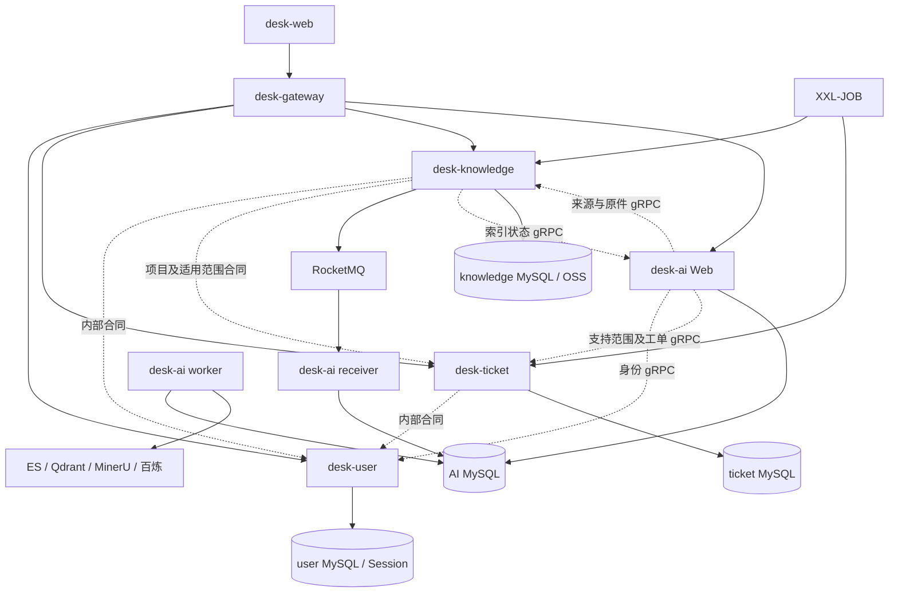

# 项目结构

本文定义 Service Desk 的目标工程、模块依赖、功能归属与文件边界。设计基线为2026-11-16，目录表为目标归属，不代表现有代码均已实现；目标按微服务职责设计，项目用途和技术栈见根 [README](../../README.md)。业务流程参考[系统设计](系统设计.md)，数据所有权与字段参考[数据库设计](数据库设计.md)，实现写法遵循各端规范。

## 1. 架构与部署单元

采用一个 Vue 前端、一个响应式网关、三个 Java 业务服务和一个 Python AI 服务。Java 公共能力拆为基础合同与内部调用合同两类库，它们没有端口、数据库或独立进程。Python Web、MQ接收与worker属于同一个业务模块、三个运行进程，使用同一套持久任务规则。

| 模块 | 类型 | 目标职责 | 数据/外部资源 |
| --- | --- | --- | --- |
| desk-common | Java普通JAR | 基础响应/输入、公共错误与异常、枚举接口、校验、序列化和环境值 | 无网络、持久化和框架自动装配 |
| desk-api | Java普通JAR及跨语言合同源 | Java内部Form/DTO/Feign；跨语言.proto及生成Java类型/stub | 无状态、无自动装配，Python由同一.proto生成包 |
| desk-gateway | Java WebFlux 应用 | 同源入口、显式路由、入口流控、身份头清理和链路接续 | Nacos，无业务库 |
| desk-user | Java MVC 应用 | 认证、组织、账号、角色、客户范围、身份核验和审计 | user MySQL、JDBC Session、Redis登录防刷 |
| desk-ticket | Java MVC 应用 | 服务项目、客户服务资格及变更事件、可选设备、工单、时间线、通知、概况、时段预约及期限、全局动作回执、诊断附件 | ticket MySQL、ticket私有OSS前缀/凭据、XXL执行器 |
| desk-knowledge | Java MVC 应用 | 原件、资料系列/修订、授权、发布、索引尝试与事务协调、修订内审核规程和人工编写知识 | knowledge MySQL、OSS、Redisson、MQ生产、XXL执行器、AI状态gRPC |
| desk-ai | Python 应用 | PDF/文本索引、授权检索、咨询、诊断任务/检查反馈、任务内假设、运行阶段、来源摘要快照、模型/工具调用、实际来源、引用、动作草稿及反馈 | AI MySQL、MQ消费、ES、Qdrant、Redis、MinerU、百炼 |
| desk-web | Vue 应用 | 登录、客户支持、服务工作台、知识管理及系统管理 | 仅同源 HTTP，无后端密钥 |

根 POM 聚合六个 Java 模块，管理统一 BOM、编译与检查；Python 和前端分别由 uv 与 npm 管理。三个 Java 业务服务与 AI 按服务/环境独立 MySQL 库和账号，部署时可共用 MySQL 实例，不能跨库访问。



图中网络箭头不表示 Maven 依赖。网络合同允许双向协作，编译依赖保持单向；具体接口和认证见[接口约定](接口约定.md)。

## 2. 为什么设置 common 与 api

### 2.1 基础库 desk-common

common面向稳定基础合同、无副作用工具与元数据；业务所有权不因代码复用而改变。目标包如下，类型在真实用例接入时建立，不一次生成空包：

```text
com.yangaobo.servicedesk.common/
├── annotation/SchemaEnum.java
├── base/
│   ├── Result.java、PageVO.java、BasePageForm.java
│   ├── IdForm.java、VersionForm.java、IdVersionForm.java
│   └── BaseEnum.java、ErrorCode.java、CommonErrorCode.java
├── constant/IdentifierConst.java
├── env/SystemEnvironment.java、SystemEnvironmentEnum.java
├── exception/BusinessException.java
├── serialize/DecimalStringSerializer.java
├── util/IdentifierGenerator.java
└── validator/Identifier.java
```

| 能力及包 | 实际目标消费者 | 责任与限制 |
| --- | --- | --- |
| base/Result、PageVO | 三个Java业务服务HTTP Controller；Gateway错误适配使用Result | code/message/data/traceId与统一分页，不读请求/ThreadLocal，不包文件/RPC |
| base/BasePageForm | Java管理列表及具名QueryForm | 纯分页，无业务筛选、排序或IPage |
| base/IdForm、VersionForm、IdVersionForm | 管理详情、带版本资源动作；VersionForm作为IdVersionForm的版本基类 | 兼容业务Form继承；任务键、请求键、可选版本保留具名模型，路径已有ID不重复提供 |
| base/BaseEnum | 本地业务枚举及确有消费者的api合同枚举 | getValue/getDesc，保持字符串线值，不保存业务全集 |
| base/ErrorCode、CommonErrorCode、exception/BusinessException | Java Service、过滤链、Gateway及RPC错误转换 | 公共码和安全异常；业务错误归应用，HTTP/gRPC映射归边界 |
| constant/IdentifierConst、validator/Identifier | Form、容器元素和明确协议校验 | 统一格式，null与必填分开；不验证资源权限 |
| util/IdentifierGenerator | Java业务资源、任务及动作创建 | 生成32位小写ID，不生成Session或供应商身份 |
| serialize/DecimalStringSerializer | PageVO.total及VO中的Long版本/Token等 | 字段级Jackson序列化，保留普通数值与null |
| annotation/SchemaEnum | 所属应用的EnumPropertyCustomizer | 仅枚举文档来源，不改变输入校验/JSON/SQL |
| env/SystemEnvironment、SystemEnvironmentEnum | 各Java应用EnvironmentConfig及基础设施配置校验 | 无Spring的不可变快照及dev/prod基础环境，不建立连接 |

common可以声明实际类型需要的Jakarta Validation API、Jackson annotations/databind、Swagger annotations与编译期Lombok；版本跟随根管理，不引入Spring Web、Security、MyBatis、驱动、Feign、Redis、MQ、OSS或springdoc starter。文档注解不等于框架装配，JSON serializer不等于全局ObjectMapper配置。

Entity、业务枚举、角色与身份、权限、事务、SQL和外部客户端归服务所有者；不设common/entity或集中业务enums。JSON、环境、OpenAPI及异常边界的运行装配归应用config/swagger/component/web，按明确入口启用，不以扫描common触发。Python遵守相同线合同并独立实现类型，既不加载JAR，也不将Java普通类规则照搬为Python类继承。

### 2.2 内部合同库 desk-api

desk-api同时维护两类真实合同，按数据所有者管理，不能让编译依赖反向指向启动应用。

| 内容 | 归属 | 消费者 |
| --- | --- | --- |
| Java纯RPC合同工具 | src/main/java/.../api/rpc | RpcContract声明状态及预算，RemoteRpcErrors按调用方白名单验证详情；不创建客户端或自动装配 |
| Java内部HTTP Form/DTO与Feign接口 | src/main/java/.../api/{user,ticket,knowledge} | Java服务，不强制Python复刻JSON模型 |
| Java/Python共同.proto | src/main/proto/desk_contracts/{common,user,ticket,knowledge,ai}/v1 | 两种语言生成message、客户端和服务端类型 |
| Java Protobuf/gRPC生成物 | target/generated-sources/protobuf下，编入desk-api普通JAR | 仅真实RPC消费者依赖，不提交/不手改 |
| Python生成物 | desk-ai/src/desk_contracts下，对应.proto导入路径的独立生成包 | 构建前从唯一源生成并打包，不提交/不手改 |

Feign只声明Java内部路径/方法及明确模型，不内置凭据、URL、fallback或装配。RPC合同不附加业务实现；Service实现及HTTP/RPC双入口都归所有者应用，共同调用同一业务Service，不复制权限规则。Entity、Mapper、ServiceImpl、对外Form/VO和客户端生命周期均不放api。

Python通过锁定grpcio-tools从相同.proto生成_pb2.py、_pb2_grpc.py、_pb2.pyi，Java由Maven generate-sources生成。desk_contracts作为独立顶层命名包，避免生成导入路径指向错误目录；构建后验证导入和安装包包含生成物。CI与镜像构建显式取得desk-api源文件，运行制品不依赖兄弟源码路径，也不需要Python加载JAR。生成入口归.github/scripts正式构建脚本，生成目录归忽略及检查排除；不在导入/应用启动时执行protoc。

proto按所有者拆分，common协议包仅稳定ActorRef及错误详情，业务枚举按所有者定义；RPC错误、认证、Deadline、原件流及兼容规则见接口约定。生成类型不适用手写普通class/Serializable/Javadoc规则，合同注释维护在.proto；适配器明确转换到所属手写模型。MQ信封仍使用接口约定的版本化JSON，不把Protobuf当成通用消息平台模型。

### 2.3 编译依赖

| 消费者 | 允许的项目依赖 | 禁止 |
| --- | --- | --- |
| desk-common | 无 | 任何应用或 api |
| desk-api | desk-common | 任何应用、业务实现或自动装配 |
| desk-gateway | 实际使用的 desk-common | desk-api 的 Servlet/Feign 传递栈、业务库及应用模块 |
| user/ticket/knowledge | desk-common、desk-api | 相互依赖启动模块或复用远端实体 |
| desk-ai / desk-web | 无 Java 源码依赖 | 共享业务数据库或服务端凭据 |

普通 JAR 不使用 Boot repackage，不建立启动类。服务启动类只扫描自身根包，客户端通过显式注册接入。依赖版本集中管理，应用仅声明真实消费者所需制品。

## 3. 其他拆分决策

模块边界按最终交付业务确定，只有表、角色或中间件名称不足以形成独立服务。

| 候选模块 | 决定 | 原因 |
| --- | --- | --- |
| desk-auth | 不建立 | 身份、账号、角色与范围统一由user维护 |
| desk-security / 多个common-* starter | 不建立 | MVC、WebFlux与Python适配留在各边界，避免自动装配扩大依赖 |
| desk-file | 不建立 | 知识原件归knowledge，工单附件归ticket，各按业务授权/保留，不建通用文件平台 |
| desk-notification | 不建立 | 只有与工单事件同事务的站内通知，归ticket |
| desk-job | 不建立 | XXL Admin是基础服务，执行器和持久扫描归ticket/knowledge，无独立业务所有权 |
| desk-device | 不建立 | 设备资格、工单和预约共用ticket本地一致性边界 |
| app/admin两套应用 | 不建立 | 按访问端分包和导航，不复制业务实现 |
| generator、工作流、实验服务 | 不建立 | 没有产品职责，评估使用题集文件与已有执行流程 |

common/api按真实用例建立合同；不生成全库CRUD或无职责目录。Java业务应用按真实持久化实体保留各层对应文件，允许没有独立行为的有效空类型和空Mapper XML，具体边界见Java后端规范。

## 4. 根目录与工具文件

```text
service-desk/
├── AGENTS.md、README.md、pom.xml
├── .editorconfig、.gitattributes、.gitignore
├── .local/              Git忽略且可删除重建的本机产物，按任务及用途分目录
├── .github/
│   ├── workflows/       各端检查与制品入口
│   ├── scripts/         协议生成、兼容检查及构建编排，接入时建立
│   └── docker/          正式镜像及镜像内配置，交付时建立
├── docs/
│   ├── README.md
│   ├── 开发/            开发规范、各端技术规范、版本约定
│   ├── 设计/            结构、业务、数据、接口
│   ├── 部署/            环境接入、镜像、服务器运行与恢复
│   ├── 验收/            验收方法、领域评测和样例数据说明
│   ├── 开发计划/        Git忽略的本机计划及验收记录，不提交
│   └── sql/             IDEA手动初始化SQL及执行说明
├── desk-common/、desk-api/             目标基础库
├── desk-gateway/、desk-user/、desk-ticket/、desk-knowledge/
├── desk-ai/
├── desk-web/
└── deploy/              独立上传集合，交付时建立
```

| 文件范围 | 正式入口与职责 |
| --- | --- |
| Java 模块根 | pom.xml、src/main/java、src/main/resources、src/test；desk-api另含src/main/proto唯一合同源，生成的target不提交 |
| desk-ai 根 | .python-version、pyproject.toml、uv.lock、alembic.ini、.env.example、忽略的.env、src、tests；Alembic环境与版本位于src/servicedesk_ai/migrations并随wheel打包；MQ入口位于src/servicedesk_ai/receiver.py，持久执行入口worker.py，未知解析对账入口reconcile_parser.py；日志/追踪装配归bootstrap、SDK适配归infrastructure；migrations/versions持有增量版本，migrations/sql保存需前置检查的明确SQL，均随wheel发布 |
| desk-web 根 | package.json、package-lock.json、index.html、vite.config.ts、tsconfig.json、eslint.config.js、.prettierignore、src、tests；Vitest维护请求和SSE行为合同 |
| .github/workflows | Java/Python/前端检查，集成验证与镜像构建 |
| .github/format | intellij-java.xml保存IDEA原生Java共享排版方案；IDE导入及命令行使用同一配置，不进入运行制品 |
| .github/scripts | format_java.py使用本机IDEA原生格式器格式化/检查手写Java，运行隔离文件归.local/idea-format；check_structure.py检查文件/依赖、错误编号与网关白名单，并调用check_java_layers.py核对实体分层、Mapper/XML及SQL归属；check_java_artifacts.py检查JAR及Mapper XML资源完整性；generate_contracts.py生成Python合同；build_ai.py编排生成/wheel及内容和dotenv排除检查；VerifyFlyway.java为原生Flyway验证入口，verify_database.py编排独占MySQL首次/增量/重复/非空保护与字典核对，check_database_constraints.py验证业务约束并回滚夹具；不保存真实配置或承担应用/服务器启停 |
| .github/docker | Dockerfile.java按DESK_MODULE构建四个Java应用；Dockerfile.ai生成协议并打包wheel，API/receiver/worker共用；Dockerfile.web及nginx.conf提供HTTPS同源入口；ES/SmartCN、MinerU派生镜像按实际交付建立 |
| Java resources | 所属应用application.yml公共组件配置、dev/prod环境配置、application-local.example.yml空模板及忽略的真实副本；三个业务应用mapper/*.xml与各Mapper同名，包括空mapper；Gateway的sentinel/gateway-flow.json流控基线及所属Flyway迁移；需要显式定制时的logback-spring.xml |
| Java src/test/resources | application-test.yml关闭外部导入和组件连接，仅供dev,test/prod,test自动化测试，不进入运行制品 |
| deploy | compose.yml、.env.example、start-server.sh、stop-server.sh及实际运行挂载；rocketmq/、xxl-job/、logging/、nacos/保存服务器直接使用的最小运行配置，日志/偏移/PQ实际数据挂持久卷而不提交 |
| docs/部署、docs/验收 | 部署目录维护环境与运行操作；验收目录维护可复用的方法与样例说明。每次执行的日志与数据归仓库根 .local，本机验收记录归 docs/开发计划 |
| docs/sql | mysql-test.sql、mysql-prod.sql保留初始结构的手动SQL快照；README.md说明空库自动初始化、已安装结构显式接管及增量迁移，不手工插入迁移历史 |
| .local/<任务>/<用途>/ | 仅根目录建立，保存可删除重建的开发日志、临时上传、验证输出、工具缓存及任务产物；由Git忽略，不进入运行制品；不保存唯一业务数据、真实环境凭据或活动配置，模块内不另建.local/logs |

.dockerignore 在镜像构建接入时建立，排除 .local/、真实配置、缓存和无关产物。所有新增正式职责登记本文件；除已登记实体的分层对应文件外，不建立无职责占位目录。deploy 中不放源码、Dockerfile、开发工具或说明副本，不依赖 ../、开发机路径或仓库检出。

## 5. Java 目录与功能划分

根包 com.yangaobo.servicedesk，各应用子包为 gateway、user、ticket、knowledge，库为 common、api。业务服务目标布局：

```text
com.yangaobo.servicedesk.<service>/
├── XxxApplication.java
├── controller/
│   ├── auth/            认证入口，仅有需求的服务建立
│   ├── app/             客户与服务工作台业务入口
│   ├── admin/           配置、资料发布和受控运维入口
│   ├── internal/        Java内部HTTP合同实现
│   └── common/          错误、文件等公共协议适配
├── service/impl/
├── mapper/
├── model/
│   ├── entity/          本库实体直接放置
│   ├── form/            按业务域分包
│   ├── dto/
│   ├── vo/
│   ├── enums/           所有者本地枚举，实现BaseEnum且保持字符串值
│   └── value/
├── rpc/                 跨语言gRPC服务端与边界转换
├── component/           Feign/gRPC客户端、消息等技术适配
├── task/
├── security/
├── config/              本应用Jackson/环境/持久化/客户端装配
├── swagger/             MVC应用OpenAPI信息、属性及枚举文档定制
├── error/
├── exception/
└── typehandler/         仅有真实JDBC自定义转换时建立
```

Service 接口直接在 service，实现在 service/impl，Mapper 在 mapper，不加 biz。是否三件套按[Java后端规范](../开发/Java后端规范.md#3-service-与三件套)决定，不能以复杂或跨表为由搬进技术组件。Entity 不跨服务，聚合 VO 不虚构实体。

目标37张自有表按user 5、ticket 12、knowledge 5、AI 15分配。knowledge的规程定义/验证标记由Document用例管理，不创建独立规程/步骤实体。AI只有15类持久对象：IndexJob、Chunk、ExecutionGate、Conversation、Message、DiagnosisTask、TaskEvent、Run、DiagnosticFact、DiagnosticCheck、ModelCall、ToolCall、SourceUsage、ActionDraft、Feedback。假设属于任务投影，摘要/引用属于Run快照；它们可有Pydantic合同但不另建ORM表、Repository或CRUD资源。消息、来源和调用账目必须保留独立生命周期。

Java持久化实体的目标文件对应如下；新增类型在代码实施时建立，本次只登记职责。名称省略Entity/Mapper/XML后缀及Service接口I前缀；Controller按现有业务入口对应，空类型不增加URL。各实体Mapper均在resources/mapper保留同名XML。辅助层可以为空，含义与限制见Java后端规范。

| 服务 | Entity / Mapper / XML | Service / ServiceImpl | Controller |
| --- | --- | --- | --- |
| user | Account | Account；Authentication也复用账号 | AccountAdmin、Authentication |
| user | Organization | Organization | OrganizationAdmin |
| user | AdminEvent | AdminAudit | AuditEventAdmin |
| ticket | Device | Device | DeviceAdmin |
| ticket | ProductModel | ProductModel | ProductModelAdmin |
| ticket | ServiceItem | ServiceItem | ServiceItemAdmin |
| ticket | ServiceEntitlement | ServiceEntitlement | ServiceEntitlementAdmin |
| ticket | ServiceEvent | ServiceEvent | ServiceEvent（空层，动作由项目/资格入口承载） |
| ticket | Ticket | Ticket；TicketDeadline 负责期限收敛 | Ticket 负责创建与查询，TicketAction 负责处理动作 |
| ticket | TicketEvent | TicketEvent | TicketEvent（空层，读取由工单动作承载） |
| ticket | Notification | Notification | Notification |
| ticket | OnsiteSlot | OnsiteSlot | OnsiteSlotAdmin |
| ticket | OnsiteBooking | OnsiteBooking | OnsiteBooking、OnsiteBookingAdmin |
| knowledge | Document | Document | DocumentAdmin、KnowledgeRead、OriginalFile |
| knowledge | DocumentSeries | DocumentSeries | DocumentSeriesAdmin |
| knowledge | DocumentRule | DocumentRule（空层，规则由资料用例维护） | DocumentRule（空层） |
| knowledge | DocumentEvent | DocumentEvent（空层，事件由资料用例追加/读取） | DocumentEventAdmin |
| knowledge | IndexJob | IndexJob | IndexJobAdmin |
| ticket | ActionReceipt | ActionReceipt | ActionReceipt（回执查询，写入归完整用例） |
| ticket | Attachment | Attachment | Attachment |

SupportResourcesController 提供服务项目、设备和型号查询，资料适用目录的知识管理员授权由 ServiceItemServiceImpl 校验。TicketDeadlineServiceImpl 负责首次受理超期、等待提醒和确认超时，接单与分派复用首次超期登记。TicketStateWriter 在调用者持有工单锁的事务内推进同一工单写版本。

NotificationQueryMapper、TicketOverviewMapper是无独立表的专用查询，各自保留同名XML，不新增Entity。TicketEventServiceImpl承载原时间线追加职责，在调用者工单事务内同时写入事件和收件人通知；不另开独立事务。AdminEventEntity映射已有sys_admin_event，查询投影直接使用该实体再转为公开VO，不新增表或独立审计写接口。

附件内部读取由rpc/DiagnosticAttachmentRpcService适配IAttachmentService.readRedacted，复用人工链相同的工单/附件范围与状态规则；model/dto/attachment/RedactedAttachment仅承载已核验脱敏版本、格式、摘要及有界字节。服务端按流控发送，并在完成前通过IdentityVerificationClient及附件用例重核授权；不把Entity或OSS定位交给跨语言调用方。

同一RPC服务的ListRedacted复用IAttachmentService.listRedacted及AttachmentMapper游标查询，只发现AI可读脱敏元信息。Python infrastructure/domain_rpc.py校验固定脱敏流，services/run_tools.py注册候选发现与inspect_diagnostic_text，services/evidence.py维护字符分页、ATTACHMENT来源及历史撤权复核；不建立另一套文件存储或附件执行器。diagnosis/budget.py按完整模型请求的Token估算选择不可拆分上下文组，diagnosis/run_context.py 固定实际清单及来源化摘要，diagnosis/execution.py 依此经既有模型账目用例发起调用。

| 模块 | 入口与用例拆分 |
| --- | --- |
| user | 认证/CSRF、组织管理、账号管理、角色/客户范围、审计、内部身份核验；最后管理员保护共享同一事务边界 |
| ticket | 服务项目、客户服务资格及变更事件、可选设备、待分类建单、环境更新、处理/转介、时间线/通知、概况、时段和预约；AI草稿采用仍调用原用例 |
| knowledge | 系列、上传/回执、草稿修订、索引事务消息、回查、准备超时及受控重放、任务查询/取消、发布/替换/停用恢复、原件读取与内部来源授权 |
| gateway | 显式路由、流控和协议头适配，不创建业务 Controller、Mapper 或资源权限服务 |

GatewayIngressDecorator实现Spring原生HttpHandlerDecoratorFactory，在HttpWebHandlerAdapter建立观测前统一清理外部身份和追踪头；GatewayIngressFilter只负责网关响应的兜底关联标识。不能将头清理下移到WebFilter后再宣称没有继承外部追踪。回归使用启用真实追踪的网关及本地HTTP下游，核对新链ID和Cookie保留。

服务目录和客户资格是独立单id主实体，分别以ServiceItemEntity/ServiceEntitlementEntity的三件套维护完整用例；it_service_event由这些用例原子追加，不按审计表再生成CRUD。其管理events动作复用对应资源白名单及权限。

概况是独立普通 ITicketOverviewService 和 TicketOverviewMapper，查询所属库聚合后返回 TicketOverviewVO。knowledge的MQ生产、AI状态gRPC、知识OSS和Redisson客户端，以及ticket的附件OSS客户端分别归各自component，索引事务协调及上传用例归Service；XXL BEAN归task，仅触发本服务用例。Sentinel资源/规则适配及Java Micrometer追踪装配归真实消费应用的config/component，common/api不承载这些SDK或全局自动装配。期限规则归ticket，AI持久受理归索引用例；不新增独立调度业务模块。

ticket附件由AttachmentController、IAttachmentService/AttachmentServiceImpl、AttachmentMapper及AttachmentViews负责HTTP、意图/脱敏用例、持久化及安全投影；AttachmentStorage/OssAttachmentStorage封装唯一真实OSS适配，DiagnosticText执行UTF-8、JSON深度及字节校验。AttachmentStorageProperties/AttachmentStorageConfig装配独立凭据和环境前缀。前端api/attachment维护上传/动作合同，views/ticket/AttachmentPanel.vue在工单详情提供原键恢复及人工脱敏确认，不默认缓存正文。

统一动作回执由IActionReceiptService在调用方事务内追加，ActionReceiptController只查询当前原操作者有权工单中的结果；事件通过action_receipt_id绑定。TicketActionTypeEnum明确人工动作与事件的映射，系统期限事件不生成用户回执。ActionDraftClient将内部协议转换为model/dto/support/DraftValidation，短时证明只存活于请求，handover才进入业务快照；RequestDigest.actionHash排除请求键和修订ID，保留根、内容摘要、目标和必要版本。预约取消、调整负责人、实际履约分别使用OnsiteCancelForm、OnsiteAssignmentForm、OnsiteFinishForm，Service在同一锁序内维护预约版本和回执。

Controller不维护嵌套模型集合，内部线模型在api按所有者管理，其余Form/DTO/VO留业务模块；基础表单与分页使用common/base，服务内SortedPageForm仅供真实支持排序的目录，不覆盖固定顺序的事件/通知。自定义Mapper SQL归resources/mapper同名XML，显式分页；普通SQL迁移位于resources/db/migration；ticket/knowledge的migration包持有需要空库前置核验的Flyway JavaMigration，显式扫描并按校验和执行resources/db/upgrade下SQL；本机模板与真实副本同时排除打包。

| 所属位置 | 类型或职责 | 消费者 |
| --- | --- | --- |
| 各服务model/entity、model/enums | 所属库映射及状态 | 本地Service/Mapper；兄弟服务不得引用 |
| 各服务error | user的AuthenticationErrorCode/AccountErrorCode/OrganizationErrorCode，ticket的SupportErrorCode/DeviceErrorCode/TicketErrorCode/BookingErrorCode，knowledge的DocumentErrorCode | 本地用例及已登记边界；只为真实独立错误建枚举，未分配编号的业务域不预建枚举 |
| 各服务component/web、exception | HttpErrorMapping、ApiErrorWriter、ResultResponseAdvice、ApiExceptionHandler | HTTP/过滤链转换，显式映射已登记码，未知回退1 |
| 各服务rpc | RpcErrorMapping、认证/追踪/Deadline拦截器、协议转换 | gRPC与同一Service，不复制HTTP业务或Result |
| 各应用config | JacksonConfig、EnvironmentConfig、InfrastructureConfigurationValidator及实际框架装配 | builder定制、唯一环境快照、真实依赖校验；Gateway不带MVC/数据库配置 |
| MVC业务服务swagger | SwaggerConfig/Properties、EnumPropertyCustomizer | 显式导入、开发启用/生产关闭，消费SchemaEnum及BaseEnum |

Gateway仅在真实消费范围内使用common基础合同、环境及错误工具，不引用业务Entity或安装MVC springdoc。各Java应用仅扫描自身包，显式导入应用内OpenAPI配置，不在common放自动装配发现文件。


## 6. Python Web、worker 与资源

```text
desk-ai/
├── pyproject.toml、uv.lock、.python-version、alembic.ini
├── src/servicedesk_ai/
│   ├── main.py          Web 装配入口
│   ├── worker.py        持久任务执行入口，实际用例落地时建立
│   ├── receiver.py      MQ短事务接收/ACK入口，与worker独立运行
│   ├── api/             会话、任务、运行/SSE、动作草稿、评价及共享HTTP依赖
│   ├── rpc/             grpc.aio服务端，调用同一业务用例
│   ├── schemas/         输入输出与内部合同
│   ├── errors/          公共及AI分域数字业务码、无HTTP的业务异常
│   ├── services/        索引、会话、任务/问题/检查/事实、运行/草稿及反馈用例
│   ├── diagnosis/       上下文选择/摘要、规程策略、有限工具循环及结果校验；执行权仍归services
│   ├── retrieval/       授权范围内召回与融合
│   ├── repositories/    AI 数据访问与执行权
│   ├── infrastructure/  Java gRPC、MQ、MinerU、ES、Qdrant、模型、Redis及追踪适配
│   ├── migrations/      Alembic环境、版本模板及revision，随wheel分发
│   └── bootstrap/       设置、资源生命周期及启动迁移
├── src/desk_contracts/   从唯一.proto生成的顶层Python包，不提交
└── tests/
    ├── support/        有实际复用的隔离夹具
    └── evaluation/     领域环境、受约束用户模拟、题集和基线/消融；不进入wheel
```

草稿输入的DraftContent、DraftRevision、DraftWithdraw归schemas/diagnosis.py，公开DraftView归schemas/diagnosis_views.py；输入和投影复用同一内容合同，不形成循环导入。草稿编辑和撤回统一沿会话→任务→草稿根锁序；revision只追加新行并推进旧修订状态，不覆盖正文。

knowledge的ProcedureRules负责修订内有限规程结构、前置键和原件定位校验，DocumentServiceImpl统一编排上传、校验回执与发布门槛；KnowledgeEvidenceRpcService复用KnowledgeAccessService授权后提供不可变定义。规程不建独立Entity或CRUD资源。Python的schemas/procedures.py约束规程与只读工具输入，services/parsing.py构建确定性SECTION/LEAF清单，repositories/evidence.py查询正文与同章节分段，services/evidence.py固定实际片段及规程检查来源，services/run_completion.py在成功事务核对定义、角色、环境和已经执行的前置检查。前端api/knowledge/procedures.ts维护规程数据合同，views/knowledge/ProcedureEditor.vue提供人工编辑及只读复核，不代替后端校验。

初始上下文由 repositories/runs.py 按消息摘要、事实版本及检查版本读取，由 diagnosis/run_context.py 选择预算分组并登记实际输入的传递来源。任务上下文补读输入归schemas/diagnosis.py，固定任务的事实/检查游标查询归repositories/tasks.py，来源继承、版本复核及工具回执归services/run_tools.py；同轮重复提议通过PreparedTool记录原工具序号，diagnosis/execution.py的ToolRound让下一轮直接收束，不能重复外调或伪报环境变化；tests/test_task_context.py覆盖范围、撤权、环境和查询边界。diagnosis/budget.py在模型输入内合并完全相同的候选和规程全局安全字段，完整持久回执及来源不被压缩。infrastructure/run_quota.py在原Redis日期键内原子区分咨询/排障预留，services/runs.py冻结相应单轮调用预算。

schemas/runs.py维护共用AnswerContent、普通RunResult及审核检查选择ProcedureResult；diagnosis/model_request.py 按已定位规程构建最终输出合同，仅本轮完整CONTENT来源可以形成可选操作。services/run_completion.py从不可变来源组装原指令与选项，经repositories/tasks.py的latest_check绑定可复查前驱，模型调用前和最终提交复用同一规程校验筛选合法操作，不另设规程执行器。事实和检查输入保留记录/回答时间，初始上下文与read_task_context补读使用同样的时间语义。tests/test_procedure_guards.py覆盖来源类型、选择唯一性、原定义绑定、澄清互斥和原有安全边界。

diagnosis/grounding.py维护回答依据核验合同、限定输入与纠正原文定位；diagnosis/execution.py在公开提交前调用，仍由services/model_calls.py持久记账和限制预算。services/evidence.py的check_feedback供初始上下文与按需补读共同登记完整人工反馈，保留检查键、result_fact_id、原消息摘要、反馈时间、环境版本和答案；聊天窗口省略原消息时仍有可追溯来源。核验器不持有工具或业务写权限，不另设Agent、步骤表或执行队列。tests/test_grounding_review.py覆盖指定资料范围、连续正文输入、核验调用关联、纠正原文的不可信边界及二次拒绝不交付候选。

任务合同归schemas/tasks.py，当前任务/检查和回执查询归repositories/tasks.py，完整人工用例归services/tasks.py；services/task_access.py在事务外核验当前身份及ticket范围，repositories/conversation_scope.py提供固定会话范围及会话锁。运行输入清单归schemas/runs.py，repositories/runs.py负责全局容量闸门、领取/续约、截止时间与未知调用收敛。HTTP、worker与Vue统一使用这些职责，已移除旧Generation运行模型及仓储。services/model_calls.py统一Chat、查询Embedding和索引Embedding的持久意图、费用与执行权；repositories/call_usage.py按Run/Task聚合实际消耗及未知预留。services/task_maintenance.py编排到期检查收敛，SQL归repositories/tasks.py；repositories/values.py只包含有真实消费者的标识与JSON编码。当前验证边界见根README。

AI API进程同时运行FastAPI和grpc.aio独立端口，前者负责浏览器诊断/事实/草稿/调用摘要/SSE，后者提供IndexJobService/GetStatus、ActionDraftService/ValidateDraft及供knowledge读取历史上下文的EvidenceContextService/ResolveContext，复用同一用例；MQ receiver只校验索引信封、调用同一索引用例短事务落库并ACK；独立worker领取数据库任务，执行解析和生成。三进程使用同一镜像、迁移及业务模型；API就绪前完成Alembic，receiver/worker不自行迁移，部署先API后消费者。各进程创建和关闭数据库/gRPC/HTTP/SDK/追踪资源；API进程通过ASGI lifespan启动/关闭aio RPC服务，使用同一所属事件循环，任一监听启动失败整体readiness失败，不能留下半启动进程；receiver故障不关闭Web/worker，Web故障不丢已受理消息。同步gRPC消费调用由接收进程的有界线程边界驱动，不阻塞Web事件循环；不能跨线程/事件循环共用AsyncSession。

交付一个receiver及一个worker进程，索引与问答分别配置并发及执行权预算，不在请求或消费窗口等待长解析，不用BackgroundTasks代替持久执行。receiver.py/worker.py命令在功能交付时落地部署说明，目录示例不代表已有实现。阶段/结果按执行令牌回写，取消及重复交付遵守同一索引合同。

AI 直接写 MySQL，REST 访问 ES/Qdrant；原件通过 knowledge，身份通过user，支持范围、设备及工单通过ticket。百炼只提供模型 API，不引入无消费者的流程框架或 Java AI 模块。gRPC Channel及HTTP/模型客户端、engine与任务由所属进程创建和关闭。

## 7. 前端按领域组织

```text
desk-web/src/
├── main.ts、App.vue
├── router/              路由与应用认证协调
├── layouts/             客户、服务和管理导航
├── views/               auth、support、device、ticket、booking、knowledge、troubleshooting、administration
├── api/
│   ├── http.ts          同源请求、15秒预算与类型化错误
│   ├── validation.ts    字段/分页/长整数的运行时校验
│   ├── resultCodes.ts   页面实际使用的错误分支常量
│   └── <domain>/        端点、types.ts、字段校验、文件/流协议
├── composables/         请求、表单、任务轮询和 SSE 生命周期
├── stores/              当前身份等必要跨页状态
├── components/          跨业务且稳定的复用界面
├── utils/
└── styles/
```

页面按操作者和动作纵向交付：身份管理随登录阶段，服务范围/可选设备维护随问题提交阶段，技术工作台和工单内本人助手随处理用例交付，预约在工单详情内完成，知识修订及任务页面随解析发布交付。管理和普通用户复用语义相同的组件，不建立两套业务实现。

API类型归所属`api/<domain>/types.ts`，不从页面/store导出公共合同。src/api/resultCodes.ts只集中前端实际判断的SUCCESS/CONFLICT等公开数字码，由公共HTTP与业务交互消费，不复制完整后端枚举。局部草稿与加载归页面，当前身份归store，派生状态computed，取消和流由创建作用域释放；业务权限始终由后端执行。

新增公共能力必须同步真实消费者及必要验证，不能以import次数代替Spring注册、Jackson字段注解、Validation或生成构建的使用判断。缓存、导出、通用审计切面及额外限流注解不设占位包；已确定组件按系统设计职责接入。

diagnosis属于desk-ai内部职责，不是独立部署包或公共框架。services拥有身份核验、持久受理、事实版本及终态，diagnosis只在传入的授权上下文和预算内推进模型/工具，不自行提交正式工单或知识发布。读取工具适配器调用ticket/knowledge合同，repositories按执行令牌写AI事实。目录随真实用例建立，不预建空工具或接口。

现有通用Agent经验按上下文预算、类型化工具、调用记账及可复现行为测试选择性迁移；不运行第二套本地工作区宿主、SQLite任务库、会话调度或登录，不引入Git/Shell/子Agent/自进化/MCP市场。对外Trace与AI业务调用记录分开，不复制完整隐藏推理。知识文本编辑使用Markdown原件和现有修订发布流程，不建设候选审核服务或独立规程引擎。

模型协议适配归infrastructure/models，SDK类型在边界转换；模型提议由领域规则核验后执行。services负责授权、状态与事务，repositories只接受调用方连接执行具名查询/CAS；schemas维护受理时的RunPipeline/RunContext。具体文件按真实用例划分，不能用旧文件路径宣称目标已落地。前端 useRunSubscription 负责原运行订阅、选择代次和迟到响应清理。api/diagnosis 下的 conversationApi、taskApi、runApi、draftApi 和 feedbackApi 分别负责各自请求及响应校验，共享动作输入归 types.ts。DiagnosisPanel.vue 负责选择会话与任务、协调运行和展示；TaskChecks.vue 负责检查反馈与原键重试，useActionDraft.ts 负责草稿修订、人工采用和原正式回执核对。未确认反馈期间禁止切换任务；已知原子业务拒绝允许调整输入，传输失败保持原键。

结构、字段字典、错误合同、迁移和制品检查在代码实施时同步现有.github/scripts入口；本次文档不新增生产检查器。开发日志、评测和验证输出统一归根.local任务目录；这些材料不进入wheel/JAR或前端构建。

## 8. 集成与迁移顺序

浏览器只访问Gateway的/api/v1；管理资源按接口约定白名单分配，规程校验复用knowledge的document入口，附件/回执归ticket。Java内部HTTP与跨语言gRPC仅私网；端口、TLS、执行器及观测配置见部署说明。

先完成正式合同及增量数据模型，再实现任务状态与持久调用、完整证据与规程，随后打通咨询/检查反馈/交接/正式确认，再接入附件、人工知识整理和运营闭环，最后完成领域评测及运行交付。每阶段同步消费者、配置、迁移和验证，不预建无消费者框架。目标是一个领域运行器，不能并存两个可创建同一任务运行的引擎。

AI仍为API、receiver、worker三个进程；增加的Python职责落在现有services/diagnosis/retrieval/repositories边界，不拆新微服务。tests/evaluation包含catalog题集、environment有限模拟及评分、client正式HTTP适配、prepare合成规程安装、strategies三种流程和__main__显式入口；生产源码不得依赖测试，wheel/镜像显式排除题集和报告。tests/__init__.py只为模块命令提供包入口，不启动资源。真实参与者数据不提交，脱敏合法合成夹具可进版本控制，结果保存在根.local任务目录；执行及已知限制见[领域评测](../验收/领域评测.md)。

tests/evaluation/ablations.py仅在独立测试进程移除结构化投影、完整阅读、按需补读或重复检测；worker.py核对冻结源码和配置、按批次Run白名单领取并复用正式RunWorker，不进入运行镜像、不向HTTP暴露切换开关。tests/test_evaluation_ablations.py验证移除效果、原始反馈保留、方法恢复和领取隔离。公开资料与合成资产的来源及操作边界见[样例数据](../验收/样例数据.md)，一次性导入文件仍归根.local，正式原件归knowledge的OSS精确版本。

供应商错误归infrastructure/models.py的ModelProviderError，适配器仅传递受控类别及是否明确拒绝，不传播SDK原文；services/model_calls.py按原执行令牌记录FAILED或UNKNOWN，diagnosis/execution.py维护Run的MODEL_PROVIDER_UNAVAILABLE诊断。worker/receiver使用固定应用logger，命令行入口仍进入统一JSON处理器。tests/test_evaluation_accounting.py验证账目缺口、故障停批与显式补测身份，tests/test_runtime_recovery.py覆盖进程入口日志和坏信封不ACK。

内部RPC依赖故障由diagnosis/execution.py按可信错误合同记录DEPENDENCY_UNAVAILABLE；API错误类型登记归api/errors.py，不遗漏EvidenceErrorCode。infrastructure/identity.py与domain_rpc.py的内部通道及bootstrap/observability.py的Zipkin连接明确直连，tests/test_internal_connections.py通过真实本机双向TLS和HTTP监听验证系统代理不会改变目标；tests/test_http_business_errors.py覆盖公开错误映射。

common/api仍只承载稳定公共合同，不放Task、DiagnosticCheck等业务实体。新增Java主实体按端规范维护分层对应文件；无独立行为的事件/回执写入由父用例原子完成，不批量开放CRUD。数据库设计是目标表字段权威，迁移脚本实施后才成为可运行结构。

已有源文件路径和旧迁移的操作说明见[数据库初始化与迁移](../sql/README.md)。本文件不以历史检查结果声明新设计落地；具体实现与验证随对应任务交付。

审核规程的模型选择合同归schemas/runs.py：AnswerContent复用正文与引用，ProcedureResult以nextAction联合CHECKS、CLARIFY和CONCLUDE；services/run_completion.py转换为唯一持久RunResult并重核业务约束。diagnosis/execution.py在取证无工具提议时进入最终结构化阶段，不将中间文本当成业务回答。diagnosis/budget.py的ExecutionBudgetExceeded表达单次执行预算不足，由Run或Index worker记录各自诊断；任务跨轮预算仍由repositories/call_usage.py表达5003。tests/test_execution_budget.py覆盖拒绝前不外调、两类预算区分及worker持久终态。
