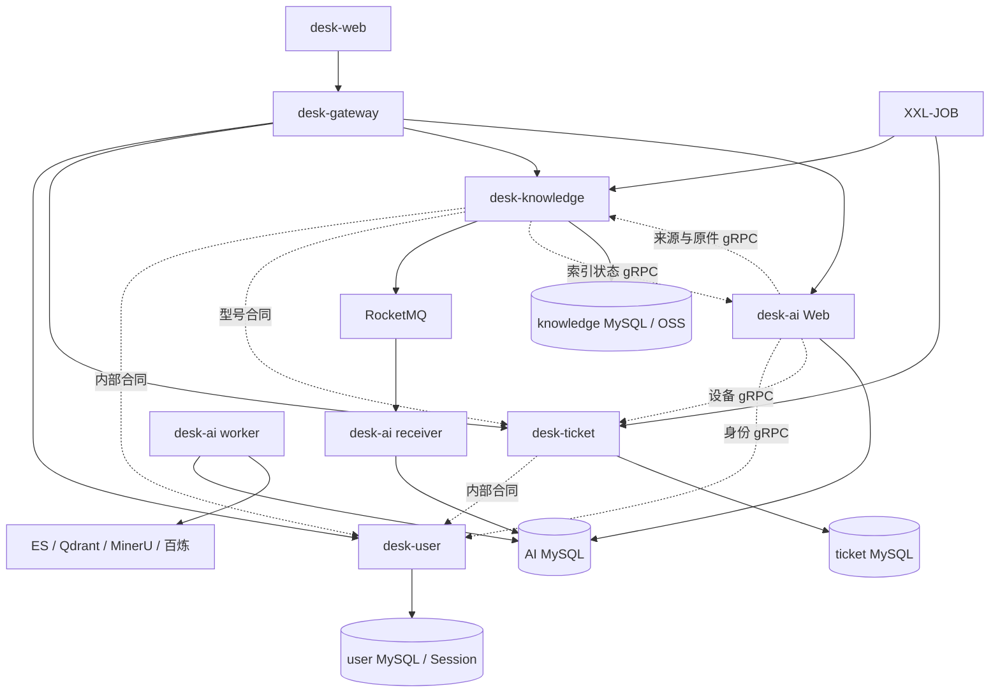

# 项目结构

本文定义 Service Desk 的目标工程、模块依赖、功能归属与文件边界。目标按微服务职责设计，项目用途和技术栈见根 [README](../../README.md)。业务流程参考[系统设计](系统设计.md)，数据所有权与字段参考[数据库设计](数据库设计.md)，实现写法遵循各端规范。

## 1. 架构与部署单元

采用一个 Vue 前端、一个响应式网关、三个 Java 业务服务和一个 Python AI 服务。Java 公共能力拆为基础合同与内部调用合同两类库，它们没有端口、数据库或独立进程。Python Web、MQ接收与worker属于同一个业务模块、三个运行进程，使用同一套持久任务规则。

| 模块 | 类型 | 目标职责 | 数据/外部资源 |
| --- | --- | --- | --- |
| desk-common | Java普通JAR | 基础响应/输入、公共错误与异常、枚举接口、校验、序列化和环境值 | 无网络、持久化和框架自动装配 |
| desk-api | Java普通JAR及跨语言合同源 | Java内部Form/DTO/Feign；跨语言.proto及生成Java类型/stub | 无状态、无自动装配，Python由同一.proto生成包 |
| desk-gateway | Java WebFlux 应用 | 同源入口、显式路由、入口流控、身份头清理和链路接续 | Nacos，无业务库 |
| desk-user | Java MVC 应用 | 认证、组织、账号、角色、客户范围、身份核验和审计 | user MySQL、JDBC Session、Redis登录防刷 |
| desk-ticket | Java MVC 应用 | 型号、设备、工单、时间线、站内通知、概况、时段预约及期限 | ticket MySQL、XXL执行器 |
| desk-knowledge | Java MVC 应用 | 原件、资料系列/修订、授权、发布、索引尝试与事务协调 | knowledge MySQL、OSS、Redisson、MQ生产、XXL执行器、AI状态gRPC |
| desk-ai | Python 应用 | 解析索引、片段、授权检索、排障运行、引用、草稿及反馈 | AI MySQL、MQ消费、ES、Qdrant、Redis、MinerU、百炼 |
| desk-web | Vue 应用 | 登录、客户售后、服务工作台、知识管理及系统管理 | 仅同源 HTTP，无后端密钥 |

根 POM 聚合六个 Java 模块，管理统一 BOM、编译与检查；Python 和前端分别由 uv 与 npm 管理。三个 Java 业务服务与 AI 按服务/环境独立 MySQL 库和账号，部署时可共用 MySQL 实例，不能跨库访问。



图中网络箭头不表示 Maven 依赖。网络合同允许双向协作，编译依赖保持单向；具体接口和认证见[接口约定](接口约定.md)。

## 2. 为什么设置 common 与 api

### 2.1 基础库 desk-common

common面向稳定基础合同、无副作用工具与元数据；业务所有权不因代码复用而改变。目标包如下，类型在真实用例接入时建立，不一次生成空包：

```text
com.yangaobo.servicedesk.common/
├── annotation/SchemaEnum.java
├── base/
│   ├── Result.java、PageVO.java、BasePageForm.java
│   ├── IdForm.java、VersionForm.java、IdVersionForm.java
│   └── BaseEnum.java、ErrorCode.java、CommonErrorCode.java
├── constant/IdentifierConst.java
├── env/SystemEnvironment.java、SystemEnvironmentEnum.java
├── exception/BusinessException.java
├── serialize/DecimalStringSerializer.java
├── util/IdentifierGenerator.java
└── validator/Identifier.java
```

| 能力及包 | 实际目标消费者 | 责任与限制 |
| --- | --- | --- |
| base/Result、PageVO | 三个Java业务服务HTTP Controller；Gateway错误适配使用Result | code/message/data/traceId与统一分页，不读请求/ThreadLocal，不包文件/RPC |
| base/BasePageForm | Java管理列表及具名QueryForm | 纯分页，无业务筛选、排序或IPage |
| base/IdForm、VersionForm、IdVersionForm | 管理详情、带版本资源动作；VersionForm作为IdVersionForm的版本基类 | 兼容业务Form继承；任务键、请求键、可选版本保留具名模型，路径已有ID不重复提供 |
| base/BaseEnum | 本地业务枚举及确有消费者的api合同枚举 | getValue/getDesc，保持字符串线值，不保存业务全集 |
| base/ErrorCode、CommonErrorCode、exception/BusinessException | Java Service、过滤链、Gateway及RPC错误转换 | 公共码和安全异常；业务错误归应用，HTTP/gRPC映射归边界 |
| constant/IdentifierConst、validator/Identifier | Form、容器元素和明确协议校验 | 统一格式，null与必填分开；不验证资源权限 |
| util/IdentifierGenerator | Java业务资源、任务及动作创建 | 生成32位小写ID，不生成Session或供应商身份 |
| serialize/DecimalStringSerializer | PageVO.total及VO中的Long版本/Token等 | 字段级Jackson序列化，保留普通数值与null |
| annotation/SchemaEnum | 所属应用的EnumPropertyCustomizer | 仅枚举文档来源，不改变输入校验/JSON/SQL |
| env/SystemEnvironment、SystemEnvironmentEnum | 各Java应用EnvironmentConfig及基础设施配置校验 | 无Spring的不可变快照及dev/prod基础环境，不建立连接 |

common可以声明实际类型需要的Jakarta Validation API、Jackson annotations/databind、Swagger annotations与编译期Lombok；版本跟随根管理，不引入Spring Web、Security、MyBatis、驱动、Feign、Redis、MQ、OSS或springdoc starter。文档注解不等于框架装配，JSON serializer不等于全局ObjectMapper配置。

Entity、业务枚举、角色与身份、权限、事务、SQL和外部客户端归服务所有者；不设common/entity或集中业务enums。JSON、环境、OpenAPI及异常边界的运行装配归应用config/swagger/component/web，按明确入口启用，不以扫描common触发。Python遵守相同线合同并独立实现类型，既不加载JAR，也不将Java普通类规则照搬为Python类继承。

### 2.2 内部合同库 desk-api

desk-api同时维护两类真实合同，按数据所有者管理，不能让编译依赖反向指向启动应用。

| 内容 | 归属 | 消费者 |
| --- | --- | --- |
| Java内部HTTP Form/DTO与Feign接口 | src/main/java/.../api/{user,ticket,knowledge} | Java服务，不强制Python复刻JSON模型 |
| Java/Python共同.proto | src/main/proto/desk_contracts/{common,user,ticket,knowledge,ai}/v1 | 两种语言生成message、客户端和服务端类型 |
| Java Protobuf/gRPC生成物 | target/generated-sources/protobuf下，编入desk-api普通JAR | 仅真实RPC消费者依赖，不提交/不手改 |
| Python生成物 | desk-ai/src/desk_contracts下，对应.proto导入路径的独立生成包 | 构建前从唯一源生成并打包，不提交/不手改 |

Feign只声明Java内部路径/方法及明确模型，不内置凭据、URL、fallback或装配。RPC合同不附加业务实现；Service实现及HTTP/RPC双入口都归所有者应用，共同调用同一业务Service，不复制权限规则。Entity、Mapper、ServiceImpl、对外Form/VO和客户端生命周期均不放api。

Python通过锁定grpcio-tools从相同.proto生成_pb2.py、_pb2_grpc.py、_pb2.pyi，Java由Maven generate-sources生成。desk_contracts作为独立顶层命名包，避免生成导入路径指向错误目录；构建后验证导入和安装包包含生成物。CI与镜像构建显式取得desk-api源文件，运行制品不依赖兄弟源码路径，也不需要Python加载JAR。生成入口归.github/scripts正式构建脚本，生成目录归忽略及检查排除；不在导入/应用启动时执行protoc。

proto按所有者拆分，common协议包仅稳定ActorRef及错误详情，业务枚举按所有者定义；RPC错误、认证、Deadline、原件流及兼容规则见接口约定。生成类型不适用手写普通class/Serializable/Javadoc规则，合同注释维护在.proto；适配器明确转换到所属手写模型。MQ信封仍使用接口约定的版本化JSON，不把Protobuf当成通用消息平台模型。

### 2.3 编译依赖

| 消费者 | 允许的项目依赖 | 禁止 |
| --- | --- | --- |
| desk-common | 无 | 任何应用或 api |
| desk-api | desk-common | 任何应用、业务实现或自动装配 |
| desk-gateway | 实际使用的 desk-common | desk-api 的 Servlet/Feign 传递栈、业务库及应用模块 |
| user/ticket/knowledge | desk-common、desk-api | 相互依赖启动模块或复用远端实体 |
| desk-ai / desk-web | 无 Java 源码依赖 | 共享业务数据库或服务端凭据 |

普通 JAR 不使用 Boot repackage，不建立启动类。服务启动类只扫描自身根包，客户端通过显式注册接入。依赖版本集中管理，应用仅声明真实消费者所需制品。

## 3. 其他拆分决策

模块边界按最终交付业务确定，只有表、角色或中间件名称不足以形成独立服务。

| 候选模块 | 决定 | 原因 |
| --- | --- | --- |
| desk-auth | 不建立 | 身份、账号、角色与范围统一由user维护 |
| desk-security / 多个common-* starter | 不建立 | MVC、WebFlux与Python适配留在各边界，避免自动装配扩大依赖 |
| desk-file | 不建立 | 原件生命周期与知识修订/引用一致，归knowledge |
| desk-notification | 不建立 | 只有与工单事件同事务的站内通知，归ticket |
| desk-job | 不建立 | XXL Admin是基础服务，执行器和持久扫描归ticket/knowledge，无独立业务所有权 |
| desk-device | 不建立 | 设备资格、工单和预约共用ticket本地一致性边界 |
| app/admin两套应用 | 不建立 | 按访问端分包和导航，不复制业务实现 |
| generator、工作流、实验服务 | 不建立 | 没有产品职责，评估使用题集文件与已有执行流程 |

common/api按真实用例建立合同；不一次生成空目录、全库CRUD和没有消费者的Service。

## 4. 根目录与工具文件

```text
service-desk/
├── AGENTS.md、README.md、pom.xml
├── .editorconfig、.gitattributes、.gitignore
├── .github/
│   ├── workflows/       各端检查与制品入口
│   ├── scripts/         协议生成、兼容检查及构建编排，接入时建立
│   └── docker/          正式镜像及镜像内配置，交付时建立
├── docs/
│   ├── README.md
│   ├── 开发/            规范、版本、部署
│   ├── 设计/            结构、业务、数据、接口
│   └── 开发计划/        纳入版本管理的阶段主计划
├── desk-common/、desk-api/             目标基础库
├── desk-gateway/、desk-user/、desk-ticket/、desk-knowledge/
├── desk-ai/
├── desk-web/
└── deploy/              独立上传集合，交付时建立
```

| 文件范围 | 正式入口与职责 |
| --- | --- |
| Java 模块根 | pom.xml、src/main/java、src/main/resources、src/test；desk-api另含src/main/proto唯一合同源，生成的target不提交 |
| desk-ai 根 | .python-version、pyproject.toml、uv.lock、src、tests；迁移落地时增加 alembic.ini、migrations；MQ入口位于src/servicedesk_ai/receiver.py，日志/追踪装配归bootstrap、SDK适配归infrastructure |
| desk-web 根 | package.json、package-lock.json、index.html、vite.config.ts、tsconfig.json、eslint.config.js、.prettierignore、src；测试落地时增加 tests 和实际工具配置 |
| .github/workflows | Java/Python/前端检查，集成验证与镜像构建 |
| .github/scripts | check_structure.py检查文件/依赖、错误编号与网关白名单；check_java_artifacts.py检查JAR；generate_contracts.py生成Python合同；build_ai.py编排生成/wheel及内容检查；无本机真实配置或服务器运行职责 |
| .github/docker | Java、AI、Web、ES/SmartCN、MinerU 的实际 Dockerfile 及镜像内 Nginx 等配置，按交付需要建立 |
| Java resources | 所属应用 YAML、空凭据本机模板、所属 Flyway 迁移；需要显式定制时的logback-spring.xml，JSON字段遵循系统设计 |
| deploy | compose.yml、.env.example、start-server.sh、stop-server.sh及实际运行挂载；rocketmq/、xxl-job/、logging/、nacos/保存服务器直接使用的最小运行配置，日志/偏移/PQ实际数据挂持久卷而不提交 |
| 系统临时目录 | 一次性脚本、备份、截图、导出、镜像归档及调研 |

.dockerignore 在镜像构建接入时建立，排除真实配置、缓存和无关产物。所有新增正式职责登记本文件；没有实际消费者不建立空目录。deploy 中不放源码、Dockerfile、开发工具或说明副本，不依赖 ../、开发机路径或仓库检出。

## 5. Java 目录与功能划分

根包 com.yangaobo.servicedesk，各应用子包为 gateway、user、ticket、knowledge，库为 common、api。业务服务目标布局：

```text
com.yangaobo.servicedesk.<service>/
├── XxxApplication.java
├── controller/
│   ├── auth/            认证入口，仅有需求的服务建立
│   ├── app/             客户与服务工作台业务入口
│   ├── admin/           配置、资料发布和受控运维入口
│   ├── internal/        Java内部HTTP合同实现
│   └── common/          错误、文件等公共协议适配
├── service/impl/
├── mapper/
├── model/
│   ├── entity/          本库实体直接放置
│   ├── form/            按业务域分包
│   ├── dto/
│   ├── vo/
│   ├── enums/           所有者本地枚举，实现BaseEnum且保持字符串值
│   └── value/
├── rpc/                 跨语言gRPC服务端与边界转换
├── component/           Feign/gRPC客户端、消息等技术适配
├── task/
├── security/
├── config/              本应用Jackson/环境/持久化/客户端装配
├── swagger/             MVC应用OpenAPI信息、属性及枚举文档定制
├── error/
├── exception/
└── typehandler/         仅有真实JDBC自定义转换时建立
```

Service 接口直接在 service，实现在 service/impl，Mapper 在 mapper，不加 biz。是否三件套按[Java后端规范](../开发/Java后端规范.md#3-service-与三件套)决定，不能以复杂或跨表为由搬进技术组件。Entity 不跨服务，聚合 VO 不虚构实体。

| 模块 | 入口与用例拆分 |
| --- | --- |
| user | 认证/CSRF、组织管理、账号管理、角色/客户范围、审计、内部身份核验；最后管理员保护共享同一事务边界 |
| ticket | 型号、设备、建单、处理动作、时间线/通知、工作台概况、时段管理、预约事务确认/查询/取消/履约 |
| knowledge | 系列、上传/回执、草稿修订、索引事务消息、回查、准备超时及受控重放、任务查询/取消、发布/替换/停用恢复、原件读取与内部来源授权 |
| gateway | 显式路由、流控和协议头适配，不创建业务 Controller、Mapper 或资源权限服务 |

概况是独立普通 ITicketOverviewService 和 TicketOverviewMapper，查询所属库聚合后返回 TicketOverviewVO。knowledge的MQ生产、AI状态gRPC、OSS和Redisson客户端归component，索引事务协调及上传用例归Service；XXL BEAN归task，仅触发本服务用例。Sentinel资源/规则适配及Java Micrometer追踪装配归真实消费应用的config/component，common/api不承载这些SDK或全局自动装配。期限规则归ticket，AI持久受理归索引用例；不新增独立调度业务模块。

Controller不维护嵌套模型集合，内部线模型在api按所有者管理，其余Form/DTO/VO留业务模块；基础表单与分页使用common/base，服务内SortedPageForm仅供真实支持排序的目录，不覆盖固定顺序的事件/通知。自定义Mapper SQL使用注解及显式分页，Flyway位于resources/db/migration；本机模板与真实副本同时排除打包。

| 所属位置 | 类型或职责 | 消费者 |
| --- | --- | --- |
| 各服务model/entity、model/enums | 所属库映射及状态 | 本地Service/Mapper；兄弟服务不得引用 |
| 各服务error | user的AuthenticationErrorCode/AccountErrorCode/OrganizationErrorCode，ticket的DeviceErrorCode/TicketErrorCode/BookingErrorCode，knowledge的DocumentErrorCode | 本地用例及已登记边界；只为真实独立错误建枚举，未分配编号的业务域不预建枚举 |
| 各服务component/web、exception | HttpErrorMapping、ApiErrorWriter、ResultResponseAdvice、ApiExceptionHandler | HTTP/过滤链转换，显式映射已登记码，未知回退1 |
| 各服务rpc | RpcErrorMapping、认证/追踪/Deadline拦截器、协议转换 | gRPC与同一Service，不复制HTTP业务或Result |
| 各应用config | JacksonConfig、EnvironmentConfig、InfrastructureConfigurationValidator及实际框架装配 | builder定制、唯一环境快照、真实依赖校验；Gateway不带MVC/数据库配置 |
| MVC业务服务swagger | SwaggerConfig/Properties、EnumPropertyCustomizer | 显式导入、开发启用/生产关闭，消费SchemaEnum及BaseEnum |

Gateway仅在真实消费范围内使用common基础合同、环境及错误工具，不引用业务Entity或安装MVC springdoc。各Java应用仅扫描自身包，显式导入应用内OpenAPI配置，不在common放自动装配发现文件。


## 6. Python Web、worker 与资源

```text
desk-ai/
├── pyproject.toml、uv.lock、.python-version
├── src/servicedesk_ai/
│   ├── main.py          Web 装配入口
│   ├── worker.py        持久任务执行入口，实际用例落地时建立
│   ├── receiver.py      MQ短事务接收/ACK入口，与worker独立运行
│   ├── api/             对外/管理HTTP路由及SSE
│   ├── rpc/             grpc.aio服务端，调用同一业务用例
│   ├── schemas/         输入输出与内部合同
│   ├── errors/          公共及AI分域数字业务码、无HTTP的业务异常
│   ├── services/        索引、排障、草稿及反馈用例
│   ├── retrieval/       授权范围内召回与融合
│   ├── repositories/    AI 数据访问与执行权
│   ├── infrastructure/  Java gRPC、MQ、MinerU、ES、Qdrant、模型、Redis及追踪适配
│   └── bootstrap/       设置与资源生命周期
├── src/desk_contracts/   从唯一.proto生成的顶层Python包，不提交
├── migrations/          Alembic 版本与环境，接入时建立
└── tests/
```

AI API进程同时运行FastAPI和grpc.aio独立端口，前者负责浏览器问答/草稿/SSE，后者提供GetStatus/ValidateDraft，复用同一用例；MQ receiver只校验索引信封、调用同一索引用例短事务落库并ACK；独立worker领取数据库任务，执行解析和生成。三进程使用同一镜像、迁移及业务模型，各自创建和关闭数据库/gRPC/HTTP/SDK/追踪资源；API进程通过ASGI lifespan启动/关闭aio RPC服务，使用同一所属事件循环，任一监听启动失败整体readiness失败，不能留下半启动进程；receiver故障不关闭Web/worker，Web故障不丢已受理消息。同步gRPC消费调用由接收进程的有界线程边界驱动，不阻塞Web事件循环；不能跨线程/事件循环共用AsyncSession。

交付一个receiver及一个worker进程，索引与问答分别配置并发及执行权预算，不在请求或消费窗口等待长解析，不用BackgroundTasks代替持久执行。receiver.py/worker.py命令在功能交付时落地部署说明，目录示例不代表已有实现。阶段/结果按执行令牌回写，取消及重复交付遵守同一索引合同。

AI 直接写 MySQL，REST 访问 ES/Qdrant；原件通过 knowledge，身份通过 user，设备通过 ticket。百炼只提供模型 API，不引入无消费者的流程框架或 Java AI 模块。gRPC Channel及HTTP/模型客户端、engine与任务由所属进程创建和关闭。

## 7. 前端按领域组织

```text
desk-web/src/
├── main.ts、App.vue
├── router/              路由与应用认证协调
├── layouts/             客户、服务和管理导航
├── views/               auth、device、ticket、booking、knowledge、troubleshooting、administration
├── api/
│   ├── http/            同源请求与类型化错误
│   └── <domain>/        端点、types.ts、字段校验、文件/流协议
├── composables/         请求、表单、任务轮询和 SSE 生命周期
├── stores/              当前身份等必要跨页状态
├── components/          跨业务且稳定的复用界面
├── utils/
└── styles/
```

页面按操作者和动作纵向交付：身份管理随登录阶段，设备维护随报修阶段，技术工作台随工单处理，预约在工单详情内完成，知识修订及任务页面随解析发布交付。管理和普通用户复用语义相同的组件，不建立两套业务实现。

API类型归所属`api/<domain>/types.ts`，不从页面/store导出公共合同。src/api/resultCodes.ts只集中前端实际判断的SUCCESS/CONFLICT等公开数字码，由公共HTTP与业务交互消费，不复制完整后端枚举。局部草稿与加载归页面，当前身份归store，派生状态computed，取消和流由创建作用域释放；业务权限始终由后端执行。

新增公共能力必须同步真实消费者及必要验证，不能以import次数代替Spring注册、Jackson字段注解、Validation或生成构建的使用判断。缓存、导出、通用审计切面及额外限流注解不设占位包；已确定组件按系统设计职责接入。

## 8. 集成与迁移顺序

浏览器只访问 Gateway 的 /api/v1；管理资源按所属服务显式路由，不使用覆盖全部 admin 的笼统路由。Java内部/internal/v1与跨语言gRPC端口仅私网，协议、Result、RPC错误/Deadline、分页、任务与SSE引用接口约定。

目标默认业务端口28101–28105，前端28199；跨语言RPC由user/ticket/knowledge/AI另用28202–28205，ticket/knowledge执行器用29901/29902，完整网络及Proxy、Admin、ELK、Zipkin端口在部署说明统一维护。Java HTTP服务发现与跨语言RPC私网目标分别管理，不能把模块依赖图等同网络拓扑。

改造先完成 common/api 和检查边界，再做身份及最小前端、人工工单闭环、预约、知识、排障及交付。每阶段同时迁移消费者、配置和测试并清理旧实现；目标目录不要求一次建完，阶段验收随实施任务交付，详细顺序见[开发改造计划](../开发计划/开发改造计划.md)。

当前骨架已建立的类型、可执行入口和实际验证统一维护在[根README](../../README.md#5-当前骨架与本地检查)。本文件其余目录描述最终归属，不要求预建未被当前用例使用的文件。
